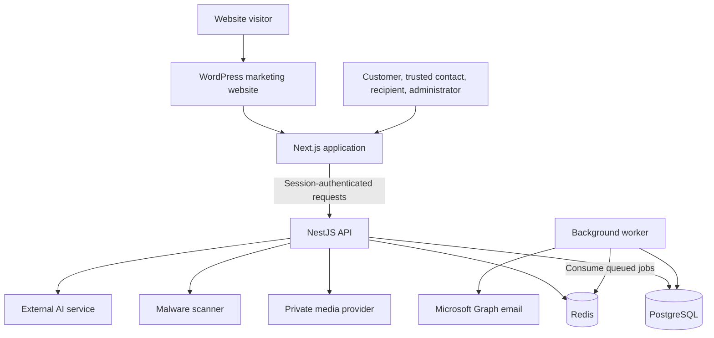
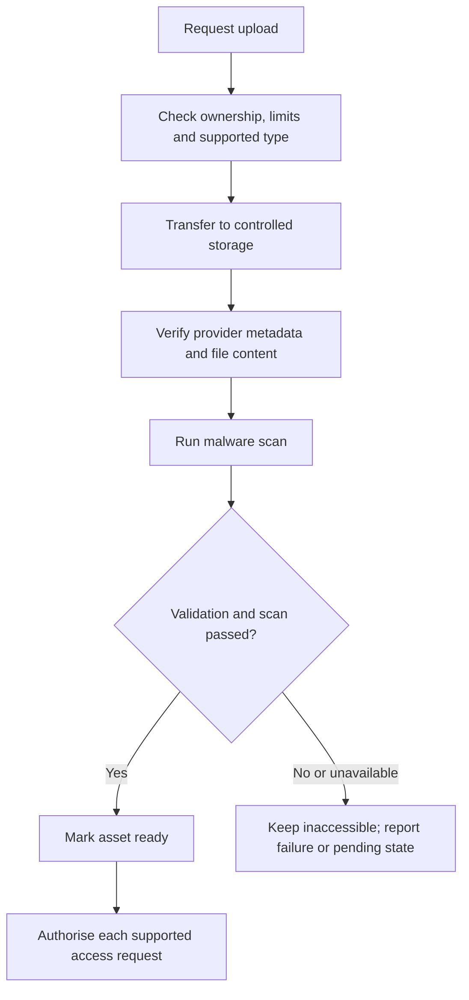
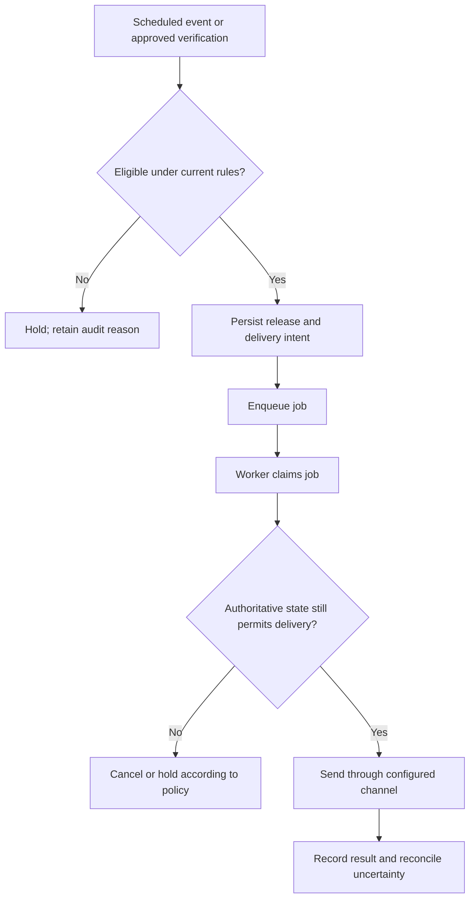

# For After — High-Level Design

| Document field | Value |
| --- | --- |
| Suggested repository location | `docs/HLD.md` |
| Status | Architecture baseline for review |
| Prepared | 30 October 2026 |
| Evidence | Project details supplied in conversation; current repository and task.md have not been inspected |
| Hosting | Provider-independent; final platform remains an open decision |

> This document describes the intended system and its safety boundaries. It is not proof that every capability is implemented, deployed, or production-ready. Reconcile it with the current task.md, source code, migrations, and tests before marking any capability complete. Names below describe logical responsibilities, not instructions to create duplicate modules or tables.

## 1. Purpose and scope

For After helps customers preserve personal messages, memories, life stories, and wishes. Selected content may become accessible to authorised people through the platform's approved sharing and release processes.

The system must keep content private during ordinary account use, enforce distinct customer and recipient permissions, and prevent premature or unauthorised releases.

This design covers:

- The WordPress website and application boundary.
- The Next.js frontend, NestJS API, and background worker.
- PostgreSQL, Redis, private media, scanning, and external integrations.
- Authentication, authorisation, controlled release, reliability, and growth.
- The AI companion's guidance and writing assistance.

Detailed endpoint contracts, exact Prisma models, and deployment commands belong in the relevant implementation documents. My Story PDF downloads and exports are outside this design. Billing and WordPress integration must not be treated as complete without verification.

## 2. Design goals

1. Preserve privacy, ownership, and existing authentication/session architecture.
2. Keep authoritative business state in PostgreSQL.
3. Perform slow and retryable delivery work outside interactive API requests where supported.
4. Scale the API and workers independently.
5. Recover from crashes without silently losing release or delivery work.
6. Keep AI assistance optional and unable to authorise business actions.
7. Reuse the existing modular architecture before considering separate microservices.

## 3. System context

The shared application can serve multiple portal types, but their sessions, guards, permissions, and data visibility remain distinct. Sharing UI infrastructure does not grant shared access to customer records.

The diagram shows logical dependencies. Actual network routes, service identities, and queue ownership must be confirmed against the deployment.

## 4. Major components

| Component | Responsibility | Key boundary |
| --- | --- | --- |
| WordPress | Marketing pages and entry into the product | No direct access to private application records |
| Next.js | Dashboard, forms, previews, portal UI, companion panel | Never holds server credentials |
| NestJS API | Validate requests, authenticate principals, enforce business rules | Authorisation happens on the server |
| PostgreSQL / Prisma | Persist accounts, content, decisions, release and delivery records | Authoritative business state |
| Redis | Existing session, rate-limit, and BullMQ responsibilities | Temporary infrastructure is not the sole release record |
| Worker | Execute queued delivery and supported background tasks | Recheck current eligibility before sensitive work |
| Private media provider | Store photo, video, and other supported assets | Access remains controlled by application permissions |
| Malware scanner | Inspect supported uploaded content | Unavailable or failed scanning must not mark an asset safe |
| Microsoft Graph | Send application email from info@forafter.com.au | Provider acceptance is not proof of inbox delivery |
| AI provider | Generate contextual guidance and reviewable drafts | Cannot grant access, save content, or release messages |

ImageKit and Groq have been discussed as existing integrations. Exact provider configuration and implementation status require repository verification. Provider names may appear in internal architecture documentation; the customer-facing product is the **For After AI companion**.

## 5. Actors and access

| Actor | Intended access |
| --- | --- |
| Customer | Manage their own people, messages, media, story, wishes, and supported account settings |
| Trusted contact | Perform specifically authorised contact or verification tasks |
| Recipient | Access only content released and authorised for that recipient |
| Administrator | Perform expressly permitted, audited operations through protected administrative controls |

A trusted contact is not automatically a recipient and does not receive general account access. Being listed as a recipient does not make unreleased content visible. Administrative roles must not be interpreted as unrestricted access to all private material.

Every resource lookup and mutation must enforce ownership or an explicit permission. Hiding a frontend control is not an authorisation check.

## 6. Logical backend domains

Retain the existing NestJS modular application unless measured operational needs justify extraction.

| Domain | Responsibilities |
| --- | --- |
| Identity and access | Sessions, authentication, OTP challenges, principal guards, supported admin MFA |
| People and trusted contacts | Recipient details, invitations, relationship-specific permissions |
| Messages | Content, recipient associations, drafts, supported lifecycle transitions |
| Scheduling and release | Eligibility, approved release conditions, delivery intents and reconciliation |
| Death verification | Evidence, review decisions, safeguards and audited transitions |
| Media | Upload authorisation, validation, scanning, readiness and controlled retrieval |
| Memory Vault | Memories and visibility rules; any memorial publication requires an approved policy |
| My Story | Question answers, chapter drafts, chapter versions and book presentation |
| My Wishes | Preferences and any implemented funeral-song entries |
| AI companion | Verified page guidance, optional source text, bounded conversation and drafts |
| Billing | Payment events and entitlements when implemented |
| Operations | Health checks, audit trails, retry handling and recovery tooling |

These are responsibility boundaries. Extend existing implementations rather than creating a new module for every row.

## 7. Important workflows

### 7.1 Save an answer, message, or wish

1. The customer edits content.
2. The frontend sends a request using the existing session architecture.
3. The API validates the input, principal, ownership, and allowed state transition.
4. PostgreSQL persists the change.
5. The UI shows success only after the operation succeeds.

Saving does not automatically send a message, publish a memorial, or release wishes. AI-generated drafts require the same explicit save flow as manually written content.

### 7.2 Upload media

Successful transfer is different from readiness. Unverified, quarantined, failed, or pending assets must not become publicly readable.

Validate file identity and content using the existing provider verification and file inspection mechanisms. Do not trust only a filename, browser MIME type, or client-reported size. Apply quotas and asset-reference ownership checks.

Use bounded signed access or an equivalent supported mechanism. Exact upload routing, scanner placement, and readiness states belong in the media implementation document.

### 7.3 Release and deliver content

Persist the decision and intended work durably. A process crash between the database commit and enqueue must be recoverable through the existing reconciler or another suitable mechanism. Introduce an outbox only if inspection confirms an unresolved gap.

Jobs need stable identifiers, concurrency controls, bounded retries, and failure visibility. Duplicate jobs must not create duplicate release decisions.

Do not claim exactly-once external email delivery. If a provider accepts a message and the worker crashes before recording success, a retry can duplicate delivery. Record attempts and provider identifiers, and handle uncertain outcomes explicitly.

Death verification, safeguard periods, cancellations, and administrative decisions must remain deterministic server-controlled processes.

### 7.4 AI companion

1. The customer opens the companion; opening alone sends no private content.
2. The customer submits a question or requests a supported writing action.
3. The backend supplies verified page facts and bounded conversation context.
4. Editor text is included only through the customer's explicit selection or consent.
5. The backend applies validation, rate limits, concurrency limits, and request timeouts.
6. The configured external AI service generates a reply.
7. The frontend renders the reply safely.
8. The customer may copy it or insert a draft into a supported editor.
9. Saving remains a separate customer action.

Use the product name **For After AI companion**. Keep privacy disclosures accurate without provider branding in the chat's ordinary labels. The applicable privacy notice should explain external processing accurately.

Do not present canned answers as live AI responses. Deterministic errors, loading states, and verified navigation metadata remain appropriate.

The model must not invent portal controls, personal memories, recipient identities, or successful operations. Navigation and draft actions must be validated against supported routes and editor context; plain text or Copy is the safe fallback.

Clear sensitive context on logout, account changes, session expiry, and relevant page or entity changes. Prevent late replies from modifying a different question or overwriting newer edits.

The companion does not read arbitrary saved records, access secrets, make payments, decide death verification, or release messages. Existing history and retention behaviour must be documented from code; do not introduce persistent chat storage silently.

### 7.5 Funeral-song preferences

This is a requested capability whose implementation needs verification.

- Place song entries within the appropriate My Wishes funeral preferences area.
- A song title is sufficient; do not require an artist-name field.
- Allow an optional supported external song link, such as YouTube or Spotify.
- Do not require a music-service account connection merely to save a link.
- Validate URLs and render external links safely.
- Adding a preference does not require creating a message recipient.
- Viewing after a customer's death must follow an explicit, verified wishes-access policy.

External links can become unavailable. They do not guarantee playback or permission to play music at a funeral.

## 8. Conceptual data design

Map these concepts to existing Prisma models before adding anything.

| Data group | Concepts |
| --- | --- |
| Identity | Accounts, principals, sessions, challenges, relevant security settings |
| Relationships | People, recipients, trusted contacts, invitations |
| Content | Messages, recipient associations, schedules, lifecycle state |
| Verification and release | Cases, evidence references, decisions, release records, delivery intents and attempts |
| Media | Provider references, ownership, validation state, scan state, size and content associations |
| Memory Vault | Memory records, media references and visibility |
| My Story | Question answers, chapter drafts and versions |
| My Wishes | Preferences and ordered song entries if implemented |
| Billing | Verified subscriptions, payment events and entitlements if implemented |
| Operations | Auditable events, reconciliation and job references |

Store media bytes in the media service, with ownership and lifecycle metadata in PostgreSQL. Store credentials in the environment's secret management mechanism, not business tables or source control.

Use database transactions, constraints, and indexes for integrity. Prisma migrations must be additive when a schema change is genuinely required. Never use reset or db push as a substitute for production-safe migration history.

## 9. Security and privacy architecture

| Area | Required property |
| --- | --- |
| Sessions | Preserve existing secure cookie, expiry, logout and role isolation behaviour |
| Origin and CSRF | Preserve current checks; never loosen them to fix a proxy problem |
| Authorisation | Enforce ownership, principal type and lifecycle permissions server-side |
| Recipient access | Restrict to authorised released content and supported verification |
| Administration | Strong authentication, least privilege and audited actions |
| Media | No public access before validation; time-bounded authorised retrieval |
| AI | Explicit content selection, bounded input, safe rendering and no automatic business actions |
| Secrets | Backend-only; no API keys, tokens or secrets in logs, client bundles or documentation |
| Logs | Record operational metadata without message bodies, prompts, private notes or OTP values |
| Abuse controls | Rate limits, quotas, concurrency limits and validated trusted-proxy configuration |

Do not trust arbitrary forwarded IP headers. A same-origin proxy can alter observed client IPs, affecting rate limits and audit records. Establish the trusted network path before using forwarded addresses.

Redis-backed safety controls must not silently become permissive when Redis fails. Document endpoint-specific failure behaviour.

## 10. WordPress, application and payment boundaries

WordPress remains the public website at forafter.com.au. The application can use a subdomain of the existing domain; a separate purchased domain is not inherently required.

The final application hostname, authentication entry flow, and payment integration are open decisions. WordPress and the application must not share raw credentials or private database access.

If Stripe or another payment provider is implemented:

- Verify webhook signatures server-side.
- Process duplicate events idempotently.
- Grant entitlements from verified provider state.
- Never grant access solely because a browser reaches a success URL.
- Keep payment configuration separate between preview and production.

This section defines expectations for future or existing integration; it does not confirm billing is live.

## 11. Deployment and environments

| Environment | Intended use |
| --- | --- |
| Local | Development and automated testing |
| Client preview | Isolated demonstration using fictional data |
| Staging | Release validation against production-like configuration |
| Production | Real users, monitored operations and tested recovery |

Use separate databases, Redis resources or appropriately isolated infrastructure, media configuration, and secrets for each environment. Preview must not point at production data.

Keep the deployment portable:

- Next.js web service.
- NestJS API service.
- Background worker process.
- One-off migration execution.
- PostgreSQL and Redis.
- Private media and reachable malware scanner.

A small preview can use a suitably sized machine with separate processes or containers. Production can use managed services or other supported infrastructure. Scanner memory and startup costs must be included in sizing.

Preserve the supported same-origin API proxy where required for cookies and origin controls. Forward only the headers the application expects. Keep database and Redis access private wherever possible.

Run migrations as a controlled deployment step. Ensure graceful shutdown, worker lease handling and adequate termination time. Do not rely on a platform's default shutdown timeout without checking it.

## 12. Scalability

Registered user count alone does not determine capacity. Size against active sessions, requests per second, concurrent uploads, database work, queue arrival rate, and delivery deadlines.

| Stage | Action | Evidence to collect |
| --- | --- | --- |
| Baseline | Measure realistic read, write, upload and worker workloads | Latency, errors, CPU, memory and queue age |
| Database | Optimise queries, add justified indexes and paginate results | Slow queries, query plans and connection usage |
| API | Add stateless replicas with shared session and rate-limit infrastructure | Load distribution and safe scaling behaviour |
| Worker | Scale independently with supported queue concurrency | Backlog, retry rate, provider quotas and duplicates |
| Media | Deliver authorised assets through suitable storage/CDN paths | Upload and playback latency, bandwidth and access expiry |
| Further growth | Add selective caching, read replicas or partitioning only when justified | Measured bottlenecks and consistency requirements |

Budget database connection pools across every API and worker replica. Autoscaling without a connection budget can exhaust PostgreSQL.

Security, ownership checks and release decisions require authoritative state; a stale replica or cache must not grant access or permit release.

Redis queues and sessions need persistence and eviction policies appropriate to their critical role. Separate disposable caching when its eviction requirements conflict with queue or session reliability.

No design guarantees support for millions of users without representative load tests, capacity planning, cost limits and operational validation.

## 13. Reliability, recovery and observability

Monitor:

- API availability, latency, error rate and resource saturation.
- Database capacity, connections, locks and slow queries.
- Redis connectivity, memory, eviction and persistence health.
- Queue age, backlog, failed jobs, retries and delivery uncertainty.
- Scanner availability, scan duration and rejected assets.
- Email provider acceptance and reported delivery failures.
- AI latency, provider errors, token usage and application/provider limits.

Use correlation identifiers and structured metadata to investigate failures without exposing content or credentials.

Back up PostgreSQL and test restoration. A replica is not a backup. Define media recovery separately from database recovery, including how restored metadata will match stored assets.

Set recovery point and recovery time objectives before production approval. Alert on overdue release work and failed reconciliation, not just server uptime.

## 14. Validation and engineering controls

Follow the existing project's Ponytail coding rules and inspect the current task.md before implementing changes derived from this document. Ponytail supplies coding rules; repository inspection must be performed using actual development tools.

Reuse current components, modules, services and utilities. Preserve working authentication, privacy and data integrity.

Use Vitest and the existing test architecture; do not introduce Jest. Validate relevant typecheck, lint, unit/integration tests, appropriate e2e tests and builds. Only record checks that genuinely ran and passed.

No commit, push, deployment, production environment change or destructive database action is authorised by this architecture document.

Priority validation scenarios:

1. A customer cannot access another customer's records.
2. Trusted contacts and recipients cannot access unreleased private content.
3. A release remains blocked while any required condition is unmet.
4. Worker retries, crashes and stale jobs cannot bypass current safeguards.
5. Failed scanning does not expose an uploaded asset.
6. AI draft insertion cannot overwrite newer or unrelated editor content.
7. AI/provider failures produce honest error states without fabricated success.
8. Session and Origin protections work through the real deployment proxy.
9. Backup restoration recovers a consistent application state.
10. Representative load tests meet agreed latency and delivery targets.

## 15. Open decisions and repository checks

- [ ] Reconcile this design with the current task.md and implemented modules.
- [ ] Confirm all principal/session boundaries and resource ownership checks.
- [ ] Confirm WordPress-to-application entry and any payment implementation.
- [ ] Confirm wishes and memorial access and release rules.
- [ ] Confirm song-entry implementation and visibility.
- [ ] Confirm database-to-queue reconciliation and delivery duplicate handling.
- [ ] Confirm media provider, scanner topology, retention and deletion policies.
- [ ] Confirm AI live answer quality, configured model and privacy terms.
- [ ] Choose hosting, regions, budget and operational ownership.
- [ ] Verify trusted proxy behaviour and observed customer IP handling.
- [ ] Define capacity targets, recovery objectives and alert ownership.
- [ ] Run deployment smoke tests and restoration tests in the selected environment.

Keep task.md as the progress source of truth. Update this HLD when architectural decisions change; implementation completion must be supported by code and verification evidence.

