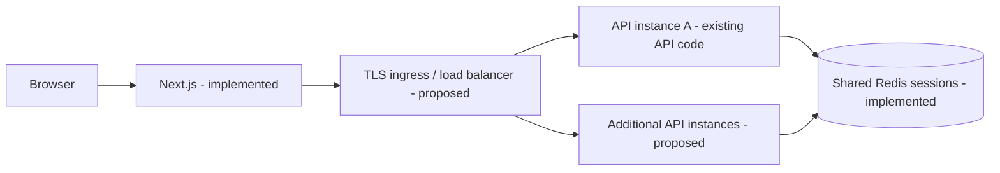
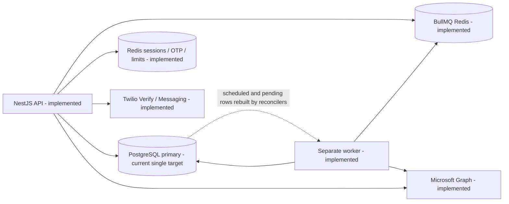
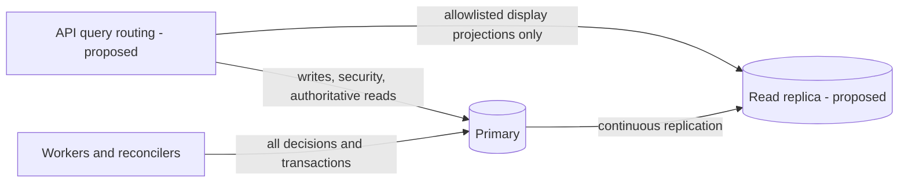
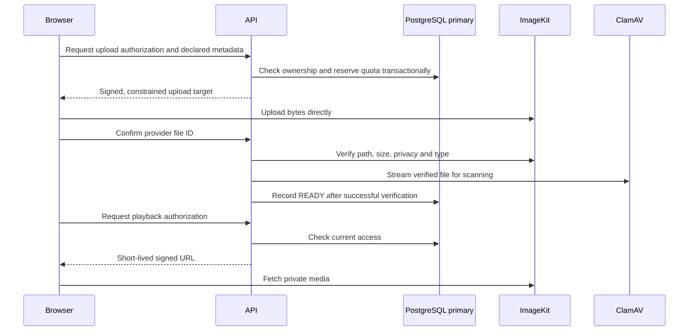

# Managing and scaling for after.

Repository review: **24 October 2026**. This guide describes the checked-out source, recorded evidence and future operating procedures. It does not implement or approve an architecture, select hosting, or certify production capacity.

## Table of contents

1. [Purpose, scope and current status](#1-purpose-scope-and-current-status)
2. [Current architecture and proposed production architecture](#2-current-architecture-and-proposed-production-architecture)
3. [Responsibilities and operational ownership](#3-responsibilities-and-operational-ownership)
4. [API and frontend scaling](#4-api-and-frontend-scaling)
5. [PostgreSQL storage and query performance](#5-postgresql-storage-and-query-performance)
6. [Connection pooling](#6-connection-pooling)
7. [Primary and read-replica architecture](#7-primary-and-read-replica-architecture)
8. [Explicit query-routing policy](#8-explicit-query-routing-policy)
9. [Read-after-write consistency](#9-read-after-write-consistency)
10. [Caching](#10-caching)
11. [Workers, queues and delivery correctness](#11-workers-queues-and-delivery-correctness)
12. [Media, quotas and cost control](#12-media-quotas-and-cost-control)
13. [Monitoring, alerts and service objectives](#13-monitoring-alerts-and-service-objectives)
14. [Backups, high availability and disaster recovery](#14-backups-high-availability-and-disaster-recovery)
15. [Staging and production deployment process](#15-staging-and-production-deployment-process)
16. [Capacity and failure testing](#16-capacity-and-failure-testing)
17. [Incident runbooks](#17-incident-runbooks)
18. [Daily, weekly and monthly operations](#18-daily-weekly-and-monthly-operations)
19. [Costs and growth roadmap](#19-costs-and-growth-roadmap)
20. [Configuration reference and implementation backlog](#20-configuration-reference-and-implementation-backlog)

## 1. Purpose, scope and current status

Use this guide to grow safely toward lakhs (hundreds of thousands) or millions of registered users. **There is no measured basis here for saying the application supports millions.** Design and purchasing decisions must follow measured traffic, data volume, privacy requirements and recovery objectives.

| Measure | Meaning and operating consequence |
| --- | --- |
| Registered users | Accounts retained in PostgreSQL; predicts some storage, not instantaneous load. |
| Monthly active users (MAU) | Distinct people active during a month; useful for product and cost trends. |
| Concurrent users | People active at the same time; their actions and think time determine traffic. Open browser tabs are not equivalent to active database work. |
| Requests per second (RPS) | HTTP arrival rate, measured by route and response size. A dashboard can generate several requests. |
| Queued deliveries | Work waiting for releases, recipient fan-out and provider calls. A scheduled burst can be large while HTTP traffic is quiet. |
| Stored and delivered media bytes | A separate capacity and cost dimension from database rows and API requests. |

The **reported 16 MB database size is a user-provided observation**, not a capacity benchmark or a measurement performed for this document. It does not establish remaining server disk, connection capacity, future row sizes, media usage or sustainable throughput. Local results do not establish production capacity.

The hosting provider, region and final production sizing remain **undecided**. Historical provider names below explain existing files; they are not recommendations or selections.

### Evidence labels

- **Source verified:** inspected implementation or configuration wiring. This does not prove runtime configuration or deployment.
- **Local recorded:** a repository report describes a test or manual development check. Tests were inspected, not executed during this review.
- **Deployed verified:** requires environment-specific release identity, configuration review and runtime checks. **No current deployment was independently verified for this guide.**
- **Proposed:** future configuration, implementation or operating procedure.
- **Unknown:** evidence is absent, stale, or must be confirmed with the eventual provider.

| Capability | Source verified | Local/documentary evidence | Deployment status and remaining work |
| --- | --- | --- | --- |
| API and separate worker | [API entrypoint](src/main.ts), [worker entrypoint](src/worker.ts), [composition](src/worker.module.ts) | [Worker process tests](test/worker-process.e2e-spec.ts), [Phase 24 report](docs/testing/phase-24-results.md) | Unknown deployed revision; worker deployment remains open in the project record. |
| PostgreSQL and Prisma | [Prisma service](src/prisma/prisma.service.ts), [schema](prisma/schema.prisma), [migrations](prisma/migrations/) | Phase 24 used local PostgreSQL 18.6 | Production server version, capacity, backups and HA unknown. |
| Shared sessions, OTP and rate limits | [HTTP setup](src/config/app.setup.ts), [Redis throttler](src/redis/redis-throttler.storage.ts), [OTP engine](src/otp-auth/otp-auth.service.ts) | [Security tests](test/security-critical.e2e-spec.ts) | Multiple-instance behavior under the actual proxy chain must be proven. |
| Release and notification recovery | [Release service](src/message-release/message-release.service.ts), [notification processor](src/release-notifications/release-notification.processor.ts) | Local fake-provider burst, retry, cancellation and crash profiles | No production throughput or exactly-once external-send guarantee. |
| Microsoft Graph email | [Provider](src/email/microsoft-email-provider.ts), [factory](src/email/email-provider.factory.ts) | [Task record](docs/task.md) reports user-confirmed real inbox delivery locally on 22 October; [Graph wiring tests](test/microsoft-email-wiring.e2e-spec.ts) use stubs | Preserve the working Graph integration. Production credentials, sender-domain setup and quotas remain to verify. |
| Twilio | [Verify](src/sms/sms-verification.ts) for portal SMS OTP; [Messaging](src/sms/sms-sender.ts) for trusted-contact invitations | Task record describes local real-SMS checks | Account limits, sender registration and production behavior unknown; general release SMS is not implemented. |
| ImageKit and upload quota | [Storage adapter](src/media/storage/imagekit-media-storage.service.ts), [quota](src/media/storage-quota.service.ts), [verification](src/media/media.service.ts) | [Quota tests](test/storage-quota.e2e-spec.ts); Phase 24 records a live synthetic signed-URL expiry check | Production account limits, backup/export options and capacity unknown. |
| Caching, replicas, autoscaling | Browser query cache exists; one database connection target in source | No production replica/caching capacity evidence | Server summary cache, replica routing and autoscaling are proposed. |
| Observability and recovery | Optional API Observe integration; health checks; durable dead letters | [Incident guide](docs/incident-response.md) describes intended operations | Alert delivery, worker heartbeat, PITR and restore drills not verified. |
| Billing and plan entitlements | No implemented billing module in [AppModule](src/app.module.ts) | [Task record](docs/task.md) lists billing as future work | Do not sell or enforce invented plan allowances through this guide. |

### Contradictions and stale information

Treat the source and dated evidence as authoritative for this review, not checked task boxes.

- [Architecture](docs/architecture.md) still describes Postmark, planned Stripe/Sentry/WordPress modules, absent admin UI and absent delivery. Current source includes admin UI and Graph delivery. Those old topology entries do not prove integrations exist.
- [Deployment](docs/deployment.md) says nothing is deployed, later mentions a Railway client demo, and mixes AWS and Google hosting proposals. [Task tracking](docs/task.md) records a Railway demo from 6 October with an API service but no separate worker deployment. These are historical claims, not current deployment verification or a hosting decision.
- [Database notes](docs/database.md) say PostgreSQL 16 and reproduce an older schema. The local test report says PostgreSQL 18.6; production version is unknown. Read [actual migrations](prisma/migrations/) for partial indexes and constraints; do not infer implemented row-level security from a planned RLS paragraph.
- [Architecture](docs/architecture.md) overstates duplicate-send protection. Database uniqueness protects logical records; Graph acceptance is a separate side effect.
- [Phase 24 results](docs/testing/phase-24-results.md) explicitly predate the Graph migration and used the now-removed Brevo adapter against a fake endpoint. The [current harness](scripts/load/delivery-load.mjs) targets fake Graph. Historical rates are not a fresh Graph benchmark. Brevo must not be restored.
- [Incident notes](docs/incident-response.md) describe per-recipient delivery status as future work and discuss sessions under an older prefix. Current release notifications exist; customer and admin sessions use separate prefixes in [main.ts](src/main.ts). Follow current source when investigating sessions.
- [Worker composition tests](src/worker.module.spec.ts) concern queue consumers/reconcilers. The API also imports [MediaModule](src/media/media.module.ts), whose cleanup timer runs there. “API has no background work” would be inaccurate.
- A test file named [production.spec.ts](../for-after-frontend/e2e/production.spec.ts) is not evidence that production was deployed or tested.

## 2. Current architecture and proposed production architecture

### Verified stack

Versions below are resolved in [backend lockfile](package-lock.json) and [frontend lockfile](../for-after-frontend/package-lock.json), not observations of running servers. Manifests specify some ranges.

| Component | Repository version | Role |
| --- | --- | --- |
| Next.js / React | 16.3.7 / 19.2.8 | Customer, recipient, trusted-contact and admin UI |
| TanStack Query | 5.104.0 | Browser request state, caching and invalidation |
| NestJS core | 12.0.4; manifest range ^12.0.1 | HTTP API and worker application context |
| Prisma client / adapter-pg | 7.10.0 / 7.10.0 | PostgreSQL access through the pg driver |
| pg | 8.23.0 | Driver and per-process connection pools |
| BullMQ / ioredis | 6.3.9 / 6.0.0 | Release, notification and safeguard queues |
| node-redis | 6.2.1 | Sessions, OTP state, rate counters and Redis health |
| ImageKit Node SDK | 7.12.1 | New private media uploads and delivery |
| MSAL Node | 7.1.0 | Microsoft Graph app-only token acquisition |
| Twilio | 6.2.0 | SMS verification and invitation sending |

PostgreSQL and Redis server versions are provider choices, not established by npm dependencies. The local report used PostgreSQL 18.6 and Redis 7.4.11. ImageKit is the active new-upload provider; a legacy B2 adapter serves/deletes old B2 rows if configured. Resend remains an optional source adapter; Microsoft Graph is the working selected integration described by the project.

### Request path

Current source has one API composition root and shared Redis state. Multiple replicas of that process and a load balancer are **proposed deployment topology**; no instance counts are selected.



Browser API calls may use a direct configured API origin or the existing optional Next.js rewrite. [next.config.ts](../for-after-frontend/next.config.ts) consumes `API_PROXY_TARGET` at build time; this adds a proxy hop and must be included in client-IP and cookie tests.

### API, worker and durable state



Queue Redis can be separated using existing `QUEUE_REDIS_URL`; it otherwise falls back to `REDIS_URL`. This wiring does not prove that separate Redis services are deployed. Both API and worker can send email: most authentication and invitation sends originate in the API.

### Proposed read replication



### Implemented direct media flow



The browser upload bypasses API buffering. Confirmation scanning still streams bytes through backend infrastructure, and content-copy operations have additional bandwidth/memory costs; see section 12.

## 3. Responsibilities and operational ownership

**Proposed responsibility matrix.** Managed service responsibilities must be confirmed in the selected provider's service agreement. A managed database does not manage application correctness.

| Area | Provider normally supplies, subject to contract | Application team must own |
| --- | --- | --- |
| Compute/network | Hardware, virtualization and contracted networking availability | Runtime sizing, instance bounds, release process, defects and dependency updates |
| Load balancing/TLS | Available ingress, certificates and health-routing facilities | Correct proxy trust, domains, cookies, Origin allowlist, timeouts and probes |
| Database | Managed engine operation/patch options, storage and failover features | Schema, migrations, indexes, query budgets, pooling, access roles and compatibility |
| Capacity | Quotas and upgrade facilities | Trend monitoring, headroom, overload protection and capacity tests |
| Backups | Backup/PITR mechanisms if purchased/configured | Enablement verification, retention, encryption, restore drills and recovery evidence |
| Redis | Managed Redis and persistence/HA options | BullMQ compatibility, noeviction, memory budgets, session isolation and reconstruction |
| Access control | IAM/secret-storage facilities | Least privilege, MFA, app authorization, credential rotation and access reviews |
| Media and messaging | API availability and purchased quotas | Private objects, signed URLs, quota enforcement, mailbox scope, delivery failures and egress costs |
| Monitoring | Metrics/log plumbing if contracted | Instrumentation, redaction, SLOs, dashboards, alert routing and tested escalation |
| Incidents | Infrastructure support within contract | Incident command, containment, correctness/privacy assessment and stakeholder coordination |
| Costs | Usage/billing reporting | Budget, forecasts, spending alerts, instance ceilings and regular review |

Incident commander: **TBD**. Primary and backup on-call contacts: **TBD**. Database, messaging/media, security/privacy and provider-support escalation contacts: **TBD**. Assign actual people and acknowledgement windows before launch. Until assigned, none of the runbooks constitutes an operational on-call service.

## 4. API and frontend scaling

**Source verified:** [main.ts](src/main.ts) uses shared Redis-backed customer/admin session stores, enables shutdown hooks and starts only the API. [OTP sessions](src/otp-auth/otp-auth.service.ts) also use Redis. [SessionAuthGuard](src/auth/guards/session-auth.guard.ts) reloads the user for account/security decisions.

API instances should keep request state in PostgreSQL/Redis, not local files or process memory. All instances of one environment must share compatible session secrets, OTP peppers, cookie settings, Redis namespaces and database schema. Development console SMS uses a process-local map and is not suitable for distributed production.

[Redis throttling](src/redis/redis-throttler.storage.ts) shares counters across instances on wired routes. A Redis error fails the request instead of silently allowing it. This is not evidence of blanket rate limiting on every route: [AuthModule](src/auth/auth.module.ts) wires route-level throttling; OTP has separate counters. Audit expensive list, media authorization and admin routes before increasing exposure.

[HTTP setup](src/config/app.setup.ts) trusts **one proxy hop in production**. That is a hard-coded assumption, not a provider-independent setting. Determine the real ingress/rewrite chain; ensure only trusted ingress can reach the API and overwrite forwarding headers. Test genuine IP attribution, forged forwarding headers and secure-cookie behavior. Do not blindly increase proxy trust.

Mutating browser requests with an Origin outside the configured allowlist are rejected. Requests without Origin are currently allowed by that middleware; authentication and authorization still apply. CORS and Origin checks do not replace session/permission checks.

### Proposed operating checklist

- [ ] Put TLS ingress in front of APIs and route only to ready instances; keep internal databases/Redis private.
- [ ] Implement distinct **liveness** (process functioning) and **readiness** (can serve requests) semantics with bounded checks. Existing [health endpoints](src/health/health.controller.ts) are `/health/database` and `/health/redis`; they check dependencies individually. There is no dedicated combined readiness/liveness pair or worker HTTP probe.
- [ ] Do not use dependency failure as a reason to restart every healthy process repeatedly. Remove unready traffic, investigate dependencies, and avoid probe-induced connection storms.
- [ ] Drain ingress before API shutdown; allow in-flight requests to finish, then close pools. Existing shutdown hooks are a foundation, not proof of provider drain timing.
- [ ] Set request/header/body limits and route-specific timeouts. Bound DB acquisition, queries, external calls and internal work, not just the load-balancer timeout.
- [ ] Give scan confirmation its own bounded concurrency/timeout budget; large numbers of simultaneous scans can saturate API/network capacity.
- [ ] Reject excess work with controlled errors and backpressure rather than unlimited wait queues. Do not automatically retry writes with ambiguous outcomes.
- [ ] Keep static assets cacheable; private authenticated responses must bypass shared frontend/CDN caching. Audit headers and framework caching under the selected hosting model.
- [ ] Set independently measured minimum and maximum API/frontend/worker instance counts and spending alerts. Counts are **TBD**; scaling to a purchased maximum must fit DB and provider budgets, including rollout overlap.
- [ ] Scale vertically for measured per-process memory/CPU pressure; scale horizontally for parallel throughput and availability. Neither fixes slow queries or provider quotas automatically.

Use `npm run start:prod` for the API and `npm run worker:prod` for workers, from the backend package. Do not import `QueueWorkersModule` into `AppModule` or launch workers once per web replica accidentally. Worker process multiplication also multiplies reconcilers and all three queue consumers.

Before multiple APIs are approved, exercise login on instance A and authenticated reads on B; logout/password change/suspension across both; OTP challenge creation and verification on different instances; admin MFA; independent customer/admin/recipient/trusted-contact cookies; rate-limit aggregation; deleted-content denial; Origin/proxy behavior; rolling restart. Check in-flight browser cache responses when switching principals as well as server authorization.

## 5. PostgreSQL storage and query performance

Local and hosted storage are finite. Track these separate limits:

| Resource | What consumes it | Why more disk alone is insufficient |
| --- | --- | --- |
| Disk capacity | Tables, indexes, TOAST values, WAL, temporary files, maintenance and provider backup placement | A full filesystem can stop writes even when the main database seems small. |
| RAM | Shared buffers, connections, per-query sorts/hashes and OS cache | Too many concurrent sorts or connections can exhaust memory. |
| CPU | Filtering, joins, sorting, encryption and transaction processing | Larger volumes do not repair CPU-heavy scans. |
| I/O and latency | Random reads, WAL flushes, checkpoints and vacuum | Storage size and IOPS/throughput may be priced or limited separately. |
| Connections | Pools in APIs, workers, reconcilers, tools and provider agents | Connection exhaustion can occur with plenty of disk free. |

Database rows store content and media metadata; ImageKit stores file objects. Media growth still creates database metadata, while media egress is accounted separately. Message versions, activity, audit records, grants, recurring occurrences and dead letters also grow; review retention before using archival or partitioning.

### Read-only diagnostics for a future authorized operator

**Not executed in this review.** Use a restricted monitoring role and an approved environment. These examples return operational aggregates, not user content. Limit execution time using the administration tool/provider; diagnostic access itself should not become a workload.

```sql
-- Current database size, not total server/filesystem consumption.
SELECT pg_size_pretty(pg_database_size(current_database())) AS database_size;

-- Largest user relations; total includes indexes and auxiliary storage.
SELECT schemaname, relname,
       pg_size_pretty(pg_table_size(relid)) AS table_size,
       pg_size_pretty(pg_indexes_size(relid)) AS index_size,
       pg_size_pretty(pg_total_relation_size(relid)) AS total_relation_size
FROM pg_stat_user_tables
ORDER BY pg_total_relation_size(relid) DESC
LIMIT 20;

-- Session counts without query text, addresses or user identifiers.
SELECT state, wait_event_type, count(*) AS connections
FROM pg_stat_activity
WHERE datname = current_database()
GROUP BY state, wait_event_type
ORDER BY connections DESC;

SHOW max_connections;

-- Maintenance pressure estimates; n_dead_tup is an estimate.
SELECT relname, n_live_tup, n_dead_tup, last_autovacuum, last_autoanalyze
FROM pg_stat_user_tables
ORDER BY n_dead_tup DESC
LIMIT 20;
```

Use provider/OS volume metrics for total disk and free space, WAL storage, temporary spill and backup footprint. `pg_database_size` is not total server disk usage. Monitor replication-slot WAL retention if replicas are later introduced.

Profile the slow routes first, with normalized query fingerprints and durations; do not collect SQL parameters, private content or full query text into public logs. Confirm whether `pg_stat_statements` is available; enabling it is future configuration work.

Review plans with `EXPLAIN` before proposing indexes. **EXPLAIN ANALYZE executes the query**; use it only for reviewed read-only SELECT statements in an appropriate isolated/staging environment, with a timeout and representative synthetic data. Do not wrap a mutation in it. Even SELECT statements can invoke side-effecting functions.

Illustrative plan-only example; the synthetic UUID is not a real owner:

```sql
EXPLAIN (COSTS, FORMAT TEXT)
SELECT id, "createdAt"
FROM "Recipient"
WHERE "ownerUserId" = '00000000-0000-0000-0000-000000000001'::uuid
  AND "deletedAt" IS NULL
ORDER BY "createdAt" DESC, id DESC
LIMIT 20;
```

### Project-specific query review

| Existing behavior | Evidence | Proposed improvement when measurements justify it |
| --- | --- | --- |
| Recipient and message lists use count + offset/limit and stable ordering | [Recipients](src/recipients/recipients.service.ts), [messages](src/messages/messages.service.ts) | Measure count cost and deep-page offsets; consider cursor pagination. Do not return an owner's entire collection for dashboard counts. |
| Message summaries exclude media/signed URLs, but select text then form a preview | [Messages service](src/messages/messages.service.ts) | Measure actual DB bytes and serialization; a short response is not proof of a narrow underlying query. |
| Readiness performs parallel counts/grouping and reads contact readiness | [Readiness](src/readiness/readiness.service.ts) | Avoid repeated recomputation across dashboard widgets; consider reviewed owner-scoped summary caching. |
| Attention includes storage totals and relationship queries | [Attention](src/attention/attention.module.ts) | Bound result sets and cost; its display summary must never authorize storage or release. |
| Activity pages then batch-resolves live targets | [Activity](src/activity/activity.module.ts) | Preserve batch access to avoid N+1 queries; keep current deletion checks authoritative. |
| Quota sums five media tables under an owner lock for reservations | [Storage quota](src/media/storage-quota.service.ts) | Profile per-owner media growth and lock wait; never replace reservation decisions with stale cache/replica totals. |
| Some release/death reconciler scans are unpaginated | [Release reconciler](src/message-release/message-release-reconciler.service.ts), [death queue](src/death-verification/death-verification-queue.service.ts) | Add bounded, fair pagination and evaluate query plans before worker multiplication. |

Existing [schema indexes](prisma/schema.prisma) include owner/status message indexes, activity ordering, pending occurrence due-time lookup and notification status/creation time. Recipient list ordering and release schedule scans merit measured review; do not add speculative indexes to every column. Each index costs storage, write I/O and maintenance. Preserve migration-only partial unique indexes and the append-only audit trigger; schema prose alone does not capture them.

## 6. Connection pooling

**Source verified:** [PrismaService](src/prisma/prisma.service.ts) constructs `new PrismaPg({ connectionString })` from `DATABASE_URL` and passes it to `super({ adapter })`. [PrismaModule](src/prisma/prisma.module.ts) is global and exports one Nest provider per application context. Reuse this client within each process; never construct a client/pool per request.

[prisma.config.ts](prisma.config.ts) supplies the CLI datasource from `DATABASE_URL`; [schema.prisma](prisma/schema.prisma) contains the PostgreSQL provider and generated ESM client settings. Preserve this convention. There is no implemented replica URL, independent pool-budget variable, or runtime migration URL in the inspected setup.

The pg driver owns pooling. Source currently sets **no explicit** `max`, `connectionTimeoutMillis` or `idleTimeoutMillis`. Inspect the installed driver defaults when implementing explicit budgets; do not copy Prisma 6 URL pool settings or an obsolete `datasourceUrl` constructor. See the [Prisma 7 pooling reference](https://docs.prisma.io/docs/orm/v7/prisma-client/setup-and-configuration/databases-connections/connection-pool).

Proposed adapter options should set a deliberate pool maximum, bounded acquisition/connect timeout and idle lifetime. Statement/transaction timeouts are separate controls; ending an HTTP request does not necessarily cancel database work. Validate error handling, transaction duration and cancellation behavior with pg/Prisma versions actually deployed.

### Illustrative budget only — not production sizing

Assume, purely for arithmetic, a primary connection ceiling of 100:

| Consumer | Illustrative calculation | Reserved connections |
| --- | --- | ---: |
| APIs | 4 processes × pool max 8 | 32 |
| Workers | 3 processes × pool max 6 | 18 |
| Future dedicated reconciler | 1 process × pool max 4 | 4 |
| Migrations/admin tools | Reserved separately | 6 |
| Provider/system/emergency headroom | Reserved, including provider-specific limits | 20 |
| Total planned reservation | 32 + 18 + 4 + 6 + 20 | 80 |
| Unassigned margin | 100 − 80 | 20 |

Current reconcilers share their worker's Prisma client, so **do not double-count them as independent pools**. The separate reconciler line illustrates a possible future process. Rolling deployment of two extra API processes would add 16, leaving only 4 of that illustrative margin; unrestricted autoscaling would break the budget.

A future replica needs its own independent calculation: for example, 4 API replica pools × 4 + 4 admin + 10 reserve = 30 against an illustrative replica ceiling of 60. Replication/provider connections and per-role limits must be included according to the selected provider. Do not assume primary spare capacity covers replica saturation.

External pooling, such as a compatible transaction pooler, is an option rather than a requirement. Confirm pg/Prisma compatibility, TLS, authentication, prepared-statement behavior, interactive transactions, session-dependent SQL, migration routing and failover. Count both client connections and backend database connections. An external pool can reduce backend connections but cannot create unlimited query throughput.

## 7. Primary and read-replica architecture

**Current:** every Prisma query uses the single `DATABASE_URL`. **Proposed:** introduce a replica only after measured read pressure persists after query/index and caching improvements.

A read replica continuously receives database changes from its primary. It is not an independent database manually synchronized with periodic application writes. Replication lag means it can return an older view after a successful write. A replica adds eligible read capacity; it does not increase the primary's write capacity.

A read replica, a high-availability standby and a backup serve different purposes. A standby may be reserved for failover and unavailable for application reads. A readable replica is not necessarily configured for automatic failover. Neither protects against replicated accidental deletion; **a replica is not a backup**.

### Provider-independent introduction checklist — proposed, not performed

1. Establish the primary bottleneck, expected eligible read fraction and latency benefit. Exclude security/worker traffic from the estimate.
2. Confirm supported PostgreSQL version, replication mode, readable endpoint, failover/promotion semantics, failure-domain placement, maximum connections and billing.
3. Provision through a separately approved change only after design review; do not build dual-write synchronization in application code.
4. Confirm private connectivity, TLS certificate validation and network restrictions. Use separate least-privilege read credentials and private secret injection.
5. Design an explicit read client and operation allowlist. Keep existing `DATABASE_URL` as the primary; replica variables are proposed in section 20.
6. Monitor replay/receive progress, lag, last successful replay and query errors. Define maximum permitted staleness per operation. An idle database's replay timestamp alone can be misleading; use provider lag/LSN metrics and heartbeat evidence.
7. Test update/delete/revoke visibility, replica restart, long-read conflicts, pool exhaustion and read-after-write behavior with synthetic records.
8. Add bounded fallback and a circuit breaker: stop sending to an unhealthy replica; admit only a measured portion of eligible reads to primary.
9. Roll out one reviewed projection at a time. Compare correctness, primary load, replica load, latency and cost.
10. Keep a routing rollback that disables replica use without changing write ownership. Drain its pools and restore primary reads within tested admission limits; retain the replica until investigation is complete.

Do not automatically promote a read replica from application code. Failover orchestration, split-brain prevention, replication recovery and endpoint changes require provider confirmation and an approved database runbook.
