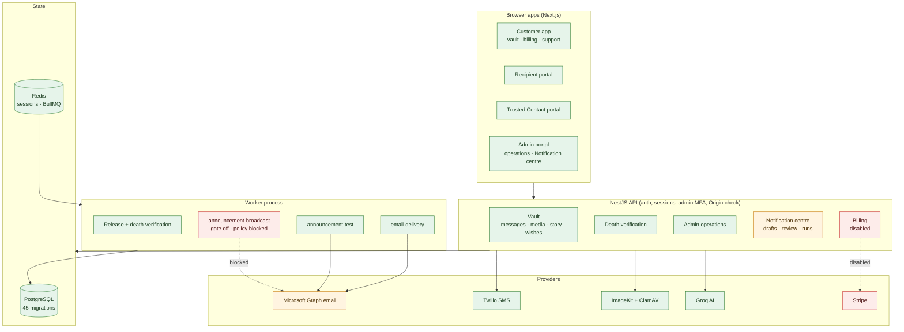

# 🕊️ For After — Project Task List

> The full-stack roadmap for **For After**, a secure Digital Legacy and Posthumous Messaging platform, from local
> development to production launch. Phase order follows `docs/PROJECT_OVERVIEW.md` §59 (Recommended Development Sequence).

|                              |                                                                                                                                                                                                                                                                                                                                                                                                                                                                                                                                                                                                                                                                                                                                                                                                                                                                                                                                                                                                                                                                                                                                                                                                                                                                                                                                                                                                                                                                                                                                                                                                                                                                                                                                                                                                                                                                                                                                                                                                                                                                                                                                                                                                                                                                                                                                                                                                                                                                                                                                                                                                                                                                                                                                                                                                                                                                                                                                                                                                                                                                                                                                                                                                                                                                                                                                                                                                                                     |
| ---------------------------- | ----------------------------------------------------------------------------------------------------------------------------------------------------------------------------------------------------------------------------------------------------------------------------------------------------------------------------------------------------------------------------------------------------------------------------------------------------------------------------------------------------------------------------------------------------------------------------------------------------------------------------------------------------------------------------------------------------------------------------------------------------------------------------------------------------------------------------------------------------------------------------------------------------------------------------------------------------------------------------------------------------------------------------------------------------------------------------------------------------------------------------------------------------------------------------------------------------------------------------------------------------------------------------------------------------------------------------------------------------------------------------------------------------------------------------------------------------------------------------------------------------------------------------------------------------------------------------------------------------------------------------------------------------------------------------------------------------------------------------------------------------------------------------------------------------------------------------------------------------------------------------------------------------------------------------------------------------------------------------------------------------------------------------------------------------------------------------------------------------------------------------------------------------------------------------------------------------------------------------------------------------------------------------------------------------------------------------------------------------------------------------------------------------------------------------------------------------------------------------------------------------------------------------------------------------------------------------------------------------------------------------------------------------------------------------------------------------------------------------------------------------------------------------------------------------------------------------------------------------------------------------------------------------------------------------------------------------------------------------------------------------------------------------------------------------------------------------------------------------------------------------------------------------------------------------------------------------------------------------------------------------------------------------------------------------------------------------------------------------------------------------------------------------------------------------------- |
| **Last updated**             | 2026-11-03 (see the [Status board](#-status-board--2026-11-03)) |
| **Latest backend step**      | 2026-11-03: Notification centre Steps 4–5 (customer broadcast runs + worker, verified with a fake provider; sending blocked by the feature gate and open policy decisions). 2026-10-30–31: admin operations Steps 1–9, billing (disabled), admin invitations, funeral songs. 2026-10-22: Microsoft Graph email live-verified locally |
| **Latest frontend step**     | 2026-11-03: Notification centre four-step wizard + send progress view. 2026-10-30–31: admin operations pages, Help & Support, billing screens, song dialog. 2026-10-28: companion panel |
| **Backend**                  | Steps 1–16 + 22–24.1 + Phases 03, 04, 08 and 09 built and tested                                                                                                                                                                                                                                                                                                                                                                                                                                                                                                                                                                                                                                                                                                                                                                                                                                                                                                                                                                                                                                                                                                                                                                                                                                                                                                                                                                                                                                                                                                                                                                                                                                                                                                                                                                                                                                                                                                                                                                                                                                                                                                                                                                                                                                                                                                                                                                                                                                                                                                                                                                                                                                                                                                                                                                                                                                                                                                                                                                                                                                                                                                                                                                                                                                                                                                                                                                    |
| **Frontend**                 | **27 of 30 tasks** built and verified (FE-1–19, FE-21–28); 676 unit/component tests (2026-11-03; 204 at Step 24); Playwright 36 passing, 0 failing, 0 skipped against the real local API (console email provider), PostgreSQL, Redis and the development bucket (Step 24, 2026-10-03). Frontend tracker: `for-after-frontend/docs/tasks.md`                                                                                                                                                                                                                                                                                                                                                                                                                                                                                                                                                                                                                                                                                                                                                                                                                                                                                                                                                                                                                                                                                                                                                                                                                                                                                                                                                                                                                                                                                                                                                                                                                                                                                                                                                                                                                                                                                                                                                                                                                                                                                                                                                                                                                                                                                                                                                                                                                                                                                                                                                                                                                                                                                                                                                                                                                                                                                                                                                                                                                                                                                                                      |
| **Checklist (phases 02–27)** | **189 of 221** items done (recounted from the checkboxes 2026-10-22 after Microsoft Graph live verification: 189 `[x]`, 29 `[ ]`, 3 `[~]`; 188 recounted 2026-10-21 after Phase 24: 188 `[x]`, 31 `[ ]`, 2 `[~]`; 186 after Phase 17 (2026-10-17); 185 after the Trusted Contact real SMS test; 184 after Phase 18; 183 after Recipient SMS sign-in 2026-10-16; 182 recounted 2026-10-13 after Phase 19B: 182 `[x]`, 36 `[ ]`, 3 `[~]`; 181 after Phase 19A; the recount before 19A found 180, the earlier figure missed one later item; 179 recounted 2026-10-09 after Phase 16; before: 178 after Phase 15B; earlier history: 176 of 227 recounted 2026-10-05; +2 Phase 11, +1 Phase 11 VIDEO and +3 Phase 12, 2026-10-07; +1 Phase 12B malware scanning, +1 Phase 13A search/tags/pagination, +1 Phase 13B create a message from a memory, +1 Phase 12C storage quota, +1 Phase 14A My Story catalogue, +1 Phase 14B rich answers + sharing, +1 Phase 15A My Wishes notice, 2026-10-08; +1 Phase 15B My Wishes media + after-death sharing, 2026-10-09)                                                                                                                                                                                                                                                                                                                                                                                                                                                                                                                                                                                                                                                                                                                                                                                                                                                                                                                                                                                                                                                                                                                                                                                                                                                                                                                                                                                                                                                                                                                                                                                                                                                                                                                                                                                                                                                                                                                                                                                                                                                                                                                                                                                                                                                                                                                                                                          |

---

## 🗓️ Status board — 2026-11-03

Snapshot of the working tree on **2026-11-03**: last commit `345ad28` (2026-11-02); **170 paths uncommitted**
(everything below marked "uncommitted"). Dev DB `for_after` and the isolated test DB `for_after_p24` both have all
**45 migrations** applied (`prisma migrate status`: up to date). Details live in each feature's section further down.

### ✅ Completed (built and tested locally; uncommitted)

| Date       | Feature                                                                                       | Where                                   |
| ---------- | --------------------------------------------------------------------------------------------- | --------------------------------------- |
| 2026-10-30 | Funeral songs on My Wishes (add/edit/order, safe song links)                                  | Phase 15 · `my-wishes.md`               |
| 2026-10-30 | Admin operations 1–4: Overview, Release monitoring, Delivery monitoring, System health + worker heartbeat | Phase 22 · `admin.md` §14–19 |
| 2026-10-31 | Admin operations 5–9: Security activity, Storage & scans, Support requests, AI operations, Admin access (read-only) | Phase 22 · `admin.md`, `support.md` |
| 2026-10-31 | SUPER_ADMIN bootstrap, Create admin + admin invitations                                       | Phase 22 · `admin.md` §22a              |
| 2026-10-31 | Free trial + billing (Stripe), **disabled by default**                                        | Phase 21 · `billing.md`                 |
| 2026-11-02 | Device setup (camera, mic, sound); browser notifications removed                              | New features                            |
| 2026-11-02 | Notification centre 1–3: drafts + preview, test email to self, audience review               | `notification-centre.md`               |
| 2026-11-03 | Notification centre 4: broadcast runs, worker, progress, stop (**sending blocked**)          | `notification-centre.md`               |
| 2026-11-03 | Notification centre wizard: Write → Preview & test → Audience → Review & send                 | `notification-centre.md`               |
| 2026-11-03 | Notification centre 5: end-to-end verification, 5 defects fixed, operator runbook             | `notification-centre.md`               |
| 2026-11-03 | Admin account settings: top-right menu, Profile · Security · Sessions (own account)           | Phase 22 · this file                    |
| 2026-11-03 | Notification centre 7: consent, unsubscribe, suppression, pilot audience (mocked)            | `notification-centre.md`               |
| 2026-11-09 | Security activity redesign (cards, graph, IP controls) + temporary IP blocks, **unavailable until attribution verified** | Phase 22 · `admin.md` §20–20a |

### 🟡 In progress

- [x] **Notification centre live test email (Step 6)** — accepted by Microsoft 2026-11-03 10:30 UTC; inbox receipt user-confirmed 2026-11-03 10:35 UTC
- [~] **Customer announcement email** — policy implemented (consent, unsubscribe, suppression, death-report rule) and a
      pilot audience (Step 7, 2026-11-03, mocked); gate off; first pilot send awaits content + owner approval
- [~] **Billing** — built and disabled; needs Stripe products/prices, keys, live webhook and the §50 replay test
- [~] **Email (Microsoft Graph)** — live-verified locally 2026-10-22; production credential + SPF/DKIM/DMARC open
- [~] **Media** — production ImageKit keys and retiring the legacy B2 bucket open
- [~] **Staging** — Railway demo live; worker service, CI, separate secrets and QA open

### ⏳ Pending (waiting on a decision or external input)

- [ ] Complaint feed / async bounce processing for announcements (before any wide, all-eligible rollout)
- [ ] Phase 01 product decisions still open (death-verification edge cases, limits, retention, account deletion)
- [ ] Twilio Messaging sender (`TWILIO_MESSAGING_SERVICE_SID`) for a real SMS invitation test
- [ ] Admin write actions (role change, MFA reset) need a step-up re-auth and role-grant policy first
- [ ] Subscription-after-death behaviour (billing decision)

### ⬜ To do

- [ ] Commit the 170 uncommitted paths (in reviewable groups)
- [ ] Browser/Playwright checks against the real API for the admin operations pages and the Notification centre wizard
- [ ] Controlled live announcement smoke test (checklist only: `notification-centre.md` §13; needs explicit approval)
- [ ] "Sign out all devices" (Phase 05)
- [ ] Data export, account deletion workflow, dependency scanning, threat-model review (Phase 23)
- [ ] WordPress login/signup integration (Phase 25, FE-29/30)
- [ ] Production: infrastructure, secrets manager, backups with restore test, monitoring, legal pages (Phase 27)
- [ ] Housekeeping: Postman plain-text passwords, `jiya@gmail.com` reset, Prisma install-script approval

### 🗺️ Architecture and status



Green = built and verified locally · amber = built, production setup or live check open · red = built but disabled or
blocked by an open decision.

---

## 📖 How to read this file

|  Symbol  | Meaning                                                |
| :------: | ------------------------------------------------------ |
| ✅ `[x]` | Done and verified by tests                             |
| 🟡 `[~]` | Partly done                                            |
| ⬜ `[ ]` | Not started                                            |
| **FE-n** | Frontend task number n in [Part 6](#-part-6--frontend) |

Each phase lists **Done** items first, then **To do**. "Backend ready" means the API exists and is tested but has no UI yet.

---

## 🧭 Contents

1. [Status board — 2026-11-03](#-status-board--2026-11-03) (completed · in progress · pending · to do + diagram)
1. [At a glance](#-at-a-glance)
2. [Part 1 — Product decisions](#-part-1--product-decisions) (phase 01)
3. [Part 2 — Backend foundation](#-part-2--backend-foundation) (phases 02–06)
4. [Part 3 — Customer vault features](#-part-3--customer-vault-features) (phases 08–15)
5. [Part 4 — Scheduling and release engine](#-part-4--scheduling-and-release-engine) (phases 16–17)
6. [Part 5 — Portals and death verification](#-part-5--portals-and-death-verification) (phases 18–19)
7. [Part 6 — Frontend](#-part-6--frontend) (phase 07 + 30 frontend tasks)
8. [Part 7 — Platform services](#-part-7--platform-services) (phases 20–23)
9. [Part 8 — Quality and launch](#-part-8--quality-and-launch) (phases 24–27)
10. [Out of scope for MVP](#-out-of-scope-for-mvp)
11. [Housekeeping](#-housekeeping)

---

## 📊 At a glance

| Phase | Area                       | Status                                                                                                                                                                                                                                                                                                                                                                                                                                                                                                                                  |    Done / items    |
| :---: | -------------------------- | --------------------------------------------------------------------------------------------------------------------------------------------------------------------------------------------------------------------------------------------------------------------------------------------------------------------------------------------------------------------------------------------------------------------------------------------------------------------------------------------------------------------------------------- | :----------------: |
|  01   | Product decisions          | 🟡 Docs written, most decisions still open; Phase 10 decided the Trusted Contact maximum, permissions and reopening; composition rules approved (2026-10-07); My Story catalogue, answer length, snapshot, answer formats + sharing; My Wishes notice decided, legal review open (2026-10-08); who sees wishes after death, media, AI deferred (2026-10-09); scheduling rules for every trigger (Phase 16, 2026-10-09); worker as its own process (Phase 17B, 2026-10-12); accepted death-verification evidence (Phase 19A, 2026-10-13) | 9 (+5 partly) / 34 |
|  02   | PostgreSQL + Prisma        | ✅ Done                                                                                                                                                                                                                                                                                                                                                                                                                                                                                                                                 |       6 / 6        |
|  03   | NestJS foundation          | ✅ Done (Swagger + global exception filter, 2026-10-05)                                                                                                                                                                                                                                                                                                                                                                                                                                                                                 |      12 / 12       |
|  04   | Authentication (core)      | ✅ Done: core, admin TOTP, change password, email verification, reset, Redis rate limits                                                                                                                                                                                                                                                                                                                                                                                                                                                |      13 / 13       |
|  05   | Sessions + authorization   | 🟡 Three principals, MFA-enforcing AdminGuard, admin idle timeout, CSRF Origin check (Step 23) done; password change ends other sessions (Step 22); standalone sign-out-all open                                                                                                                                                                                                                                                                                                                                                        |      12 / 13       |
|  06   | Local development login    | ✅ Done (`/dev-login`, Step 17)                                                                                                                                                                                                                                                                                                                                                                                                                                                                                                         |       2 / 2        |
|  07   | Next.js dashboard shell    | ✅ Done (Step 17)                                                                                                                                                                                                                                                                                                                                                                                                                                                                                                                       |       6 / 6        |
|  08   | User profile               | ✅ Name, Account settings UI (Step 22), verified email change (Phase 08)                                                                                                                                                                                                                                                                                                                                                                                                                                                                |       3 / 3        |
|  09   | People I Love (Recipients) | ✅ Backend + UI (Step 18), pagination and private Recipient photo (Phase 09)                                                                                                                                                                                                                                                                                                                                                                                                                                                            |       8 / 8        |
|  10   | Trusted Contacts           | ✅ Backend, email OTP, Customer UI, max 2, email + SMS invitations, permission model (Phase 10); SMS OTP sign-in via Twilio Verify, real SMS verified 2026-10-17                                                                                                                                                                                                                                                                                                                                                                        |      13 / 13       |
|  11   | Messages                   | ✅ TEXT/PHOTO/AUDIO/VIDEO/MIXED + UI, paged summary list, media cleanup on delete (Phase 11/12); video alone or in MIXED                                                                                                                                                                                                                                                                                                                                                                                                                |      14 / 14       |
|  12   | Media                      | 🟡 ImageKit for photo/audio/video, verification + magic bytes + ClamAV (12B), storage quota (12C), cleanup reconciler, upload UI, recorders done; prod keys + B2 retirement open                                                                                                                                                                                                                                                                                                                                                        |      14 / 15       |
|  13   | Memory Vault               | ✅ Backend + UI (Step 18); search, tags, pagination (13A); sharing = create a message from a memory (13B)                                                                                                                                                                                                                                                                                                                                                                                                                               |       7 / 7        |
|  14   | My Story                   | ✅ Backend + UI (Step 18); V1 catalogue + snapshot policy (14A); photo/audio/video answers, linked memories, sharing as a Message (14B)                                                                                                                                                                                                                                                                                                                                                                                                 |       6 / 6        |
|  15   | My Wishes                  | ✅ Backend + UI (Step 18); notice (15A; informational, no acknowledgement since 2026-10-14); media + after-death sharing as a Message snapshot, AI deferred post-MVP (15B)                                                                                                                                                                                                                                                                                                                                                              |       7 / 7        |
|  16   | Scheduling                 | ✅ All 8 triggers executed + schedule UI: FIXED_DATE (Step 12), ON_DEATH/AFTER_DEATH (Step 15), NOW, BIRTHDAY, ANNIVERSARY, CUSTOM_EVENT, ANNUAL_AFTER_DEATH + per-recipient releases (Phase 16)                                                                                                                                                                                                                                                                                                                                        |      11 / 11       |
|  17   | Redis + BullMQ             | ✅ Release, death-verification and `email-delivery` queues, admin failed-job view/retry, separate worker process, durable DLQ + ops alerts (real alert verified 2026-10-17)                                                                                                                                                                                                                                                                                                                                                             |      10 / 10       |
|  18   | Recipient portal           | ✅ Backend (Step 13) + UI (Step 19) + email sign-in codes and release emails (Step 24) + SMS sign-in via Twilio Verify (real SMS verified 2026-10-16) + sender display-name snapshot (2026-10-17); grant revocation and read receipts post-MVP                                                                                                                                                                                                                                                                                          |       7 / 7        |
|  19   | Death verification         | ✅ Workflow (Steps 14–15) + Trusted Contact portal, Customer safety UI (Step 19), admin review UI (Step 20), supporting evidence (Phase 19A) and second-contact confirmation (Phase 19B)                                                                                                                                                                                                                                                                                                                                                |      15 / 15       |
|  20   | Notifications              | 🟡 Email via Microsoft Graph (live-verified locally 2026-10-22); announcements to customers built but blocked (gate off + policy decisions, 2026-11-03); production credential + SPF/DKIM/DMARC open | 3 (+1 partly) / 5  |
|  21   | Stripe billing             | 🟡 Free trial + Stripe billing built locally, **disabled by default** (2026-10-31); Stripe products, keys, live webhook open |       0 / 6        |
|  22   | Admin portal               | 🟡 Admin backend + UI; operations Steps 1–9 (2026-10-30–31); Create admin/invitations; Notification centre (2026-11-03); admin write actions need step-up re-auth | 6 (+1 partly) / 7  |
|  23   | Audit + security           | 🟡 `AuditLog` + admin events (Step 16) + `PASSWORD_CHANGED` (Step 22); full app audit (Step 23); other customer events, export, deletion open                                                                                                                                                                                                                                                                                                                                                                                           | 2 (+1 partly) / 7  |
|  24   | Testing                    | ✅ Local: unit 1,280 + e2e 563 on dedicated test DB/Redis; §50 matrix (Stripe replay waits for phase 21); worker load harness, 7 profiles pass (2026-10-21). Staging/production not tested                                                                                                                                                                                                                                                                                                                                              |       7 / 7        |
|  25   | WordPress integration      | ⬜ Not started                                                                                                                                                                                                                                                                                                                                                                                                                                                                                                                          |       0 / 3        |
|  26   | Staging                    | 🟡 Railway client demo live (frontend, API, PostgreSQL, Redis); CI, separate secrets, worker service deploy, QA open                                                                                                                                                                                                                                                                                                                                                                                                                    |       2 / 6        |
|  27   | Production                 | ⬜ Not started                                                                                                                                                                                                                                                                                                                                                                                                                                                                                                                          |       0 / 9        |
|  FE   | **Frontend (all apps)**    | 🟡 Customer app + vault + portals (Steps 17–19) + Admin Portal (Step 20) + Account settings (Step 22); billing, WordPress open                                                                                                                                                                                                                                                                                                                                                                                                          |    **27 / 30**     |

### What the backend already does

```text
Customer ──login──► vault: People I Love · Trusted Contacts · Messages (+ photo/audio) · Schedules
                           Memory Vault · My Story · My Wishes
FIXED_DATE / NOW / CUSTOM_EVENT schedule ──BullMQ──► Message RELEASED ──► Recipient access grants
BIRTHDAY / ANNIVERSARY / ANNUAL_AFTER_DEATH ──per Recipient, yearly──► grant + email (Message stays SCHEDULED, Phase 16)
Recipient ──email code──► read released Messages + media                         (Step 13)
Customer adds Trusted Contact (max 2) ──email or SMS invitation──► accept / decline  (Phase 10; SMS 2026-10-17)
Trusted Contact ──email code──► see accounts ──► file death report (PENDING)       (Step 14)
                                                  └─ verifies nothing, releases nothing
CANCELLED / REJECTED case ──later report──► NEW case, full workflow again        (Phase 10; VERIFIED never reopens)
Report ──safety notice──► safeguard ──► admin verifies ──► PASSED + ON_DEATH/AFTER_DEATH release   (Step 15)
Admin ──password + TOTP──► dashboard · users (suspend/reactivate) · audit log · queues · death review (Step 16; UI Step 20)
Trusted Contact ──optional evidence (PDF/JPEG/PNG)──► admin secure view           (Phase 19A)
2nd Trusted Contact report ──confirmation──► verify allowed when 1 or 2 required met (Phase 19B)
Customer dashboard ──► readiness score · delivery timeline · recent changes (2026-10-13, read-only)
```

---

## 🧩 Part 1 — Product decisions

> Phase 01. Questions only the product owner can answer. Many backend limits are placeholders until these are decided.

### 01 · Product decisions — 🟡 9 (+5 partly) of 34 done

**Done**

- [x] Product documentation written (`docs/`: PRD, overview, architecture, database, API, auth, security, threat model, deployment)

**Trusted Contacts and death reports**

- [~] Trusted Contacts: one or two? mandatory? replacement rules? exact permissions? _Decided (Phase 10, 2026-10-06):
  **maximum 2 active** per Customer (removed ones do not count; replacement = remove, then add); **permissions**: email OTP
  sign-in, display name, `hasPreservedContent`, case status, report death, start a new case after `REJECTED`/`CANCELLED`;
  no preserved-content, Recipient, settings or admin access ([trusted-contact-auth.md](trusted-contact-auth.md) §11).
  **Invitations: email + SMS supported** (SMS brought into scope 2026-10-17; the Customer picks the channel per send). **Sign-in: email OTP + SMS OTP through Twilio Verify** (SMS brought into scope 2026-10-16; real SMS verified 2026-10-17). Still open: mandatory?_
- [~] Trusted Contacts: can they see message titles, or that unreleased content exists? _Step 14 shows only a
  `hasPreservedContent` true/false (no titles or counts); confirm with product_
- [ ] Trusted Contacts: is showing them the Customer's relationship label (e.g. "Friend") acceptable?
- [x] **Death reports: how a `REJECTED`/`CANCELLED` case reopens** (Phase 10, 2026-10-06). A terminal `REJECTED` /
      `CANCELLED` case remains immutable history; a later legitimate Trusted Contact report creates a **new** case
      (`reopenedFromCaseId`, audit `CASE_REOPENED`) that runs the full safety workflow. Only one open case per Customer
      (partial unique index). `VERIFIED` / `PASSED` never reopens ([death-verification.md](death-verification.md) §1.1)
- [ ] Death verification: should "confirm alive" accept a free-text note from the Customer (not supported in Step 15)?
- [ ] Death verification: may Trusted Contacts or Recipients ever see `verifiedDeathAt`? May admins reject before review?
- [ ] Death verification: recovery/reversal procedure for a wrong verification (today: manual, see incident response)
- [ ] Death reports: same email added twice as Trusted Contact by one Customer can file one report per row (allow or block?)
      _Still open. Phase 19B only ensures one email never counts as two confirmations._
- [ ] Death reports: should Trusted Contacts of a `SUSPENDED` Customer still see the account?
- [~] Death verification: accepted evidence, number of confirmations, admin review rules. _Accepted evidence
  **resolved** (Phase 19A, approved 2026-10-13): optional; PDF/JPEG/PNG, 20 MB, 5 per reporter; reporter + admin
  may view; outside the Customer quota; never a condition for verify
  ([death-verification.md §2A](death-verification.md#2a-supporting-evidence-phase-19a)). Number of confirmations
  **resolved** (Phase 19B, approved 2026-10-13): 1 or 2 by contacts who can confirm, snapshotted at opening, counted
  by distinct reporter email, a prerequisite for verify only
  ([§2B](death-verification.md#2b-second-trusted-contact-confirmation-phase-19b)). Still **open:** other admin review
  rules, evidence retention period._

**Messages, scheduling and release**

- [x] **Scheduling rules (approved 2026-10-09, Phase 16)**: NOW = queued right after scheduling, released by the worker;
      BIRTHDAY = each Recipient's own birthday, every year, at a Customer-chosen local time + IANA zone (409 if a live
      Recipient has no birthday); ANNIVERSARY = month/day every year (past this year → next year); CUSTOM_EVENT = one
      named local date/time/zone, once; ANNUAL_AFTER_DEATH = only after an admin-verified death, first anniversary of the
      verified date of death, then yearly; 29 Feb → 28 Feb in non-leap years; calendar recurrence, never +365 days;
      repeat years = new email, same permanent grant; a recurring Message stays SCHEDULED and is locked once shared
      ([scheduling.md §10](scheduling.md#10-phase-16-every-trigger-approved-2026-10-09))
- [ ] Scheduled messages are locked (edit = unschedule → edit → reschedule): is that the UX we want?
- [x] **Composition rules (approved 2026-10-07)**: a single modality uses its own type (text → TEXT, photo → PHOTO,
      audio → AUDIO, video → VIDEO; PHOTO/AUDIO/VIDEO carry no text); MIXED = at least two distinct of TEXT, PHOTO, AUDIO,
      VIDEO, in any combination. The Customer chooses `contentType`; it is never inferred ([message-composition.md](message-composition.md))
- [ ] What happens at release time if all assigned recipients were deleted after scheduling?
- [ ] When is a message `CANCELLED`, and can it ever be restored?
- [ ] Limits: message text 20,000 chars, 100 recipients per message, after-death offset ≤ 36,500 days (all configurable placeholders)
- [ ] Release: what should happen to a due message whose recipients were all deleted (currently stays SCHEDULED,
      re-checked every minute)?
- [~] Release: alerting/admin view for stuck releases; run the worker as its own process in production? **Own process
  approved and built (Phase 17B, 2026-10-12)**; stuck-release alerting still open

**Media, storage and billing**

- [ ] Should `FAILED` media uploads be hidden from the list or cleaned up?
- [ ] Storage tiers and limits (placeholders: Basic 5 GB, Standard 25 GB, Legacy 100 GB)
- [ ] Subscription after death: what happens to billing and access

**People, accounts and data**

- [ ] Recipient access: downloads, original quality, permanent access, sharing. _2026-10-17: sender display name
      approved for MVP (Phase 18); grant revocation and read receipts deferred post-MVP; access stays permanent in
      the MVP. Downloads, original quality and sharing still open._
- [ ] Is a person who is both Recipient and Trusted Contact one linked record?
- [ ] Duplicate Recipients / Trusted Contacts per customer: allowed or blocked?
- [ ] Can a `PASSED` account ever sign in?
- [ ] Account deletion and data retention policy (legal review)

**My Story**

- [x] Approve the final prompt set and categories: **approved 2026-10-08** (Phase 14A), 9 categories (Childhood,
      Family, Relationships, Work, Travel, Milestones, Values, Life lessons, Legacy) and 22 prompts; the 12 original keys
      kept unchanged (`docs/my-story.md`)
- [x] Answer length: **50,000 characters** per My Story answer (approved 2026-10-08; My Wishes stays 20,000)
- [x] Prompt snapshot: **the wording first answered** (approved 2026-10-08): edits keep it, a new answer or a re-answer
      after delete takes the current wording; any wording change bumps the version, a new meaning needs a new key;
      retired prompts keep their answers (readable, editable, deletable) but take no new ones
- [x] Answer formats beyond text (audio, video, photos) and linking Memory Vault items: **approved 2026-10-08** (Phase
      14B): text optional (an answer may be files or memories only), no file-count limit (size limits + quota only);
      linked memories are private context, never shared or copied; sharing = an independent Message snapshot through
      the existing recipients/schedule/release, never direct Story access

**My Wishes**

- [ ] Approve the question set and categories (the Step 11 catalogue is a development placeholder; the overview's
      possible fields include burial/cremation, flowers, clothing, speakers, charity, religious/cultural preferences, which
      it does not cover)
- [~] Legal review of the disclaimer wording; is an explicit, versioned acknowledgement needed? Should the API serve the
  disclaimer text? **Product owner decided 2026-10-08 (Phase 15A):** current wording approved as version 1; explicit
  acknowledgement once per version before writing (not consent); the API serves the text. **Changed 2026-10-14:** the
  notice is informational only; no acknowledgement is required (historical rows kept). **Still open: a formal legal
  review of the wording** (none has been done; nothing claims one)
- [x] Who may see wishes after a verified death, and when (Trusted Contacts? Recipients?): **approved 2026-10-09** (Phase
      15B, `docs/my-wishes.md`): private while alive; after a verified death only people the Customer explicitly picks
      from People I Love, through a separate Message snapshot ("Create message for loved ones") with `ON_DEATH` or
      `AFTER_DEATH` timing; never the wish itself; Trusted Contacts never read wishes; admins never read wish content; no
      "family" model. Also decided: PHOTO/AUDIO/VIDEO in wishes, text optional, no file-count limit; **AI help deferred
      post-MVP** (MVP excludes AI; any future AI must never present output as legal advice)

---

## 🏗️ Part 2 — Backend foundation

> Phases 02–06. Database, framework, Customer login and sessions: everything the features are built on.

### 02 · PostgreSQL + Prisma — ✅ 6 of 6

**Done**

- [x] PostgreSQL `for_after` database
- [x] Prisma 7 with `@prisma/adapter-pg`, client generated to `src/generated/prisma`
- [x] `User` model with `UserRole` (CUSTOMER, ADMIN, SUPER_ADMIN) and `UserStatus`
- [x] Migration `init`
- [x] `PrismaModule` / `PrismaService`, fails fast if the database is unreachable
- [x] Database errors logged without connection details

### 03 · NestJS foundation — ✅ 12 of 12

**Done**

- [x] NestJS 12, TypeScript, ES modules, Node 22
- [x] `ConfigModule` with `.env`
- [x] API prefix `/api/v1` (health checks stay at `/health/*`)
- [x] Global `ValidationPipe` (whitelist, forbid unknown fields, transform)
- [x] Helmet security headers, CORS for frontend/WordPress origins
- [x] Health checks: `GET /health/database`, `GET /health/redis`
- [x] Vitest unit + e2e setup, oxlint, Prettier
- [x] NestJS Observe (enabled when keys are set)
- [x] Redis 7 running locally in Docker (`for-after-redis`)
- [x] README rewritten for the project
- [x] Swagger / OpenAPI docs page: `/api/docs` (+ `/api/docs-json`) from the installed `@nestjs/swagger`; gated by
      `SWAGGER_ENABLED` (unset → development only, so production is off by default); four cookie session schemes
      (Customer, Admin, Recipient, Trusted Contact), no bearer auth; DTO schemas from the Nest CLI Swagger plugin
- [x] Global exception filter so unexpected errors never leak details (`src/config/global-exception.filter.ts`,
      registered in `configureApp`): HttpExceptions and body-parser 4xx unchanged; anything else is
      `{ statusCode: 500, message: "Internal server error", traceId? }` (Observe trace id), logged as class + safe code + stack frames only. Unit spec + `test/error-boundary.e2e-spec.ts` (secret-leak, Prisma/Redis/S3/Brevo-shaped
      errors, validation 400, bad JSON 400, Swagger on/off, OpenAPI document)

### 04 · Authentication — ✅ 13 of 13

**Done**

- [x] `POST /auth/register` (customers only; role/status cannot be sent)
- [x] `POST /auth/login` (generic error, same timing for unknown email)
- [x] `POST /auth/logout` (destroys session, clears cookie)
- [x] `GET /auth/me`
- [x] Argon2id password hashing
- [x] Email normalised to lowercase; duplicate email → 409
- [x] Only `ACTIVE` accounts can sign in
- [x] Rate limit: 5 requests/min per IP on register and login
- [x] Email verification (Phase 04): `POST /auth/verify-email`, `POST /auth/resend-verification`; registration emails
      a single-use 24 h link (`/verify-email?token=…`); only the SHA-256 of the 32-byte token is stored (`AuthToken`);
      sets `User.emailVerifiedAt` (on `/auth/me`), audited `EMAIL_VERIFIED`. **Signing in does not require it:** no
      doc defines that policy, so login is unchanged (open product decision)
- [x] Password reset (email link with expiry) (Phase 04): `POST /auth/forgot-password` (same `202` answer for any email)
      and `POST /auth/reset-password`; single-use 60 min link, registration password rule, Argon2id,
      `passwordChangedAt` ends every session, no auto sign-in, audited `PASSWORD_RESET_COMPLETED`; Customers only
- [x] Change password with re-authentication (Step 22): `POST /auth/change-password`, Customer only, current password
      required (wrong → `400`), registration rule reused, 5/min; this browser gets a new session id, every other
      Customer session gets `401` via `User.passwordChangedAt` vs session `authenticatedAt`; audited `PASSWORD_CHANGED`
- [x] TOTP two-factor authentication **required for admins** (Step 16, `docs/admin.md`): password → Redis challenge →
      TOTP (`otplib`, ±30 s, time-step replay guard) or one-time recovery code; AES-256-GCM secrets; 5 attempts per
      challenge + Redis per-IP limit. Optional Customer 2FA is not built (reuse the same service when needed)
- [x] Move rate-limit storage to Redis before running more than one API instance (Phase 04): `RedisThrottlerStorage`
      on the app's Redis client under `for_after:throttle:`; two API instances share one counter (e2e); fails closed

### 05 · Sessions + authorization — 🟡 12 of 13

**Done**

- [x] Redis-backed sessions (`connect-redis`), no in-memory fallback
- [x] HttpOnly `for_after_session` cookie, SameSite=Lax, Secure in production
- [x] Session ID regenerated on login
- [x] `SessionAuthGuard` reloads the user every request (suspension applies immediately)
- [x] `@CurrentUser()` decorator
- [x] `CustomerGuard` (customer-only routes; admins get 403)
- [x] Ownership pattern: every query scoped to `ownerUserId` + `deletedAt: null`, not-owned → 404
- [x] Three separate principals (Step 14), none authorizes another's routes (401):

  | Principal       | Cookie                              | Signs in with        |
  | --------------- | ----------------------------------- | -------------------- |
  | Customer        | `for_after_session`                 | email + password     |
  | Recipient       | `for_after_recipient_session`       | email code (Step 13) |
  | Trusted Contact | `for_after_trusted_contact_session` | email code (Step 14) |

- [x] Shared email OTP + Redis session engine (`src/otp-auth/`) used by Recipient and Trusted Contact auth, with separate
      peppers, Redis namespaces, cookies and guards
- [x] `AdminGuard` (Step 15): `ADMIN`/`SUPER_ADMIN` only, role re-read each request; Customers 403; no admin sign-up

**To do**

- [x] Session timeout on inactivity for admins (Step 16): `ADMIN_SESSION_IDLE_TIMEOUT_SECONDS` (30 min); admin sessions
      without MFA state are destroyed; `AdminGuard` checks role **and** MFA. Customer sessions unchanged
- [x] Separate admin session cookie (Step 23 follow-up): `for_after_admin_session` + Redis prefix
      `for_after:admin_sess:`, read only on `/admin/*` and `/admin-auth/*`; `POST /admin-auth/logout`. Customer and
      admin sessions coexist in one browser; each logout ends only its own (backend e2e + Playwright)
- [ ] "Sign out all devices" as its own action (Step 22: a password change already ends every other session; there is
      still no per-user session list)
- [x] CSRF review for cookie-based requests (Step 23, `docs/step-23-audit.md` SEC-002): `SameSite=Lax` + CORS allowlist,
      plus an Origin check that refuses state-changing requests from any origin outside `FRONTEND_URL`/`WORDPRESS_URL`
      (`403`); no token needed for this model. WordPress (FE-29) must be listed in `WORDPRESS_URL`

### 06 · Local development login — ✅ 2 of 2

**Done**

- [x] Backend login API usable locally (`localhost:4000/api/v1/auth/login`)
- [x] Next.js `/dev-login` page (localhost:3000) using the real `POST /auth/login`; real `404` in production builds
      (`src/proxy.ts` + page `notFound()`, E2E-tested against `next build`) → **FE-7** (Step 17)

---

## 🗂️ Part 3 — Customer vault features

> Phases 08–15. What a Customer stores in their vault. Every backend here is owner-scoped: another Customer's data is
> always `404`.

### 08 · User profile — ✅ 3 of 3

**Done**

- [x] Backend (Step 22): view via `GET /auth/me`, update own name via `PATCH /users/me` (Customer only, explicit DTO,
      trimmed 1–100, cannot be cleared; email/role/status/id rejected with `400`; no `/users/:id`)
- [x] Frontend: Account settings page (`/settings`, account menu) → **FE-9** (Step 22)

- [x] Change email with verification (Phase 08): `POST /auth/change-email` (current password re-checked) emails a 24 h
      single-use link to the NEW address; `User.email` changes only on `POST /auth/change-email/confirm` (atomic:
      email, `emailVerifiedAt`, `emailChangedAt`, other change/reset links consumed, audited `EMAIL_CHANGED`); every
      Customer session ends; the old address gets a notice. Resend and cancel included. Settings keeps the email
      read-only with a "Change email" dialog; `/settings/verify-email-change` confirms

> **Setup readiness (2026-10-13, read-only, not a checklist item):** `GET /users/me/readiness` (Customer only, own
> rows) returns a 0–100 score, 20 per step: People I Love added; a READY Trusted Contact (accepted invitation; changed
> 2026-10-14 from "has not declined", see Trusted Contact readiness below); something
> preserved (message, memory or My Story answer with text or a READY file); every message scheduled (no DRAFT);
> My Wishes answered (no notice acknowledgement since 2026-10-14). Count/exists queries only; nothing stored, no migration. Dashboard
> readiness card. E2E (11) and Playwright (`readiness.spec.ts`) tests.

### 09 · People I Love (Recipients) — ✅ 8 of 8

**Done**

- [x] `Recipient` model + migration `add_recipients` (not a `User`; signs in by email code since Step 13)
- [x] CRUD API: `POST/GET /recipients`, `GET/PATCH/DELETE /recipients/:id`
- [x] Validation: email normalised, basic phone format, date-only birthday, private note ≤ 2000
- [x] Soft delete; `ownerUserId`/`deletedAt` never returned
- [x] Unit tests + real-PostgreSQL e2e tests incl. cross-user isolation

**To do**

- [x] Pagination on the list endpoint (Phase 09): `GET /recipients?page&limit` (25 default, 100 max, the admin lists'
      `PageQueryDto`) → `{items, pagination}`, newest first with an `id` tiebreak; owner-scoped count; People I Love
      shows 25 per page with Previous / Next; the message picker still loads everyone
- [x] Recipient photo (Phase 09): optional private photo (`RecipientPhoto`), JPEG/PNG/WebP ≤ 5 MB, presigned PUT →
      HEAD-verified → current in one transaction (old one replaced only then; partial unique index = one current
      photo), signed 5-minute access, remove; initials fallback in the list and detail. Unit + e2e + Playwright (real
      private bucket)
- [x] Frontend: list, add, view, edit, remove "People I Love" → **FE-10** (Step 18) (Playwright verified, Step 21)

### 10 · Trusted Contacts — ✅ 13 of 13

**Done**

- [x] `TrustedContact` model + migration `add_trusted_contacts` (not a User, no content access)
- [x] CRUD API: `POST/GET /trusted-contacts`, `GET/PATCH/DELETE /trusted-contacts/:id`
- [x] Email or mobile required, kept on every PATCH, also enforced by a database CHECK
- [x] Soft delete; ownership isolation; unit + e2e tests
- [x] **Step 14:** sign-in by email code (`docs/trusted-contact-auth.md`): own Redis session + cookie, generic `202`
      (no enumeration), HMAC-stored codes, 5 attempts, single use, rate limits
- [x] **Step 14:** `GET /trusted-contact/accounts`: every Customer listing the signed-in email, with display name,
      content-exists boolean and case status only; foreign/removed relationship ids → 404
- [x] **Step 14:** removing a Trusted Contact ends their access to that Customer immediately (re-checked each request)

**To do**

- [x] Maximum per customer: **maximum 2 active Trusted Contacts** (Phase 10). `409` on a third; soft-deleted ones do
      not count; count + insert under a `FOR UPDATE` lock on the Customer row (e2e: 5 concurrent creates → one `201`);
      FE-11 hides "Add" and explains the limit
- [x] **Email + SMS** invitation + acceptance flow (Phase 10; SMS 2026-10-17): `TrustedContactInvitation` (SHA-256
      token hash, 7-day technical default TTL, one `PENDING` per contact), sent through `EmailProvider` (Microsoft Graph since 2026-10-21; Brevo before; real email invitation user-confirmed 2026-10-22) or
      `SmsSender` (Twilio Programmable Messaging via a Messaging Service; not Verify), the Customer's choice per send
      (`{ channel }`, no fallback, never both; only email is automatic on create). Resend supersedes, accept/decline
      atomic, removal or a change of the address it went to (email or mobile) kills the link, accepting creates no
      session; one `/trusted-contact/invitation` page. **Real SMS invitation not yet sent**: needs
      `TWILIO_MESSAGING_SERVICE_SID` (no Messaging sender configured)
- [x] SMS OTP for mobile-only Trusted Contacts (brought into scope 2026-10-16): same Twilio Verify service as
      Recipients (`src/sms/`), `request-sms-otp` / `verify-sms-otp` on `/trusted-contact-auth`, only active contacts are
      texted, same `for_after_trusted_contact_session` (HttpOnly, Redis) and permissions as email sign-in; Trusted
      Contact mobiles E.164; Phase 19B confirmations count a mobile-only reporter by mobile. Unit, backend e2e and
      Playwright (console provider) pass. **Real SMS verified 2026-10-17** (India, mobile-only contact, one OTP through
      the sign-in page: Twilio approved, existing session created, portal opened, restricted routes still refused).
      (SMS invitations are a separate item, above)
- [x] Email OTP delivery (Step 24): `TrustedContactOtpDelivery` → `EmailOtpDelivery` → `EmailProvider` (Microsoft Graph since
      2026-10-21; Brevo before). Real-inbox OTP user-confirmed 2026-10-22
- [x] Permission model (Phase 10): a Trusted Contact may report/verify death through the death-verification workflow
      and may start a new case after a previous `REJECTED`/`CANCELLED` case; no preserved-content access; admin stays the
      final verifier. Enforced server-side; e2e covers the forbidden routes
- [x] Frontend: manage Trusted Contacts → **FE-11** (Step 18; their own portal is FE-24 to FE-27, Step 19) (Playwright verified, Step 21)

### 11 · Messages — ✅ 14 of 14

**Done**

- [x] `Message` model + migration `add_messages`: `MessageContentType` (TEXT/VIDEO/AUDIO/PHOTO/MIXED), `MessageStatus`
      (DRAFT/SCHEDULED/RELEASED/CANCELLED)
- [x] Every message created as DRAFT; `status`/`ownerUserId` never accepted from the client
- [x] `MessageRecipient` join (many-to-many), unique per pair; only the owner's live recipients can be assigned (generic
      400 otherwise)
- [x] CRUD API: `POST/GET /messages`, `GET/PATCH/DELETE /messages/:id`; PATCH replaces recipients atomically; only DRAFT
      is editable/deletable (409)
- [x] Soft delete; ownership isolation (404); responses hide `ownerUserId`, `deletedAt`, join-table ids
- [x] Unit tests + real-PostgreSQL e2e tests incl. cross-user and transaction cases
- [x] Step 8 composition (`docs/message-composition.md`): API accepts TEXT, PHOTO, AUDIO, MIXED as the customer's
      explicit `contentType` (never inferred, never changed by the server); VIDEO added in Phase 12 (below)
- [x] Drafts may be incomplete; PATCH `textContent`: missing = unchanged, `null` clears, blank stored as `null`
- [x] Strict `checkComposition` before DRAFT → SCHEDULED (409 with a safe message): no PENDING_UPLOAD/FAILED media;
      per-type required/forbidden text, photo, audio; MIXED needs ≥ 2 modalities
- [x] Concurrency: conditional DRAFT row updates so edits/uploads and scheduling can't interleave
- [x] Pagination / summary list (Phase 11, 2026-10-07): `GET /messages?page&limit` reuses `PageQueryDto` + `paginate`
      (`{items, pagination}`, limit max 100, `createdAt` desc + `id` desc); items are summaries with a 200-character
      `textPreview`, never full text, media or URLs; `GET /messages/:id` unchanged. FE list reads every page (status groups
      unchanged). Unit + e2e (pages, empty page, ties, invalid/max limit, isolation, deleted excluded, no full text)
- [x] Soft-deleting a message cleans up its media (Phase 11, 2026-10-07): the same UPDATE soft-deletes all its live media
      (any status) under the DRAFT row lock; objects deleted after commit, best effort, only those keys; failures logged by
      id, never restore access, still 204; repeat delete is 404 with no storage call. Since Phase 12 a failed file delete is
      retried by the media cleanup reconciler. Unit + e2e (READY/PENDING_UPLOAD/FAILED, PHOTO/AUDIO/VIDEO, failure, retry,
      cross-user, SCHEDULED)
- [x] VIDEO content type (Phase 12, 2026-10-07, on the ImageKit video pipeline): explicit `VIDEO` (create/PATCH), drafts may
      be incomplete; scheduling needs ≥ 1 READY video and no text/photo/audio; PENDING_UPLOAD/FAILED/deleted video blocks.
      **Product decision (2026-10-07): video alone (VIDEO) or as one part of MIXED** (any two or more of text, photo, audio,
      video); TEXT/PHOTO/AUDIO with video → 409. Recipients see released video only (signed URL). Unit + e2e (composition, schedule, released/unreleased/
      unauthorized Recipient), FE Video type + preview, Playwright (upload → preview → schedule; released Recipient playback)

**To do**

- [x] Frontend: create/edit message flow, assign recipients, status views, unschedule-to-edit → **FE-12**, **FE-16** (Step 18) (Playwright verified, Step 21)

### 12 · Media — 🟡 14 of 15

> **Provider decision (2026-10-07):** ImageKit for PHOTO, AUDIO and VIDEO, replacing Backblaze B2 (Steps 7–9) and the planned
> Mux / Cloudflare Stream. Items first done on B2 are now done on ImageKit; B2 rows stay readable (`docs/media-storage.md` §2c).

**Done**

- [x] Provider-neutral `MediaStorage`; **ImageKit** (`@imagekit/nodejs`) for every new upload (Phase 12), legacy B2
      adapter read/delete only (Step 7 built this on a private B2 bucket via the S3 API)
- [x] `MediaAsset` model + migrations `add_media_assets` and `imagekit_media_provider` (additive: `storageProvider`, existing rows
      `B2`; `providerFileId`; `storageDeletedAt`; DB CHECK now PHOTO/AUDIO/VIDEO, size > 0)
- [x] Direct upload: `POST /messages/:id/media/upload-url` → ImageKit Upload V2 token (HS256 JWT fixing path, private,
      no overwrite, max size; 10 min) → browser POST to ImageKit → `POST …/complete {providerFileId}` verified with the
      ImageKit API → READY / FAILED (was presigned PUT + HeadObject on B2)
- [x] PHOTO (jpeg/png/webp, ≤ 20 MB), AUDIO (mpeg/mp4/webm/wav, ≤ **25 MB**, ImageKit Free plan limit; was 100 MB), VIDEO
      (mp4/webm, ≤ 100 MB, messages only); SVG rejected; server-generated id-only paths
- [x] List, signed access URL (private original, 5 min, READY only), soft delete + file delete; changes only on DRAFT messages
- [x] Owner-only; provider errors sanitized (503); signed URLs never stored or logged; private key backend-only
- [x] Unit + e2e tests with a fake provider (no network); Playwright deletes the synthetic ImageKit files each test
      uploaded, by fileId only (`e2e/imagekit.ts`); real local ImageKit check with synthetic files passed (photo,
      WAV and recorded audio, WebM video: upload, tamper/oversize/overwrite refused, verification, signed 200 vs unsigned 403,
      delete)
- [x] Uploads independent of the message `contentType` (allowed media checked at scheduling, Step 8)
- [x] Video via ImageKit (Phase 12; replaces "Mux or Cloudflare Stream"): upload, server verification, private signed
      playback of the original. No processing step or webhook (no transcoding); HLS/thumbnails not built
- [x] Cleanup of stale `PENDING_UPLOAD` rows and orphaned files: `MediaCleanup` (DB first, then best-effort delete with
      `storageDeletedAt`; reconciler every `MEDIA_CLEANUP_INTERVAL_SECONDS` retries ImageKit leftovers, retires 24 h-old
      pending uploads, bounded, idempotent; never deletes on B2 automatically). Memory deletion now cleans up its media too
- [x] Browser direct uploads work: ImageKit's upload API takes the signed POST from the browser (Playwright verified, real
      uploads). The B2 bucket CORS rule is no longer needed
- [x] Malware scanning / quarantine, magic-byte checks (Phase 12 + **12B, 2026-10-08**): every complete (message media,
      Memory Vault, Recipient photos, B2→ImageKit copies) runs provider check → magic bytes → **ClamAV (clamd INSTREAM)**
      scan of the streamed file → `READY`. Infected → `FAILED` for good (generic 400, no access, not schedulable, file
      deleted via `MediaCleanup`); scanner down/timeout/odd reply → 503, stays `PENDING_UPLOAD` (fail closed,
      retryable). No new status or migration. Unit + e2e (fake scanner) and a real local clamd check (Docker
      `clamav/clamav`: clean PNG/WAV/MP4 incl. 100 MB → READY; bare EICAR → INFECTED; detections → FAILED; clamd down
      → 503). **Not yet run on any deployed environment**: needs a clamd service (`docs/media-storage.md` §2e)

**To do**

- [ ] Separate production ImageKit account/keys (`IMAGEKIT_*`), and retiring the legacy B2 bucket. Local B2 media migrated
      to ImageKit with `npm run migrate:b2-to-imagekit` (3/3 READY rows; re-verified 2026-10-07: private ImageKit file, size
      matches, signed 206 / unsigned 403, B2 originals untouched). **Local re-audit 2026-10-08: 0 live B2 rows** (the 4
      `PENDING_UPLOAD` rows were retired by the stale-upload reconciler; every B2 row left is soft-deleted) and no upload
      path writes to B2. Real local regression on 2026-10-08 (ImageKit + clamd: PHOTO/AUDIO/VIDEO READY, signed 200 /
      unsigned refused, quota, cleanup) passed. **Still open:** the Railway demo was deployed from `staging` on
      2026-10-06, before Phase 12, so it runs the B2 version: it needs this code deployed (commit/push), production
      `IMAGEKIT_*` keys, a clamd service + `CLAMAV_HOST`, `prisma migrate deploy`, the B2 → ImageKit migration and a
      row audit (`docs/deployment.md`). **Legacy B2 adapter, AWS SDK (used only by it) and `OBJECT_STORAGE_*` kept**
      until that environment shows 0 live B2 rows; the B2 bucket stays as a backup until its deletion is approved
- [x] Storage usage tracking and quota enforcement (80/90/100% warnings) (**Phase 12C, 2026-10-08**,
      `docs/media-storage.md` §5). Approved policy: one limit per Customer, `STORAGE_LIMIT_BYTES` (default 5 GiB) until
      plans (Phase 21); counts Message media, Memory Vault media and Recipient photos that are `READY` (used) or
      `PENDING_UPLOAD` (reserved), from PostgreSQL; `FAILED`/deleted never count. Enforced before any upload is signed,
      in the row-inserting transaction under a lock on the Customer's `User` row (no parallel oversubscription; also for
      memory→message copies); 409 when full or when the file would cross the limit; existing files stay available.
      `GET /users/me/storage`; Account settings meter with 80/90/100 % notices. Unit, PostgreSQL e2e (incl. a 5-request
      race), component and Playwright tests. **Follow-up (2026-10-09): Storage Manager** `/settings/storage`: per-source
      breakdown, `GET /users/me/storage/items` (largest first, type/source filters, paged), deletion only through each
      feature's own endpoint and rules (scheduled/released message media not deletable), full storage still deletes
      (`docs/media-storage.md` §5a)
- [x] Frontend: upload with progress + cancel, browser audio recorder, signed previews, delete → **FE-13**, **FE-14**
      (Step 18) (Playwright verified, Step 21); video select/upload/preview/delete (Phase 12). **Browser video recorder
      (Phase 12A, 2026-10-07)**: camera + mic only on click, live preview, timer, play back, Record again / Discard, then the
      same VIDEO upload (WebM, or MP4 where the browser records MP4; ≤ 100 MB checked before upload; no duration limit).
      Component tests + Playwright (Chromium fake camera, real ImageKit: READY, signed preview, schedule; discard; denied).
      A manual check with a real camera is still to do

### 13 · Memory Vault — ✅ 7 of 7

**Done**

- [x] Step 9 (`docs/memory-vault.md`): `MemoryVaultCategory` enum, `MemoryVaultItem`, `MemoryVaultMediaAsset`, migration
      `add_memory_vault`
- [x] CRUD `/memory-vault` (+ `?category=`), owner-scoped, soft delete; private: no status, recipients, schedule or release
- [x] PHOTO/AUDIO media reusing Step 7 storage, allowlist, limits and verification; deleting a memory hides its media
- [x] Unit + e2e tests (mocked storage) incl. cross-user isolation
- [x] Search, tags, pagination (**Phase 13A, 2026-10-08**; orphaned-file cleanup after soft delete: done in Phase 12):
      `GET /memory-vault?page&limit&category&search&tag` (shared `PageQueryDto`/`paginate`, 25 per page, max 100,
      `createdAt DESC, id DESC`; one WHERE for page and count), case-insensitive search of title + text (LIKE
      wildcards literal), per-Customer `MemoryVaultTag` + `MemoryVaultItemTag` (migration `memory_vault_tags`, additive),
      tags by name, normalized, PATCH replaces the set; `GET /memory-vault/tags`. UI: search box, tag select, category
      chips and Previous/Next all in the URL, tag chips on cards/detail, tag input with suggestions. Unit, e2e (two
      look-alike Customers), component and Playwright (26 memories) tests
- [x] Sharing / recipient assignment / scheduling / create a message from a memory (**Phase 13B, 2026-10-08**;
      `docs/memory-vault.md`): the memory stays private; `POST /memory-vault/:id/messages` makes a new, independent
      DRAFT Message (explicit `contentType`, chosen text and READY PHOTO/AUDIO, People I Love by the Message rules). A
      snapshot: own text and own ImageKit copies at message paths (re-upload via `MediaStorage.copyObject`, then the full
      upload check incl. ClamAV); editing/deleting either side never affects the other; one memory → many messages.
      Recipients, scheduling (`checkComposition`), release, grants and the Recipient Portal are the existing Message
      ones; no memory recipients/schedules/release, no migration. Failed copies → `FAILED` + `MediaCleanup`. UI:
      "Create a message" on the memory page → pick people, type and content → normal message page. Unit, e2e (create →
      schedule → release → Recipient reads message + copies, never the memory; edit/delete independence; cross-user)
      and component tests; real ImageKit copy check passed (14/14, files cleaned up). Playwright scenario
      (`e2e/portals.spec.ts`) **passed 2026-10-08** against a console-email API (real FIXED_DATE release, Recipient
      sign-in, copied text + photo + audio, memory edited and deleted afterwards)

Note (2026-10-19, client copy, frontend only): the Memory Vault page now opens with the latest approved introduction,
"Memory Vault" plus one description ("Gather the photos, videos and stories… memorial page to share with loved ones and
funeral guests."), with the future-audience guidance kept as secondary text, before "Save a memory", filters and the list;
earlier introductions superseded. **The memorial page it describes does not exist yet**: no
memorial model, route, share link, death-verification hook or per-memory selection rules; memories stay owner-only
(`docs/memory-vault.md`). Product work to scope, not done.
Note (2026-10-19, client-requested UI redesign, frontend only): Memory Vault list page redesigned: ivory intro panel
(same approved copy, guidance inset, decorative prints from existing `public/brand` images, lg+ only), one toolbar
(search, tag, Save a memory), scrollable category chips on mobile, compact empty state. Verified in a browser at
1440/820/390 px (empty, 7 memories, filtered; no horizontal overflow). Keyboard focus rings fixed on Button and
category chips (`outline-none` cancelled `focus-visible:outline-2` in Tailwind 4; `focus-visible:outline-solid` added).
No API, data or behaviour change; memorial page and favourite songs still not built.

**To do**

- [x] Frontend: Memory Vault pages, category filter, photo/audio → **FE-17** (Step 18) (Playwright verified, Step 21)

### 14 · My Story — ✅ 6 of 6

**Done**

- [x] Step 10 (`docs/my-story.md`): prompt catalogue in code (stable keys, version, 7 categories), `MyStoryResponse`,
      migration `add_my_story`
- [x] `/my-story/prompts` (+ `?category=`), `PUT/GET/DELETE /my-story/prompts/:promptKey/response`; one answer per
      prompt, soft delete, restore on re-save
- [x] Unit + e2e tests incl. cross-user isolation
- [x] Final prompt set and categories approved in discovery (**Phase 14A, 2026-10-08**, `docs/my-story.md`): approved
      V1 catalogue of 9 categories and 22 prompts in life order; all 12 earlier keys kept with their exact wording and
      version (no stored answer affected; none retired), 10 added. Rules: stable keys, version bump on any wording
      change, new key for a new meaning, `retired` prompts keep their answers but take no new ones. Answers up to
      50,000 characters (server-enforced). Snapshot = wording first answered (edits keep it; returned so the editor
      shows "You answered an earlier wording"). No migration. Unit (catalogue pinned + integrity, snapshot, retired),
      PostgreSQL e2e (older-wording scenario, restore, cross-user), component and Playwright (categories, Work/Travel,
      answer/reload/edit/delete/answer again) tests

- [x] Audio/video/photo answers, linking Memory Vault items, sharing, release, create a message from an answer
      (**Phase 14B, 2026-10-08**, approved policy, `docs/my-story.md`): `MyStoryMediaAsset` + `MyStoryMemoryLink`
      (migration `my_story_rich_answers`, additive; `textContent` now optional); PHOTO/AUDIO/VIDEO through the shared
      ImageKit pipeline (quota, magic bytes, ClamAV, signed URLs, MediaCleanup); private memory links (own live
      memories, replace semantics); `POST …/response/messages` makes an independent DRAFT Message snapshot through the
      shared `MessageSnapshotService` (also used by Memory → Message; explicit `contentType`; files re-uploaded and
      re-checked; linked memories never copied), then the existing recipients, schedule, BullMQ release, grants and
      Recipient Portal. UI: uploads + audio/video recorders, memory picker, "Create a message". Unit, PostgreSQL e2e
      (incl. release → Recipient, independence both ways), component and Playwright (real uploads + real release)
      tests; real ImageKit + clamd check (17/17)

Note (2026-10-19, client copy, frontend only): the My Story page now opens with the latest approved introduction,
"My Story" plus two paragraphs ("Follow thoughtful prompts…" / "Your answers will come together in chapters…"), in a
compact editorial hero (text left, decorative photo right from xl), before progress, category chips and prompt cards;
earlier introductions superseded. **The compiled, chapter-organised story it describes
does not exist yet**: answers are only shown one prompt at a time; no story view, chapters, sharing of the whole story or
PDF/book export. The catalogue order (`MY_STORY_CATEGORIES`) and answer model are enough for a read-only chapter view
without a migration. Product work to scope, not done.

> **My Story book page turn (2026-10-21, frontend only, not a checklist item):** Previous/Next and the contents
> turn the reading surface like a book page (≈ 760 ms; next = right to left, previous = left to right), with a soft
> fold and shadow; sidebar, top bar, contents and the chapter controls stay still. Plain DOM + Web Animations API
> (`src/components/prompts/page-turn.ts`), no dependency: `react-pageflip` (last release 2022) needs fixed-size pages,
> but chapters grow with their answers and media. The live chapter stays real HTML; the outgoing page's visible slice is
> copied into an inert, aria-hidden layer (no ids, no media) for the turn. `?chapter=KEY` is the source of truth
> (`useSearchParams`; the page is a static shell in `<Suspense>`): a turn finishes first, then pushes the URL;
> Back/Forward turn to the URL; repeated clicks are ignored mid-turn; first/last chapters show disabled end markers (no
> wrap-around); one live-region announcement per turn; reduced motion = 160 ms fade. Component tests (18) and a browser
> check at 1440/820/390 px with mocked API data (long chapters, portrait/landscape photos, video, audio). No API change.

> **My Story book (2026-10-19, not a checklist item):** owner-only reading view of saved answers. `GET /my-story/book`
> (session + Customer guards, the session user's rows only) groups live answers with content (the existing
> `hasContent` rule) into chapters by category in catalogue order, prompts in catalogue order, using each answer's
> prompt snapshot; answers whose key is no longer in the catalogue are kept in `unsorted` ("More of your story"). No
> private notes in the response; no table, migration or job. Frontend: `/my-story/book?chapter=KEY` (cover with the
> owner's name, contents, one chapter at a time, previous/next, "Back to writing"; photos whole, audio/video through
> the existing players), dashboard "Your story, chapter by chapter" (up to 3 chapters, existing answered progress)
> and "Preview My Story" on the My Story page. Saving or deleting an answer refreshes it (query key under the My Story
> root). E2E (6, incl. cross-account and unknown keys), component tests (9), browser-checked desktop and mobile.
> **Not built:** PDF/export/print, sharing with loved ones, AI storytelling.

> **My Story approved design (2026-10-27, frontend only, not a checklist item, uncommitted):** `/my-story` is now a
> focused writing workspace (`src/components/prompts/story-workspace.tsx`) in place of the photo hero, chips and
> card grid. **UI implemented:** breadcrumb, "Every life holds a story." header, "View my book" (the existing
> `/my-story/book`), tabs "Your answers" / "Chapters" (Radix Tabs; the answers panel stays mounted, so switching tabs
> keeps typed text); one question at a time with chapter label, progress bar (`role=progressbar`) and "N of M answers
> saved" for the selected chapter; Save answer / Next question / Previous question; right column "Your chapters"
> (the catalogue's categories in API order with real saved counts) and "Bring your memories together". Ivory,
> maroon, bronze and stone tokens already in `globals.css`. The approved reference image was not available to
> compare against; built from the written spec. **Existing APIs connected:** `GET /my-story/prompts`,
> `PUT …/response` (sends `textContent` only, so private note, media and memory links are untouched), the existing
> server-side draft autosave/recovery (`useDraftEditor`, remounted after each explicit Save), `GET /my-story/book`
> for the Chapters tab (read-only list, links into the reader). Progress counts only the server's `answered`, so
> unsaved text never counts. Every catalogue question stays reachable (Previous/Next across chapters); photos, memories,
> private note, delete and "Create a message" stay on the full answer page `/my-story/[promptKey]`, linked from the
> editor. Unsaved changes: Next/Previous, chapter selection, "View my book" and chapter links ask "Save and
> continue" / "Discard changes" / "Stay here"; a failed save stays put with the text kept; the textarea is read-only
> while a save runs, so a late reply never overwrites newer typing; unload keeps the existing browser warning.
> Shell sidebar links are still not intercepted (App Router has no blocking API, as before). One writing companion
> (56 px maroon launcher, bottom-right with safe-area insets; "Help me write" opens the same panel; closed by
> default; modal sheet: focus trap, Escape, focus back to the opener; bottom sheet on phones). My Wishes unchanged.
> **AI: not built / not configured.** No AI endpoint, provider or chapter-draft storage exists in the backend. The
> three companion actions and "Create chapter draft" say they are not available and that nothing was sent; nothing
> is generated. **Pending integration:** an authenticated, owner-scoped backend endpoint plus an approved provider
> (product decision: AI was deferred post-MVP), then draft preview with Use this draft / Try again / Cancel / undo
> and stale-response guards in the companion; chapter draft persistence and review states. **Automated checks
> passed (2026-10-27):** frontend typecheck, eslint (whole project), `next build`, Vitest: all 32 files pass (12 new
> workspace tests: data/progress, every question reachable, text-only save, save failure, 50,000 limit, read-only
> during save, unsaved dialog incl. failed Save and continue, one companion, no AI/network calls, chapter draft
> unavailable, Chapters tab + empty state); superseded hero/grid tests removed. `e2e/vault.spec.ts` updated for the
> new page but **Playwright was not run**. **Browser verification performed:** local dev server with every API call
> mocked (synthetic data, no external requests) at 1440/820/390 px: no horizontal overflow, launcher does not cover
> Save/Next at the end of the page, companion and unsaved dialog return focus, typed text kept, Chapters tab renders.

> **My Story inline media and memories (2026-10-27, frontend only, not a checklist item, uncommitted):** the focused
> editor on `/my-story` now has, below the answer: "Add to this memory" (Add media + Choose from Memory Vault),
> the answer's file tiles and linked memories, then expandable "Private note" and "Sharing settings", then Save
> answer / Next question / Previous question. The "Photos, memories, private note and sharing" link is removed; the
> full answer page `/my-story/[promptKey]` is unchanged (deep links, recorders, delete answer). The approved reference
> image was not available; built from the written spec. **Reused, no new API, model or migration:** `useUpload`
> (upload-url → direct ImageKit upload → `complete`; server-side magic bytes, ClamAV fail-closed, quota reservation,
> cleanup), `UploadProgress`, `MediaTile` (signed URLs, lazy, Listen/Watch on request, remove with confirmation),
> the existing memory search and link/unlink (`memoryVaultItemIds` replace-the-set; now shared as `LinkedMemories` +
> `MemorySearch` by both pages), `PrivateNoteField`, the existing "Create a message" flow. Add media is one file input
> limited to the pipeline's types (JPEG/PNG/WebP, MP3/M4A/WebM/WAV, MP4/WebM; kind from the file type); no recording
> inline. The memory picker is a dialog: choices are staged, Cancel changes nothing, one PUT links them. Files and
> links are kept as soon as added (as before); Save answer sends words + private note, as the full page does; the UI
> says so. Leaving a question mid-upload asks first ("Cancel upload and continue" / "Stay here", or the three choices
> when text is unsaved); the cancelled upload is removed for its own question only. Small shared fix:
> `uploadToProvider` now refuses to send when cancelled before the upload URL arrived (previously it would still
> upload and complete). **Automated checks passed (2026-10-27):** typecheck, eslint, Vitest 33 files / 514 tests (new
> `story-inline-media.test.tsx`, 12 tests: layout order + no detour link, photo upload on this question's endpoints
> without navigation, AUDIO/VIDEO by type, unsupported/oversize refused before upload, scan refusal stays failed + Try
> again, quota refusal, tiles + remove, picker Cancel/link/no duplicates, unlink never deletes the memory, private
> note save + failure, sharing before an answer exists, mid-upload leave race). `e2e/vault.spec.ts` text updated;
> **Playwright not run**. **Browser verification performed:** mocked API, synthetic data, no external requests, at
> 1440/820/390 px: no horizontal overflow (a 390 px overflow from long file names was found and fixed), tiles don't
> overlap, picker dialog returns focus, Add media keyboard-focusable. Not verified: real ImageKit/ClamAV uploads from
> the new control (the pipeline itself is unchanged).

> **My Story mobile chapter selector (2026-10-27, frontend only, not a checklist item, uncommitted):** below `lg`
> (1024 px, where the page drops to one column) "Your chapters" was a horizontal scrolling strip (`flex
> overflow-x-auto`, `shrink-0` items, `whitespace-nowrap` labels in `ChapterNav`). It is now a compact selector
> using the existing Radix `DropdownMenu` radio group: trigger shows the chapter name, its real saved count and a
> chevron; the open menu lists every chapter vertically with its count, the selected one checked (`aria-checked` +
> check icon), long titles wrap, 44 px items, scrolls vertically when needed, kept inside the viewport. From `lg` the
> vertical list is unchanged. Only one of the two is displayed, so the hidden one is not focusable. Both call the
> same chapter handler, so the existing unsaved-changes / upload-in-progress dialog still guards the move; the menu
> applies the choice after it has closed, so focus returns to its trigger (also after the dialog). No backend change.
> **Checks passed (2026-10-27):** typecheck, eslint, Vitest 33 files / 515 tests (one unrelated dashboard test
> timed out under load in the full run and passed 8/8 alone), `npm run build`. New test: real counts, vertical
> options with the selected one checked, Escape returns focus, Stay here keeps the chapter and the typed text,
> Discard moves, no write requests. **Browser verification performed** (mocked API, synthetic data incl. a very long
> chapter name, no external requests) at 320, 375, 390 (also at 150% root text), 768, 1023, 1024 and 1440 px: no
> document horizontal overflow, nothing clipped inside the chapter card, no duplicate ids, menu in the viewport and
> above the header, last chapter reachable by keyboard, focus back on the trigger after Escape / Stay here / a move,
> no writes from the selector. `e2e/vault.spec.ts` unchanged (desktop viewport uses the list); **Playwright not run**.

> **For After companion: shared in the Customer shell, AI replies through Groq (2026-10-27, not a checklist item,
> uncommitted, not deployed).** See [assistant.md](assistant.md). **Frontend:** the companion moved out of My Story
> into one `CompanionProvider` in `DashboardShell` (keyed by account), so it is on every Customer page and not on
> public/auth, Admin, Recipient or Trusted Contact pages. Launcher "Open AI companion", panel "For After companion".
> A page registry (`components/companion/companion.tsx`) gives each page a safe id, static quick answers written
> from the docs (labelled "from For After, not AI") and that page's writing actions. My Story "Help me write" opens
> the same companion for its question; the answer text is sent only after "Include the text in my answer box"
> (preview shown). "Use this draft" appears only for that question's reply and places it only if the answer is
> unchanged since the request; it never saves. A new page, another question or leaving the editor clears the
> conversation, typed and included text, aborts the request and ignores late replies; sign-out/account switch
> unmounts it. **Backend:** `src/assistant/` adds `POST /api/v1/assistant/reply` (Customer session, Origin check,
> whitelisted DTO: page, action allowed per page, message ≤ 2,000, source ≤ 6,000, ≤ 6 user/assistant history turns,
> total ≤ 12,000; `promptKey` looked up in the My Story catalogue). Instructions are built server-side; Groq Chat
> Completions via `fetch`, model `GROQ_MODEL` (default `llama-3.3-70b-versatile`), ≤ 700 completion tokens, 25 s
> budget, at most one retry (5xx/network, or 429 with retry-after ≤ 3 s), browser cancellation aborts the call.
> Redis limits (fail closed): per Customer 30/hour, app-wide 20 provider attempts/minute, 3 in flight (sorted set,
> released on every outcome, expires after a crash). Errors: 400/404/429/502/503 with fixed copy. Logs metadata only.
> No schema change, no dependency, no stored conversations. **Checks passed (2026-10-27):** backend typecheck, lint
> (oxlint), Vitest 58 files / 1,317 tests (new `assistant.service.spec.ts`, 20: reply shape, server-built
> instructions, model override, refusals before the provider, no key, provider 401/403/400/404, 5xx/network retry +
> app-wide count, 429 retry-after, malformed output, timeout, cancellation, per-Customer + in-flight limits, Redis
> down; logs hold no text or key); `tsc -p tsconfig.build.json` compiled (`npm run build` not run: it would stop the
> running :4000 watch API); e2e `test/assistant.e2e-spec.ts` 11/11 on the isolated DB/Redis (anonymous 401, admin
> denied, typed reply with a fake key, `system` history role / unknown fields (`ownerId`, `model`) / bad page or
> action / oversize / unknown question refused before the provider, foreign Origin 403, per-Customer 429).
> Frontend typecheck, eslint, Vitest 34 files / 533 tests (new `companion.test.tsx`, 18), `npm run build` (passed after trimming a stale duplicated tail in the dev server's generated `.next/dev/types` files). **Browser checks
> performed** (mocked API in the browser, synthetic data, nothing reached the API or Groq) at 1440 and 390 px: one
> launcher on 12 Customer routes and after repeated navigation, none on 7 public/auth/portal routes or after sign-out,
> right quick answers/actions per page, no request on open, Help me write request shape, draft placed not saved,
> focus returns, no horizontal overflow. **Groq mocked everywhere: live Groq not verified** (manual smoke test in
> assistant.md §6). Open before production: Groq data-use terms, real account limits, per-environment key.

> **Companion panel scrolling (2026-10-28, frontend only, not a checklist item, uncommitted):** the whole sheet was
> the scroll container (`overflow-y-auto` on `SheetContent`), so the header, close button and composer scrolled away
> and a native scrollbar ran the full panel height. Now a bounded column: fixed header (title, subtitle, close), one
> scroll area (AI notice, quick answers, include-my-answer, writing help, conversation, errors, status), fixed
> composer footer. Scoped `.companion-scroll` style in `globals.css` (thin, `brand-stone` thumb, `brand-bronze` on
> hover/focus, transparent track, stable gutter, `forced-colors` falls back to system colours; `scrollbar-*`
> properties plus `::-webkit-scrollbar` for Safari). New replies are followed only when the reader is at the bottom;
> focus never moves. No behaviour, API or backend change. **Checks passed:** typecheck, eslint, Vitest companion
> 19/19 (new structure test: header, close and composer outside the one scroll area) + My Story workspace 13/13,
> `npm run build`. **Browser check** (production build served locally on :3100, mocked API, no requests outside the
> browser) at 320×640, 390×844, 390×844 with 200% root text, 768×1024, 1280×600 and 1440×900: header, close and
> composer always visible; at most one scrolling element; no scrollbar when content fits (dashboard at 390/768/1440);
> no panel overflow (a 200% composer overflow was found and fixed with `grid-cols-1`); auto-follow at the bottom, no
> jump while reading; focused buttons in view; typed text survives a resize; no request on open or resize; Close
> returns focus. Not checked: the scrollbar's look (headless Chromium does not paint it; computed styles verified),
> a real phone keyboard. Seen but not in scope: the dashboard and My Story pages themselves overflow horizontally at
> 200% root text (196/60 px with the panel closed).

> **Companion popup redesign (2026-10-29, not a checklist item, uncommitted):** the existing panel restyled after the
> approved reference (`For After AI companion chat.png`, root, untracked): burgundy sparkle mark, "For After AI
> companion" / "A little guidance, at your pace.", a 44 px Close, a section chip ("Current section: Dashboard", menu
> icons), burgundy Customer bubbles and ivory replies with a small mark, outlined "Open … →" links, Copy as a labelled
> icon button, an ivory composer ("Ask a question or share a thought…", grows to a limit, round Send) and the footer
> "AI suggestions · You choose what to share" with a "Privacy" disclosure (provider named there only). 440 px wide on
> desktop, 22 px corners, bottom sheet on phones. Send stays focusable while waiting (`aria-disabled`); long words
> wrap. No minimise (Close already collapses to the launcher). Logic, requests, links, drafts and clearing unchanged; the
> panel stays the existing modal sheet. Verified (AI mocked): frontend typecheck, lint, companion tests 23/23, related
> story/message tests, build; production build in a browser at 320, 390, 768, 1440, 1280×600 and a 200% zoom
> equivalent (header, Close, composer, Send and Privacy visible; no sideways overflow; nothing sent on open). The full
> frontend suite was not completed: it was stopped for low system memory.
> **Companion live evaluation (2026-10-29, not a checklist item, uncommitted):** the nine-step checklist was run once
> against the configured model (`openai/gpt-oss-120b`) through the local frontend build and a separate local API on the
> isolated test database (console email/SMS, no worker), with a fictional Customer (deleted afterwards); 20 live
> requests, the agreed maximum. **Live connectivity:** 16 replies, 4 provider `429`s (per-minute token limit; pacing
> avoided them later). **Live answer quality:** scenarios 1–4, 6, 7, 9 pass; 8 passes on the client side (server-side
> cancellation not observed live); 5 not re-verified after the fix. **Fixes:** stricter instructions (one conditional
> step, one question per reply, draft once a detail is given, no asterisks) and server removal of paired `**bold**`;
> mocked regression tests added. **Mocked checks:** backend assistant unit 25/25, `test/assistant.e2e-spec.ts` 11/11
> (its expected body updated for `draft`), tsc, lint. **Backend build:** `nest build` passed into a temporary folder;
> `npm run build` itself not run because the user's watch API uses `dist/`. **Playwright:** there is no companion spec
> in `for-after-frontend/e2e`; the live run used a scratch Playwright script. Details: `docs/assistant-evaluation.md`.
> **Companion guidance, section links and editor hand-offs (2026-10-29, not a checklist item, uncommitted):**
> verified page facts in `GUIDE` (trusted contacts: report, documents and status only; no plans or billing yet), all
> pages' facts sent with the current page first, and response-style rules (one next step, conditional wording, one
> focused question, no "Let me know" endings). Optional `[DRAFT]` / `[OPEN: id]` markers are checked and stripped by
> the server into `draft` / `open` (page ids only, never the current page). The panel shows "Open <section>" as a plain
> link to a route from `PAGES`, and "Use this draft" only for `draft: true` replies. `HelpMeWrite` now serves My Story,
> Messages (Message text), Memory Vault (The memory) and My Wishes (Your answer); placing a draft never saves. Included
> text is a snapshot that must match the field before it is sent. Verified with mocked AI: backend assistant 23/23,
> tsc, lint; frontend typecheck, lint, full suite 541/541, build; production build in a browser at 1440/390/320.
> Backend build and live-model evaluation not run (checklist in `assistant.md`).
> **Companion made conversational (2026-10-28, not a checklist item, uncommitted):** the static "Quick answers
> (from For After, not AI)" cards and the large provider card are removed. The panel is "For After AI companion",
> "Here to help you find your way."; an empty conversation shows "What would you like help with?" with up to three
> suggested questions per page, and a suggestion is sent exactly like a typed message (shown as the Customer's turn
> first, one request to `POST /assistant/reply`, then the reply). Replies are labelled "AI companion"; "Thinking…"
> while waiting; failures show a short status with Try again (the question is not repeated) and never canned text.
> Under the composer: "Only your messages and text you choose to include are sent to an external AI service. Review
> replies before using them." plus a "Privacy details" disclosure naming Groq and what is sent; no provider name
> elsewhere in the chat UI. Backend: the server instructions now ask for practical steps with the real menu/button
> names (verified in the frontend), use of earlier turns without repeating, one focused question when details are
> missing, no invented features, an honest "I can't see your account", and a truthful answer if asked what it is.
> Contract, limits, guards, history rules (user/assistant only, current message never in history) and draft safety
> unchanged. Instruction configuration only: no training. **Checks passed:** backend typecheck, lint, assistant
> unit tests 21/21 (new follow-up test), `npm run build`; frontend typecheck, eslint, companion 19/19 + My Story
> 25/25, `npm run build`. **Browser check** (production build on :3100, mocked API) at 1440, 390 and 320 px:
> no request on open, no provider text outside Privacy details, suggestion → user turn → "Thinking…" → reply,
> follow-up history correct, 503 status + retry without a duplicate turn, header and composer visible, one scroll
> area, no overflow. **Live reply quality not evaluated** (no live calls in this task).

**To do**

- [x] Frontend: My Story prompts + editor → **FE-18** (Step 18) (Playwright verified, Step 21)

### 15 · My Wishes — ✅ 7 of 7

**Done**

- [x] Step 11 (`docs/my-wishes.md`): non-legal prompt catalogue in code (stable keys, version, 7 categories),
      `MyWishResponse`, migration `add_my_wishes`
- [x] `/my-wishes/prompts` (+ `?category=`), `PUT/GET/DELETE /my-wishes/prompts/:promptKey/response`; one answer per
      prompt, soft delete, restore on re-save
- [x] Private: no recipients, Trusted Contact or admin access, schedule, release, media, Message/memory/story conversion
- [x] Unit + e2e tests incl. cross-user isolation and "creates nothing else"
- [x] Disclaimer shown in the UI; acknowledgement/consent record if legal review requires it (**Phase 15A, 2026-10-08**,
      decided by the product owner; formal legal review still open in Phase 01): version 1 = the existing wording, served
      only by `GET /my-wishes/disclaimer` (frontend copy removed); explicit acknowledgement once per version
      (`MyWishesDisclaimerAcknowledgement`, migration `my_wishes_disclaimer_acknowledgements`, additive, no backfill;
      `POST /my-wishes/disclaimer/acknowledgement`, idempotent; audit `MY_WISHES_DISCLAIMER_ACKNOWLEDGED`, version only);
      server-side: `PUT` of a wish is 409 until the current version is acknowledged, `GET`/`DELETE` never need it. An
      acknowledgement, never "consent". Unit, PostgreSQL e2e (incl. concurrency and a simulated version 2), component
      and Playwright tests. **Changed 2026-10-14 (product decision):** the notice stays visible but is informational
      only: no checkbox, no Continue, no server-side gate on saving, media upload or autosave, and readiness counts an
      answered wish alone. `MyWishesDisclaimerAcknowledgement` rows are kept as history (no migration); the
      acknowledgement route stays for older clients and the current UI never calls it

**To do**

- [x] Release to family after verified death, media, AI help (product decision; AI must never present output as legal advice)
      (**Phase 15B, 2026-10-09**, approved policy, `docs/my-wishes.md`): `MyWishMediaAsset` (migration `my_wishes_media`,
      additive; `textContent` now optional, no row changed); PHOTO/AUDIO/VIDEO through the shared ImageKit pipeline
      (quota, magic bytes, ClamAV fail-closed, signed URLs, MediaCleanup incl. stale uploads); adding a file needed the 15A
      acknowledgement until 2026-10-14 (no longer). `POST …/response/messages` makes an independent DRAFT Message through the shared
      `MessageSnapshotService` (explicit `contentType`, chosen text/files, files copied and re-checked, any number per wish),
      then the existing recipients, `ON_DEATH`/`AFTER_DEATH` schedule, verified-death workflow, BullMQ release, grants,
      minimal release email and Recipient Portal. Wish and message independent both ways. Trusted Contacts and admins never
      read wish content. **AI help: deferred post-MVP** (not built; MVP excludes AI). UI: uploads + audio/video recorders,
      files-only wishes, "Create message for loved ones" → existing message page. Unit, PostgreSQL e2e (report → safeguard
      → review → verify → release → Recipient; independence; no Trusted Contact/admin/Recipient wish access), component and
      Playwright (real uploads + real verified-death release); real ImageKit + clamd check (20/20)
- [x] Frontend: My Wishes pages with the exact non-legal disclaimer → **FE-19** (Step 18) (Playwright verified, Step 21)

> **Funeral songs, "Music I’d like remembered" (2026-10-30, `docs/my-wishes.md` → Songs).** On the My Wishes page (All and
> Music and readings filter): add / edit / remove / Move up–Move down songs. Fields: song title (required, 200), optional
> YouTube/Spotify link (500; `youtube.com`/`youtu.be`/`music.youtube.com` watch links and `open.spotify.com/track/…`, HTTPS,
> exact host allowlist, canonicalised, never fetched), optional timing (Arrival / Reflection / Farewell / Other + 100-char
> detail), optional note (1,000); **no Artist field**, no music account, OAuth, API, upload or player; max 50 songs.
> `MyWishSong` + migration `20261030090000_add_my_wish_songs` (additive; applied and drift-checked only on the isolated
> `for_after_p24` DB, **not** on the dev DB). `/my-wishes/songs` GET/POST/PATCH/DELETE + `PUT /order` (exact own set,
> one transaction, 409 on stale/foreign). Owner-only: saving sends, schedules, releases or shares nothing and needs no
> Recipient; no Recipient, Trusted Contact or admin access. **Gap:** no after-death viewing of songs by loved ones (not in
> "Create message for loved ones"); not counted in readiness, the Trusted Contact content flag or Recent changes.
> Companion My Wishes knowledge updated. Verified: backend `song-link.spec.ts` (42) and `my-wish-songs.e2e-spec.ts` +
> `my-wishes.e2e-spec.ts` (17, isolated env) pass; backend unit suite 1364/1365 (the 1 failure is the separate local
> `app.setup.spec.ts` timeout); backend tsc + oxlint clean; frontend `wish-songs.test.tsx` (18), full suite 242/242,
> typecheck + eslint clean, `next build` passes. Not run: Playwright browser e2e (needs the migration on the dev DB), backend `npm run build`
> (would stop the :4000 watch API).

> **Song dialog redesign (2026-10-30).** "Add a song" / "Edit song" is now two steps in one dialog (Your song → Personal
> details) with a stepper, fixed footer and one internal scroll region; same fields, validation, API payload and privacy.
> Continue/Enter never saves; Back keeps values; "Skip and save" only when adding with no optional details; a double click
> sends one request (synchronous guard); focus starts on the title. No API, schema or backend change. Verified: frontend
> `wish-songs.test.tsx` 19/19; browser check on the local app (synthetic user, private API on :4001 with email/SMS
> disabled, user deleted afterwards) at 320, 375, 768, 1440, 375×480 and 640×400 (≈200% zoom): no horizontal overflow,
> dialog and footer in view, last field above the footer, Escape returns focus, keyboard-only add saves once (201)
> (run before the final lint-driven move of the double-submit guard, which the component tests cover). Frontend full
> Vitest 560/560, typecheck, eslint and `next build` pass.

---

## ⏰ Part 4 — Scheduling and release engine

> Phases 16–17. When a message is released. Every trigger executes: `FIXED_DATE` (Step 12), `ON_DEATH` /
> `AFTER_DEATH` after an admin-verified death (Step 15), and since Phase 16 `NOW`, `CUSTOM_EVENT` and the per-Recipient
> yearly `BIRTHDAY`, `ANNIVERSARY` and `ANNUAL_AFTER_DEATH`.

### 16 · Scheduling — ✅ 11 of 11

**Done**

- [x] `ReleaseTriggerType` enum (all 8 product types) + `MessageSchedule` (one per message), migration `add_message_schedules`
- [x] API: `POST/GET/PATCH/DELETE /messages/:id/schedule`; supports FIXED_DATE, ON_DEATH, AFTER_DEATH (Phase 16: all 8 triggers)
- [x] DRAFT → SCHEDULED on create, SCHEDULED → DRAFT on delete, both atomic; only the Step 12 release worker sets RELEASED
- [x] FIXED_DATE needs an explicit timezone offset, stored as UTC, must be in the future; DB CHECK enforces fields per trigger
- [x] Stored in PostgreSQL only (no Redis-only schedules, no `setTimeout`)
- [x] Composition check runs inside the scheduling transaction after the row is locked; schedule PATCH changes only the trigger
- [x] Unit + e2e tests incl. cross-user isolation
- [x] Release engine for FIXED_DATE (Step 12, phase 17); schedule create/PATCH/unschedule keep the queue in sync after commit
- [x] ON_DEATH / AFTER_DEATH execution (Step 15) after an admin-verified death: `DeathTriggeredMessageActivation`
      (`dueAt` = `verifiedAt` / `verifiedDeathAt + afterDeathDays`), released through the same queue and transaction

- [x] NOW, BIRTHDAY, ANNIVERSARY, CUSTOM_EVENT, ANNUAL_AFTER_DEATH; per-recipient release/delivery records
      (**Phase 16, 2026-10-09**, rules approved in phase 01, `docs/scheduling.md` §10): IANA zone + local time, calendar
      recurrence (29 Feb → 28 Feb), `MessageRecipientRelease` (unique message + recipient + year) → grant for that
      Recipient only → one `ReleaseNotification` per occurrence (email-delivery queue); recurring Messages stay SCHEDULED,
      locked once shared; DB CHECK per trigger; migrations `recurring_and_per_recipient_schedules`,
      `schedule_check_not_null` (additive). Unit (recurrence, schedules, occurrence release, reconciler, death) + e2e with
      real PostgreSQL/Redis/BullMQ (`recurring-schedules`, `death-verification` with ANNUAL_AFTER_DEATH) + FE component
      tests + Playwright (`schedules.vault.spec.ts`, isolated console-email API)
- [x] Frontend: schedule picker (FIXED_DATE with timezone offset, ON_DEATH, AFTER_DEATH), change timing, unschedule → **FE-15** (Step 18) (Playwright verified, Step 21)

> **Delivery Timeline (2026-10-13, read-only, not a checklist item):** `GET /users/me/delivery-timeline` reads the
> engine's own rows (FIXED_DATE/CUSTOM_EVENT `scheduledFor`; BIRTHDAY/ANNIVERSARY and verified ANNUAL_AFTER_DEATH
> pending `MessageRecipientRelease` occurrences, one per Recipient, next only; ON_DEATH/AFTER_DEATH activation
> `dueAt` after a verified death, otherwise conditional with no date; NOW until released) plus the last 30 days'
> deliveries (max 5). Titles and first names only. Page `/messages/timeline` and a dashboard "Coming up" preview;
> unscheduled count from readiness. No scheduling behaviour changed, no table, no migration. E2E (7), component and
> Playwright (`delivery-timeline.spec.ts`) tests.

> **Dashboard "Preview how it will be shared" (2026-10-19, frontend only, not a checklist item):** right after the
> dashboard hero (where the old "What would you like to do?" shortcuts were). Candidates come from the delivery
> timeline (one per scheduled message; default = next FIXED_DATE, then next dated, then after-death, shown as its rule);
> content from the owner's existing `GET /messages/:id`, media list and signed access URLs (READY files only; private
> note never shown). "Preview message" (read-only letter) and Story (segments: 6 s for text/photo, off with reduced
> motion; video/audio bars follow real playback) dialogs; details 60% / Story 40% on desktop, stacked below. The Reel
> preview was removed the same day at the product owner's request. Story viewer redesigned the same day: ivory
> keepsake viewer (header with segments, logo, "Private preview", "For …"; scrolling content; footer with count,
> previous / play-pause / next, "Only visible to you"), media shown whole on ivory, written slides never auto-advance,
> play/pause drives the real video/audio or the photo slideshow, leaving a slide or closing pauses media; compact on
> short landscape screens. Browser-checked at 1440x900, 1365x768, 390x844 and 844x390 with locally served test
> photos (16:9, 9:16), WebM video and WAV audio (real playback). Read-only: no API or backend change. **Owner
> preview only: Recipients have no Story view yet, so recipient parity is not built.** Component tests (7);
> browser-checked at 1440/820/390 px with real scheduled TEXT messages (schedule and status unchanged by previewing).
> Photo/video/audio previews covered by component tests only (no real upload in this check).

### 17 · Redis + BullMQ — ✅ 10 of 10

**Done**

- [x] Step 12 (`docs/message-release.md`): `bullmq` + `ioredis`, queue `message-release` on `QUEUE_REDIS_URL` or
      `REDIS_URL`; sessions keep the `redis` client
- [x] `MessageRelease` audit row (unique `messageId`), migration `add_message_release_execution`; SCHEDULED → RELEASED +
      release row in one locked transaction
- [x] Reconciler (startup + every 60 s) rebuilds jobs within the 24 h lookahead from PostgreSQL; overdue run immediately
- [x] Worker re-checks PostgreSQL: stale jobs no-op, early jobs re-delayed, no live recipient blocks, DB errors retried
      (5 attempts, exponential backoff)
- [x] Deterministic job id `message-release-<messageId>`, id-only payload, bounded job history; no release endpoint
- [x] Unit tests + e2e with real PostgreSQL, Redis and BullMQ (release, duplicates, stale, reschedule, death triggers,
      recovery, read-only)
- [x] Step 15 `death-verification` queue: delayed safeguard job per case + reconciler (notice retries, overdue
      safeguards, missing activations); release reconciler also queues verified death-trigger activations

**To do**

- [x] Delivery worker for email (Step 24): `email-delivery` queue, `ReleaseNotification` row per grant (unique), job id
      per row, provider-neutral idempotency keys, backoff, reconciler. SMS is out of scope (phase 20)
- [x] Dead-letter handling, queue monitoring and alerts (**Phase 17A + alert reconciler, 2026-10-17**): monitoring
      (Step 16: `GET /admin/system/queues`, sanitized failed-job list, audited retry). Durable `DeadLetterJob` rows in
      PostgreSQL for exhausted `message-release`, `death-verification` and `email-delivery` jobs (unique per queue + job
      id, sanitized error code/text, entity type + id only, no payload), so nothing depends on BullMQ's 7-day failed
      set; Admin `GET /admin/system/dead-letters` (+ `/:id`, `POST /:id/retry`): rebuilt from the entity id and current
      PostgreSQL state, audited, conditional OPEN → REQUEUED, RESOLVED only when the job completes. One ops alert per new
      dead letter straight through `EmailProvider` (Microsoft Graph since 2026-10-21, stubbed-Graph e2e only; the 2026-10-17
      real alert went through Brevo, the previous provider) to `OPS_ALERT_EMAIL`, never via `email-delivery`; a worker-only
      reconciler retries PENDING / FAILED alerts (last 24 h, 20 per pass, 15 min cooldown, claim per row, graceful
      shutdown). Unit + real PostgreSQL/Redis/BullMQ e2e; **real alert verified 2026-10-17** (one synthetic dead letter,
      delivered to the ops inbox). Backlog / Redis-connection alerts post-MVP (`docs/deployment.md` §7)
- [x] Separate worker process (**Phase 17B, 2026-10-12**, `docs/message-release.md` §3): `src/main.ts` → `AppModule`
      (HTTP + queue producers only, zero BullMQ consumers, no reconcilers) and `src/worker.ts` → `WorkerModule`
      (`QueueWorkersModule`: message-release, death-verification and email-delivery workers + their reconcilers +
      dead-letter hooks; Nest application context, no HTTP/controllers). Shared domain services, no duplicated logic, no
      migration. Workers fail fast without queue Redis; SIGTERM/SIGINT stop timers, finish the active job, await a running
      reconcile, then close Redis/PostgreSQL. Scripts `worker:dev` (own `dist-worker/`) / `worker:prod` (`dist/worker.js`).
      Tests: `src/worker.module.spec.ts` (composition roots + lifecycle), `test/worker-process.e2e-spec.ts` (API-only →
      job queued, nothing released; worker-only → release + grant + one email; worker/API restart → no duplicates);
      full backend e2e 29 files green with suites opting into `QueueWorkersModule`. Not deployed anywhere

---

## 🚪 Part 5 — Portals and death verification

> Phases 18–19. The two outside audiences: **Recipients**, who read what was released to them, and **Trusted
> Contacts**, who report a death. Neither is a User, and neither can see anything else.

### 18 · Recipient portal — ✅ 7 of 7

**Done**

- [x] Recipient authentication by email OTP (no password), separate Redis session + `for_after_recipient_session` cookie (Step 13)
- [x] View only released messages, authorized by release-time `RecipientMessageAccessGrant` snapshots (Step 13)
- [x] Secure media access: READY PHOTO/AUDIO via short-lived signed URLs (Step 13)

**To do**

- [x] SMS OTP (2026-10-16): Email | Mobile sign-in; Twilio Verify sends and checks the code (`src/sms/`), only for
      mobiles with an eligible grant (no SMS relay), enumeration-safe `202`, Redis rate limits, same Recipient session
      and cookie as email. Recipient mobiles now E.164. Unit, backend e2e and Playwright (console provider) pass;
      [`recipient-portal.md`](recipient-portal.md) §3b. **Real SMS verified 2026-10-16** (after the Twilio account was
      reactivated and its credentials corrected): one OTP to an Indian mobile, delivery confirmed, code approved by
      Twilio Verify, existing Recipient Redis session created
- [x] Email OTP delivery and a "message is waiting" email after each release (Step 24, one provider for both
      portals; [`email-production-setup.md`](email-production-setup.md))
- [x] Recipient access policy finalized (2026-10-17): the sender's display name is snapshotted on each access grant at
      release (all 8 triggers, additive migration) and shown with authorized released Messages only; grant revocation
      and read receipts are deferred post-MVP by product decision
      ([`recipient-portal.md`](recipient-portal.md) §2A, §2B)
- [x] Frontend: calm, simple recipient experience → **FE-21** to **FE-23** (Step 19) (Playwright verified, Step 21)

### 19 · Death verification — ✅ 15 of 15

> ⚠️ **Report ≠ verification ≠ release.** Only an admin, after the safety notice and the safeguard window, can verify.

**Done (Step 14: report intake)**

- [x] Trusted Contact reports death (`docs/death-verification.md`): `DeathVerificationCase` (one per Customer) +
      `DeathReport` (one per contact, reporter snapshot), migrations `add_death_report_intake` and `death_report_owner_deletion`
- [x] `POST /trusted-contact/accounts/:id/death-reports` → `201 PENDING_VERIFICATION`; duplicate → 409; date-only, not in
      the future; note ≤ 2000, never logged; `confirmReport: true` required; injected fields → 400
- [x] `GET /trusted-contact/accounts/:id/death-verification`: status, reportedByYou, openedAt only (no counts or reporters)
- [x] A second Trusted Contact reports into the same case; nothing is verified automatically
- [x] A report changes no User, Message, schedule, release or access grant (verified by unit, e2e and live checks)

**Done (Step 15: verification workflow)**

- [x] Account-holder safety notice through provider-neutral `DeathNoticeDelivery` (console in development; email in
      Step 17); failures keep the case `PENDING_VERIFICATION` and are retried; Step 14 cases picked up automatically
- [x] Safeguard window (`DEATH_VERIFICATION_SAFEGUARD_SECONDS`, default 14 days), started only after a successful notice
      and stored per case; `SAFEGUARD_ACTIVE → READY_FOR_REVIEW` by a delayed BullMQ job + reconciler
- [x] Customer "I'm still alive": `GET /death-verification/me`, `POST …/confirm-alive` → `CANCELLED` from any open status
      (Phase 10: a later report then opens a new case; see the product decision in Part 1)
- [x] Admin review (minimal): list, detail, verify (`verifiedDeathAt` with timezone, not future) and reject, only from
      `READY_FOR_REVIEW`, no override
- [x] Verified: account `PASSED` in the same transaction (login 403, sessions 401); ON_DEATH/AFTER_DEATH activation and
      release through the Step 12 queue with Step 13 access grants
- [x] Atomic decisions (exactly one of confirm-alive / verify / reject wins) + `DeathVerificationAuditEvent` trail
- [x] Migration `add_death_verification_workflow` (additive); unit, e2e (17) and live Postman checks

**To do**

- [x] Evidence upload (death certificate etc.) to private storage (**Phase 19A, 2026-10-13**,
      [death-verification.md §2A](death-verification.md#2a-supporting-evidence-phase-19a)): optional supporting files
      from the reporting Trusted Contact on an open case; PDF/JPEG/PNG, 20 MB, 5 per reporter; private ImageKit, file
      signature + ClamAV; reporter re-view and admin secure view via short-lived signed URLs; outside the Customer quota;
      never verifies or releases anything; migration `add_death_verification_evidence` (additive). Unit, e2e (30),
      component and Playwright (local, real ImageKit + clamd) tests. Retention period unresolved
- [x] Second confirmation when a second Trusted Contact exists (**Phase 19B, 2026-10-13**,
      [death-verification.md §2B](death-verification.md#2b-second-trusted-contact-confirmation-phase-19b)): the second
      contact's own `DeathReport` is the confirmation; `requiredConfirmations` (1 or 2, DB CHECK) snapshotted when the
      case opens from contacts who can confirm (email, invitation not declined), never recalculated; counted by distinct
      reporter email; admin verify gated in its transaction under the case row lock (409, no override); reject,
      confirm-alive, safeguard unchanged; counts admin-only. Migration `add_death_verification_confirmation_requirement`
      (additive; open older cases backfilled from history, closed ones `NULL`). Unit, e2e (17 new), component and
      Playwright tests
- [x] Frontend: Trusted Contact portal → **FE-24** to **FE-27** and Customer safety banner + confirm-alive (Step 19,
      component-tested); admin review UI → **FE-28** (Step 20: list, detail with the case's event timeline, verify with an
      explicit offset `verifiedDeathAt` + confirmation, reject, 409 "case changed" + refetch; verified live: VERIFIED →
      PASSED → ON_DEATH release by the backend, reject, confirm-alive race)

---

## 🎨 Part 6 — Frontend

> The frontend lives in `D:\FOR-AFTER-DIGITAL-VAULT\for-after-frontend` (Steps 17–20; its own tracker is `docs/tasks.md`), next to `for-after-backend` and
> `postman`. See its README for setup, the auth architecture and tests. The backend for 25 of the 30 tasks below is
> already built and tested.

### Frontend summary — 🟡 27 of 30 done

| Group                      | Tasks  |     Done     |            Backend ready             |
| -------------------------- | :----: | :----------: | :----------------------------------: |
| A. Foundation              |   6    |  ✅ 6 of 6   |                 n/a                  |
| B. Customer account        |   3    |  ✅ 3 of 3   |                3 of 3                |
| C. Customer vault features |   11   | 🟡 10 of 11  |               10 of 11               |
| D. Recipient portal        |   3    |  ✅ 3 of 3   |                3 of 3                |
| E. Trusted Contact portal  |   4    |  ✅ 4 of 4   |                4 of 4                |
| F. Admin portal            |   1    |  ✅ 1 of 1   |                1 of 1                |
| G. WordPress               |   2    |    0 of 2    |                1 of 2                |
| **Total**                  | **30** | **27 of 30** | **27 of 30** (FE-1 needs no backend) |

**Stack (phase 07, built in Step 17):** Next.js 16 (App Router) · React 19 · TypeScript · Tailwind CSS 4 · shadcn/ui
(Radix) · TanStack Query 5 · React Hook Form + Zod 4 · Lucide · Vitest + RTL · Playwright. All API calls use cookies
(`credentials: 'include'`), never tokens; `GET /auth/me` is the only auth source of truth.

**🎯 First milestone (§60):** create user → login → session → `/auth/me` → dashboard opens (FE-1 to FE-5 + FE-8).
✅ Reached in Step 17 and covered by Playwright against the real local API.

### 07 · Next.js dashboard shell = A. Foundation — ✅ 6 of 6

|  #   | Task                                                                                                             | Backend  |
| :--: | ---------------------------------------------------------------------------------------------------------------- | :------: |
| FE-1 | ✅ Create the Next.js app with the planned stack (Step 17)                                                       |   n/a    |
| FE-2 | ✅ API client that sends cookies and handles `401` / `403` / `409` / `429` consistently (`ApiError`)             | ✅ ready |
| FE-3 | ✅ Auth-aware layout: redirect to login when `/auth/me` returns 401; 403 shown as access denied; admins kept out | ✅ ready |
| FE-4 | ✅ Dashboard layout: sidebar, mobile sheet navigation, header with current Customer, logout                      | ✅ ready |
| FE-5 | ✅ Dashboard home page (welcome + vault overview; future sections marked "Coming soon", no invented stats)       | ✅ ready |
| FE-6 | ✅ Shared loading, error and empty states (`PageLoader`, `Spinner`, `ErrorState`, `EmptyState`, form fields)     |   n/a    |

### B. Customer account — ✅ 3 of 3

|  #   | Task                                                                                                                                                                                                  | Phase | Backend  |
| :--: | ----------------------------------------------------------------------------------------------------------------------------------------------------------------------------------------------------- | :---: | :------: |
| FE-7 | ✅ `/dev-login` page for local development; real `404` in production builds (Step 17)                                                                                                                 |  06   | ✅ ready |
| FE-8 | ✅ Register / login pages in the app (WordPress forms are FE-29). Register → `/login` (backend creates no session)                                                                                    |  04   | ✅ ready |
| FE-9 | ✅ Account settings (`/settings`, account menu): first/last name (header refreshes), email read-only with a verified "Change email" dialog (Phase 08), password change (Step 22; Playwright verified) |  08   | ✅ ready |

### C. Customer vault features — 🟡 10 of 11 (Step 18; Playwright verified, Step 21)

|   #   | Task                                                                                                                                                                   | Phase |    Backend     |
| :---: | ---------------------------------------------------------------------------------------------------------------------------------------------------------------------- | :---: | :------------: |
| FE-10 | ✅ People I Love: list (paged), add, view, edit, remove, private photo                                                                                                 |  09   |    ✅ ready    |
| FE-11 | ✅ Trusted Contacts: list, add, edit, remove, max 2, invitation status + resend (Phase 10)                                                                             |  10   |    ✅ ready    |
| FE-12 | ✅ Messages: create/edit draft, choose content type, assign recipients                                                                                                 |  11   |    ✅ ready    |
| FE-13 | ✅ Message media: photo/audio upload with progress + cancel (presigned PUT → complete), previews, delete. ⚠️ Real browser uploads need the bucket CORS rule (phase 12) |  12   |    ✅ ready    |
| FE-14 | ✅ Audio and video recorder in the browser (MediaRecorder, WebM/MP4 by browser; video recorder Phase 12A)                                                              |  12   | ✅ audio ready |
| FE-15 | ✅ Schedule picker: FIXED_DATE with timezone, ON_DEATH, AFTER_DEATH + days; change timing; unschedule                                                                  |  16   |    ✅ ready    |
| FE-16 | ✅ Message status views (DRAFT / SCHEDULED / RELEASED) and the explicit "unschedule to edit" flow                                                                      |  16   |    ✅ ready    |
| FE-17 | ✅ Memory Vault: list/filter by category, search, tag, pages; create/edit/delete with tags, photo/audio media; create a message                                        |  13   |    ✅ ready    |
| FE-18 | ✅ My Story: prompts by category (approved V1), answer/edit/delete, earlier-wording notice; photo/audio/video, memory links, create a message                          |  14   |    ✅ ready    |
| FE-19 | ✅ My Wishes: prompts by category, answer/edit/delete, non-legal informational notice from the API (15A; no acknowledgement since 2026-10-14)                          |  15   |    ✅ ready    |
| FE-20 | ⬜ Plan/billing pages (Stripe checkout and portal)                                                                                                                     |  21   |  ⬜ not built  |

> **Message media layout fix (2026-10-21, frontend only, not a checklist item):** on `/messages/[id]` ("Photos and
> voice"), photo/video previews, long file names and delete buttons overflowed their cards into neighbouring content,
> and on phones caused 337–407 px of horizontal page scroll. Cause: each `MediaTile` was a CSS grid with an implicit
> `auto` column, which grows to the full width of a truncated (`nowrap`) file name. Fix in the shared
> `src/components/media/media-manager.tsx`: tile column `minmax(0, 1fr)`; the section is a size container, two columns
> from a 32rem (`@lg`) section width (beside the schedule panel or not), one below; file name truncates with the full
> name on hover, size and delete button kept visible; photos and videos share one 4:3 frame (photos shown whole,
> `object-contain`; video placeholder, loading and player inside it); `<audio>` can shrink. No API or behaviour change.
> Browser-checked (Playwright, mocked media responses, no uploads) at 1440/1280/1024/820/390/320 px with one, two and
> four attachments (portrait + landscape photo, video, audio, long names), before and after Watch/Listen: 0 items
> outside a card, 0 page overflow (before: 20 of 30 checks failed). tsc, eslint and 206 related component tests pass.
> The same preview changes reach the Recipient Portal, Story book and share preview (not browser-checked there).

### D. Recipient portal — ✅ 3 of 3 (Step 19; Playwright verified, Step 21)

|   #   | Task                                                                              | Phase |      Backend       |
| :---: | --------------------------------------------------------------------------------- | :---: | :----------------: |
| FE-21 | ✅ Recipient sign-in: email → 6-digit code (one accessible field, paste, resend)  |  18   | ✅ ready (Step 13) |
| FE-22 | ✅ Released messages list and message page: calm, simple, distraction-free        |  18   |      ✅ ready      |
| FE-23 | ✅ Photo/audio viewing through short-lived signed URLs (lightbox, per-item retry) |  18   |      ✅ ready      |

### E. Trusted Contact portal — ✅ 4 of 4 (Step 19; Playwright verified, Step 21)

|   #   | Task                                                                                                                                            | Phase |      Backend       |
| :---: | ----------------------------------------------------------------------------------------------------------------------------------------------- | :---: | :----------------: |
| FE-24 | ✅ Trusted Contact sign-in: email → 6-digit code                                                                                                |  10   | ✅ ready (Step 14) |
| FE-25 | ✅ Accounts list: account holder name, "preserved content exists" flag, case status                                                             |  10   |      ✅ ready      |
| FE-26 | ✅ Death report form: optional date (not in future), optional note, summary, required confirmation; "report ≠ verification" wording; 409 states |  19   |      ✅ ready      |
| FE-27 | ✅ Case status page: all six statuses in plain words, "reported by you", opened date                                                            |  19   |      ✅ ready      |

### F. Admin portal — ✅ 1 of 1

|   #   | Task                                                                                                                                                                                                                                                                                                                            | Phase |      Backend       |
| :---: | ------------------------------------------------------------------------------------------------------------------------------------------------------------------------------------------------------------------------------------------------------------------------------------------------------------------------------- | :---: | :----------------: |
| FE-28 | ✅ Admin portal (Step 20): password + mandatory TOTP sign-in, first-time enrolment with recovery codes, recovery-code sign-in, users (search/filter/suspend/reactivate), death-verification review (verify/reject), audit log viewer, queues (failed jobs, retry). Component-tested, Playwright + live run against the real API |  22   | ✅ ready (Step 16) |

### G. WordPress — ⬜ 0 of 2

|   #   | Task                                                                                         | Phase |      Backend       |
| :---: | -------------------------------------------------------------------------------------------- | :---: | :----------------: |
| FE-29 | ⬜ WordPress login/signup forms on `forafter.com.au` calling the NestJS API                  |  25   |      ✅ ready      |
| FE-30 | ⬜ Redirect to `app.forafter.com.au/dashboard` after login, shared `.forafter.com.au` cookie |  25   | ⬜ config not done |

Frontend testing (component + Playwright E2E) is tracked in phase 24 and applies to every task above.

---

## ⚙️ Part 7 — Platform services

> Phases 20–23. Shared services the product needs before launch. None started yet.

### 20 · Notifications — 🟡 3 (+1 partly) of 5

- [x] Email provider with templates (Step 24): a provider-neutral `EmailProvider`, now **Microsoft Graph**
      (`MicrosoftGraphEmailProvider`, `EMAIL_PROVIDER=microsoft`, since 2026-10-21; Brevo when built) | `resend` optional,
      inactive | `console` dev-only | `disabled`; production requires `microsoft` or `resend`; four HTML + text templates with no preserved
      content, fake inbox for tests ([`email-production-setup.md`](email-production-setup.md))
- [x] Brevo adapter (previous provider; removed 2026-10-21 with its opt-in live spec): `BrevoEmailProvider`, REST over
      `fetch`, no SDK; dev sender was a Brevo-verified personal address, no custom domain
- [x] Brevo `401 unauthorized` on an eligible Recipient OTP (2026-10-05): cause was Brevo's authorised-IP check
      (unrecognised IP). IP blocking turned off for development; read-only checks then passed authentication.
      Troubleshooting table in [`email-production-setup.md`](email-production-setup.md) §4
- [x] **Manual:** confirm an eligible Recipient OTP and a Trusted Contact OTP arrive in a real inbox. **User-confirmed
      2026-10-22** through Microsoft Graph from `info@forafter.com.au` (manual check, not an automated test)
- [~] **Manual (live + production), Microsoft Graph:** **live (development) part done 2026-10-22**: app-only
  (client-credentials) Graph auth; Exchange RBAC for Applications grants Application Mail.Send scoped to the
  `info@forafter.com.au` mailbox (`Test-ServicePrincipalAuthorization` → `InScope=True`, user-reported); real
  application emails delivered (see the 2026-10-22 note below). **Still open, production:** a certificate or federated
  credential instead of the client secret (rotation of the stored secret not recorded here), SPF/DKIM/DMARC.
  (Replaces the Brevo domain item; Brevo was removed 2026-10-21)
- [ ] SMS via Twilio
- [x] Notifications sent today (Step 24): Recipient and Trusted Contact sign-in codes, "a message is waiting for you"
      after a release (durable, retried, one per grant), account-holder safety notice when a death report starts the
      safety check
- [x] Recipient release notifications (Step 24.1): one email per released Message per assigned Recipient with an email,
      only after the release and the access grant (FIXED_DATE, ON_DEATH, AFTER_DEATH at its real release time), greeting
      by first name ("Hello," without one), no content. Idempotent on the access grant; a Recipient without email still
      gets the release and grant; a provider failure never undoes a release. Worker and reconciler skip deleted
      messages, matching OTP eligibility. Details: [`email-production-setup.md`](email-production-setup.md) §3.
      One scheduled notification through the **local** worker and Microsoft Graph user-confirmed 2026-10-22 (no Railway
      worker is deployed, see §26)
- [x] Account and invitation emails: email verification and password reset (Phase 04), Trusted Contact invitations
      (Phase 10); all three user-confirmed through Microsoft Graph 2026-10-22. SMS OTP sign-in and SMS invitations are
      built (Twilio Verify / Programmable Messaging); real SMS invitation still not sent; see Phase 10

> **Microsoft Graph email adapter (2026-10-21, not a checklist item; selected later that day, see below):** `EMAIL_PROVIDER=microsoft`
> (`MS_TENANT_ID`, `MS_CLIENT_ID`, `MS_CLIENT_SECRET`, `MS_SENDER_MAILBOX`, `EMAIL_FROM`) sends through Graph
> `POST /v1.0/users/{mailbox}/sendMail` with an MSAL (`@azure/msal-node` 7.1.0) client-credentials token for
> `https://graph.microsoft.com/.default`; `saveToSentItems: false`; 202 = accepted, not delivered; no idempotency key
> (a lost response can mean a second email). Same templates, queue, retries and dead letters; errors map to the
> existing `EmailSendError` contract (429/5xx/401/timeouts retryable; 403/404/other 4xx/rejected app registration
> permanent; Retry-After logged, queue backoff applies). Startup rejects missing values and obvious placeholders.
> Mocked unit tests only (plus real MSAL token caching/renewal against a mocked network); **no real email sent** at the time (live delivery confirmed 2026-10-22, below).
> Local one-off: `npm run build && npm run email:send-test -- --to <address>`. Production (certificate or federated
> credential, application access policy, DNS) is open: [`email-production-setup.md`](email-production-setup.md) §7

> **Brevo removed, Microsoft Graph selected (2026-10-21, not a checklist item):** `BrevoEmailProvider`, its tests and live
> test, `BREVO_API_KEY` and the Brevo setup instructions are gone; `EMAIL_PROVIDER=brevo` stops startup. Production
> providers: `microsoft` (selected) or `resend` (dormant); `console`/`disabled` remain for local and automated tests.
> New `test/microsoft-email-wiring.e2e-spec.ts` proves API emails (verification), worker emails (release notification,
> incl. a 429 retried by the queue) and ops alerts all go through Graph, against a stubbed Graph with fictional
> credentials. The load harness now drives the Microsoft provider. Delivery history is untouched (Brevo message ids
> stay readable as text). The local backend `.env` now selects `microsoft`. **Pending (at the time):** live Microsoft verification
> (tenant permissions, rotated secret, sender mailbox UPN, one real send) and production credentials. Live verification
> followed 2026-10-22 (below); production credentials remain open.

> **Microsoft Graph live delivery confirmed (2026-10-22, user-confirmed manual verification, not automated tests):**
> sender mailbox `info@forafter.com.au`. Setup first returned Graph `403` (`forbidden_ErrorAccessDenied`); resolved with
> Exchange RBAC for Applications granting Application Mail.Send scoped to that mailbox (`Test-ServicePrincipalAuthorization`
> → `InScope=True`; troubleshooting in [`email-production-setup.md`](email-production-setup.md) §4). The user then
> received, from the running local API and worker: a Recipient email OTP, a Trusted Contact email OTP, a Trusted Contact
> email invitation, password-reset and email-verification emails, and one scheduled notification sent by the worker.
> Source check: `MicrosoftGraphEmailProvider` is the only real adapter wired (`emailProviderFor`, used by `EmailModule`
> in the API and the worker's `QueueWorkersModule`); no Brevo code or dependency remains (one spec asserts
> `EMAIL_PROVIDER=brevo` is refused); local `.env` has `EMAIL_PROVIDER=microsoft`. No new automated tests were run for
> this entry. Graph has no idempotency key, so external delivery is still at-least-once, not exactly-once. Ops-alert
> email through Graph is covered only by the stubbed-Graph e2e. **Not covered:** production credential (certificate or
> federated credential), SPF/DKIM/DMARC, a deployed Railway worker, SMS invitations.

### 21 · Stripe billing — ⬜ 0 of 6

- [ ] Stripe Billing: plans, free trial, monthly/annual
- [ ] Checkout, billing portal, invoices
- [ ] Webhooks (signature-verified, idempotent), with the §50 _Stripe webhook replay_ test (deferred from Phase 24)
- [ ] Failed-payment handling, upgrade/downgrade/cancel
- [ ] Plan limits (storage, recipients, trusted contacts)
- [ ] Subscription-after-death behaviour (per product decision)

> **Free trial, billing and subscriptions, Step 10 (2026-10-31, `docs/billing.md`), built locally and disabled by
> default.** Decided by the product owner: Stripe; app-run card-free trial; 7 days; at the end the Customer is sent to
> buy a plan. Done: `stripe@23.1.0`; migration `20261031120000_add_billing` (additive: `CustomerTrial` unique per
> account, `BillingAccount` with the server-created Stripe customer mapping, `StripeEvent` idempotency, audit
> `TRIAL_STARTED`/`SUBSCRIPTION_SYNCED`, actor `SYSTEM`), applied and drift-checked **only on the isolated
> `for_after_p24` DB**. One access-state function (§3) used by a global gate (402 on Customer content writes, uploads and
> AI; reads, deletes, settings, billing, support, safety answers and all release work never gated; expiry at request
> time, no scheduler), `/billing` status/trial/checkout/portal, a signature-verified, livemode-checked, idempotent
> webhook that re-reads the subscription from Stripe, `/settings/plan` (start trial, real dates, plans, bounded
> "Confirming your subscription", payment issue, cancellation), a shell redirect to the plan page, Account settings
> "Plan" card, and SUPER_ADMIN-only "Subscriptions & payments" + Users billing summary. Pre-enforcement accounts are
> never restricted. **Verified (Stripe mocked; no Stripe call, no charge):** backend billing unit 20/20 (state matrix
> and boundaries, gate paths, launch gate off, env mode); billing e2e 9/9 on the isolated DB/Redis (402 before trial,
> concurrent/forged/retried trial, expiry without scheduler, rollout rule, allowlisted checkout and fixed URLs, success
> URL grants nothing, unsigned/forged/wrong-mode/foreign/duplicate/concurrent/late events, Stripe outage → 500 and no
> access, cancellation scheduled/payment issue/ended, nothing deleted, SUPER_ADMIN-only admin + Users summary,
> `no-store`); admin e2e 32/32; frontend plan, shell, billing and affected tests 207/207, typecheck, eslint.
> **Not done:** any real Stripe (test-mode) run, launch decisions in `billing.md` §1, `next build`, Playwright.

> **SUPER_ADMIN bootstrap, Create admin and billing access (2026-10-31, `docs/admin.md` §22a).** Migration
> `20261031150000_add_admin_invitations` (additive enum values: `AuthTokenPurpose.ADMIN_INVITATION`, audit
> `ADMIN_CREATED`, `ADMIN_INVITATION_SENT`, `ADMIN_INVITATION_ACCEPTED`, `SUPER_ADMIN_BOOTSTRAPPED`) applied to the
> isolated `for_after_p24` DB and to the **local development DB** (verified local, `NODE_ENV=development`; the dev DB
> already had every earlier migration). Local maintenance command `scripts/dev-promote-super-admin.ts` (local-only,
> exact id + email of an ACTIVE ADMIN, idempotent, audited, ends sessions via `passwordChangedAt`). **Executed once on the
> local dev DB for the requested account: stored role SUPER_ADMIN, ACTIVE, MFA enrolment kept, one
> `SUPER_ADMIN_BOOTSTRAPPED` audit row (actor SYSTEM); re-run reported "Already SUPER_ADMIN"; it is the only SUPER_ADMIN.**
> A bug found by the e2e before that run was fixed: writing a JS `Date` through `pg` stored local time in the
> UTC timestamp column (hours in the future), which would have revoked every new session. Create admin: SUPER_ADMIN
> with two-factor in the last 15 min, ADMIN only, email collision never elevates, invitation link (existing token
> table, single use, 72 h) → `/admin/invitation` sets the password → normal sign-in with TOTP setup. Billing:
> Management → "Subscriptions & payments" (`/admin/billing`, SUPER_ADMIN only, unchanged). **Verified:** onboarding e2e
> 6/6 (promotion matching/refusals/idempotency/audit/session end/fresh role, billing allowed for SUPER_ADMIN and denied to
> ADMIN/Customer/anonymous with `no-store`, create-admin permission/forged fields/collisions/concurrency, invitation
> supersede/expiry/single use/password rule/TOTP required, provider failure → `not_sent`), admin e2e 32/32, billing e2e
> 9/9, account-recovery e2e, backend unit, oxlint, tsc; frontend Create admin/invitation tests 5/5 and admin/auth/
> account/layout 184/184, typecheck, eslint. **Not run:** `next build`, backend `npm run build`, Playwright, a manual
> sign-in as the promoted account.

### 22 · Admin portal — 🟡 6 (+1 partly) of 7

- [x] Death-verification review + decision API (Step 15): `/admin/death-verifications` list, detail, verify, reject;
      paginated and audited since Step 16
- [x] Admin APIs (separate, audited; not the customer endpoints): `/admin/*` + `/admin-auth/*` (Step 16, `docs/admin.md`)
- [x] Users: search (email/name, case-insensitive), view (metadata + counts, never content; audited), suspend and
      reactivate (never `PASSED`; `ADMIN` → Customers, `SUPER_ADMIN` → also admins; no self-change) (Step 16)
- [~] Subscriptions, deliveries, failed jobs: **failed jobs done** (Step 16). Admin subscription management deferred until
  the Stripe backend exists (Phase 21); admin delivery monitoring deferred until the delivery worker/data model exists
  (Phase 17/20). No billing or delivery data was invented
- [x] Audit log viewer: `GET /admin/audit-logs` (event, actor, subject, date filters, paginated) + detail (Step 16)
- [x] Admin 2FA required (Step 16): mandatory TOTP + recovery codes, admin idle timeout
- [x] Frontend: admin portal → **FE-28** (Step 20, `for-after-frontend/src/components/admin/`); no billing, delivery,
      role-editing, deletion or force-release UI (no such APIs)

Open (not checklist items yet): admin MFA reset / recovery-code regeneration API, re-authentication for sensitive
actions, role management (deliberately no API).

> **Admin Overview, Step 1 of the admin operations plan (2026-10-30, `docs/admin.md` §14–15).** Done and verified:
> `GET /admin/dashboard` extended in place (same guards: admin role + completed MFA; read-only; counts and statuses
> only). Customers are now `role = CUSTOMER` only (it previously counted every role) plus new in the last 168 h; open
> death cases by state; releases past due and not yet released (the reconciler's due rules at `now`, incl. blocked
> ones); release emails retrying / failed for good; BullMQ waiting/active/delayed/failed over the allowlisted queues;
> open dead letters; PostgreSQL and Redis checks (reused `HealthService`). Each source fails on its own → `null` →
> "Unavailable", never 0. UI: "Attention required" (non-zero signals only, no false all-clear), customer / case /
> release / job panels, service status, Refresh with server "Last updated". No schema change, no new sidebar items.
> Tests: backend admin unit 45/45 (definitions, 168 h boundary, null vs 0, partial failure, no private fields), admin
> e2e 23/23 on the isolated DB (incl. reading the dashboard creates no release or notification), full unit 1368/1368,
> oxlint, tsc; frontend admin component tests incl. zero vs unavailable, partial failure, refresh, links only to
> existing pages; full Vitest 564/564, typecheck, eslint, `next build`; browser check at 320/375/768/1440 px with a
> synthetic admin (real TOTP) on the isolated DB: no overflow, keyboard refresh, Redis-down and request-failed views.
> **Gaps (later steps, `docs/admin.md` §15):** no worker heartbeat or scanner health check ("Not monitored"); no
> release or delivery monitoring page (those counts are not linked); no scan state on media; no "held release" state;
> no delivered/uncertain email tracking. Backend `npm run build` not run (it stops the local :4000 watch API).

> **Release monitoring, Step 2 of the admin operations plan (2026-10-30, `docs/admin.md` §16).** Done and verified:
> Operations → Releases (`/admin/releases`, detail `/admin/releases/:reference`) over new read-only
> `GET /admin/releases[/:reference]` (admin role + MFA, PostgreSQL only, `Cache-Control: no-store`). One row per
> SCHEDULED/RELEASED/CANCELLED message: ids, trigger, stored times and a current assessment computed per request
> (released, cancelled, past due, scheduled, recurring, waiting for a verified death, no schedule) reusing the release
> service's `releaseDueAt()`; never titles, content, recipient details, payloads or provider text. Filters: status,
> trigger, scheduled range, exact reference, exact account, past due; allowlisted sort with an id tie-breaker; bounded
> pages. Detail: schedule, release record, death activation and case (links to the case and its audit events), yearly
> occurrence and release-email counts, dead letters (error category only) and history from stored timestamps only.
> Past due is one shared definition (`pastDueWhere`): the Overview now counts Messages (was due items) and links to
> `?pastDue=true`; the e2e test checks both totals match. No schema change. Tests: backend admin unit (assessment
> mapping incl. after-death never past due by age, filters, sort, 404, read-only Prisma fake, no private fields),
> admin e2e 24/24 on the isolated DB (denial for anonymous/Customer/Recipient/Trusted Contact, real fixtures, no
> state change), full unit 1383/1383, oxlint, tsc; frontend release list/detail tests (states, stale refresh, filter
> URL and page reset, links, no mutation controls), full Vitest 572/572, typecheck, eslint, `next build`; browser check
> on the isolated DB at 320/375/768/1440 px (no overflow after a badge-wrap fix, no titles shown, keyboard filter and
> detail, Overview link). **Gaps:** why a past-due release is stuck (worker `blocked`/`stale` reasons are only logged);
> history before a schedule change is not stored; release detail views are logged, not audited (needs a new audit
> event type); no `Message(status, updatedAt)` index yet (documented for growth); no global no-store policy for other
> admin responses. Backend `npm run build` not run (it stops the local :4000 watch API).

> **Delivery monitoring, Step 3 of the admin operations plan (2026-10-30, `docs/admin.md` §17).** Done: Operations →
> Deliveries (`/admin/deliveries`, details `/admin/deliveries/release-emails/:id` and `/safety-notices/:caseId`) over
> new read-only `GET /admin/deliveries[...]` (admin role + MFA, `Cache-Control: no-store`). Covers the two durable
> delivery records: release emails (`ReleaseNotification`) and the death-verification safety notice (case fields).
> Statuses from stored fields only (waiting, retrying, accepted by the email provider, failed for good; plus "last
> attempt: outcome uncertain" for timeout/network errors; notices: waiting, attempted, accepted, not sent (case
> closed)); never "Delivered" (no provider confirmation exists). Error codes are allowlisted on output. References only:
> no addresses, subjects, bodies, links, tokens, payloads or provider text. Optional queue job state on email detail
> (Redis; "unavailable" when unreadable, lists are PostgreSQL only). Overview email counts and Release detail link to
> the matching filters (shared definitions). No schema change, no mutation endpoint. **Not covered (no durable
> records):** Trusted Contact invitations, OTPs, account emails, any SMS; per-attempt history (only count + last error).
> **Verified:** backend admin unit tests (category allowlist, status mapping, uncertain vs failed, filters, sort, 404,
> Redis-down detail, read-only Prisma fake, no private fields) and full unit suite 1403/1403, oxlint, tsc; admin e2e
> 25/25 on the isolated DB (denial for all principals, real release-email and safety-notice records, no addresses,
> Overview totals equal the filters, no state change); frontend admin component tests 83/83 (incl. Deliveries), frontend
> typecheck and eslint; browser check on the isolated DB with a private API + worker (email disabled) at 320/375/768/
> 1440 px: no overflow, no titles or addresses, keyboard detail navigation, Release → Deliveries link.
> **Step 3 decisions applied (same day):** release emails show an opaque recipient reference and a **server-masked**
> destination (`maskDestination`: `r***@g***.com`; short parts `*`, malformed `***`; the full address never leaves the
> API); past-due releases show "Reason not recorded" (worker unchanged); the release schedule panel is labelled "Current
> schedule"; detail views are application-log entries, not durable audit events (a new audit event type is deferred);
> `Cache-Control: no-store` now comes from one path-scoped middleware for every `/admin` and `/admin-auth` response
> (errors included; Customer routes unaffected), checked on real HTTP responses; indexes evaluated with read-only
> `EXPLAIN` (sequential scans are cheapest at current volume; filtered paths already indexed; no index added, trigger
> documented in `docs/admin.md` §16). **Verified after these changes:** admin e2e 26/26 (incl. headers and masked
> destination), backend unit 1414/1415 (the 1 is the local `app.setup.spec.ts` 5 s timeout under load; it passes alone),
> oxlint, tsc; frontend typecheck, eslint, full Vitest 580/580, `next build`. **Not run:** backend `npm run build` (it
> stops the local :4000 watch API).

> **System health, Step 4 of the admin operations plan (2026-10-30, `docs/admin.md` §19).** Done: Operations → System
> health (`/admin/system/health`) over new `GET /admin/system/health` (admin role + MFA, no input, `no-store`). From the
> answering API instance: API (this request), PostgreSQL (`SELECT 1`) and Redis (`PING`) via the existing
> `HealthService`, the malware scanner via a new clamd `PING` on the existing adapter (configured host/port only, no
> file, socket always destroyed), and a new worker heartbeat (worker process only: Redis hash in queue Redis via BullMQ's
> connection, opaque id + time, every 15 s (`WORKER_HEARTBEAT_INTERVAL_SECONDS`), stale after 45 s, pruned after 5 min,
> removed on shutdown with a 1 s cap). 2 s budget per check, in parallel; one 5 s snapshot shared by System Health and
> the Overview. Statuses: ok / failed / timed out / stale / missing / unknown / not configured, each service with its own
> success wording; summary "Issues detected" / "Monitoring incomplete" / "No issues in these checks" (scoped). The
> Overview's service panel is now a compact "System status" summary with "View system health" (the earlier "compact
> summary" refinement had not been built). No schema change; public health endpoints unchanged. **Verified:** backend
> unit (heartbeat: settings, fresh/stale/missing/expired, multiple workers, bounded pruning, failures logged once,
> fake-timer start/stop, 1 s shutdown cap, only `WorkerModule` publishes; health: ok/failed/timed out, independent
> failures, snapshot coalescing and expiry, real local TCP clamd stand-in for PONG / bad reply / silence, not configured,
> no hosts or keys in output) and full suite 1431/1432 (the 1 is the local `app.setup.spec.ts` 5 s timeout under load; it
> passes alone), oxlint, tsc; admin e2e 28/28 on the isolated DB/Redis (denial for all principals, `no-store`, real
> statuses, Overview = same snapshot, real heartbeat round trip); frontend admin component tests 87/87, typecheck,
> eslint; browser check on the isolated env with a temporary private API + real worker + real local clamd: all five
> services observed, no overflow at 320–1440 px, keyboard refresh, Overview summary and link, and a hard-killed worker
> went `ok` → `stale` after 45 s with its last-seen time kept. **Not run:** full frontend Vitest and `next build` (the
> run was stopped by the system for low memory, not by a failure); backend `npm run build` (it stops the local :4000
> watch API).

> **Security activity, Step 5 of the admin operations plan (2026-10-31, `docs/admin.md` §20).** Done: Operations →
> Security activity (`/admin/security`, detail `/admin/security/[reference]`) over new `GET /admin/security/events` and
> `/:reference` (admin role + MFA, `no-store`): a read-only projection of 13 existing `AuditLog` security event types in 6
> categories, explicit DTO (no user agent, no raw metadata or free-text reasons; controlled MFA reason codes; /24 or /48
> network re-validated and labelled "Proxy attribution unverified"), filters (category, outcome, actor type, exact
> reference, account, date range: default 30 days, max 366), stable order, per-category recorded-row counts, manual
> refresh with stale indicator, coverage notice. Overview: "Admin two-factor failures recorded, last 7 days" linking to
> the filtered list. No new event capture (customer/recipient/trusted-contact sign-in failures, OTP failures, throttling
> and Origin rejections stay documented gaps), no schema change, no auth code touched. **Verified:** backend
> `admin-security.service.spec.ts` + `admin.service.spec.ts` 22/22 (DTO exclusions, malformed metadata and addresses,
> filters, bounds, stable order, failure is not zero), oxlint, tsc; admin e2e 29/29 on the isolated DB/Redis (denial for
> all principals, `no-store`, real MFA-failure rows attributed to the verified admin, untrusted `X-Forwarded-For` not
> recorded, non-security rows 404, validation, reading writes no audit rows); frontend Security activity tests 7/7 and
> admin overview tests, typecheck, eslint.

> **Storage and scans, Step 6 of the admin operations plan (2026-10-31, `docs/admin.md` §21).** Done: Operations →
> Storage & scans (`/admin/storage`, detail `/admin/storage/[reference]`) over new `GET /admin/storage/assets` and
> `/:reference` (admin role + MFA, `no-store`): read-only metadata over the six media tables (five quota tables +
> death-verification evidence, shown apart with no account). One row = one stored file (no shared assets). Totals use
> `StorageQuota`'s definitions (verified = live READY bytes; reserved = live PENDING_UPLOAD declared bytes, shown
> separately); states from stored columns only (Awaiting upload or checks / Verified / Failed verification; removal
> pending vs recorded from `deletedAt`/`FAILED` and `storageDeletedAt`). No per-file scan result, reason or time exists,
> so none is shown ("Not recorded per file"); READY is not labelled "scan passed" (pre-12B rows were not scanned); no
> quarantine; provider inventory not reconciled. Totals fail independently (`null`, never zeros). System health's scanner
> row links here. No schema change; no upload, scan, access or cleanup code touched; `AdminModule` has no media provider.
> **Verified:** backend `admin-storage.service.spec.ts` 8/8 (DTO exclusions, verified vs declared, summary definitions,
> parameterised filters, allowlisted sort + id tie-breaker, range bounds, failed totals = null), full unit suite
> 1450/1450, oxlint, tsc; admin e2e 30/30 on the isolated DB/Redis (real SQL: fictional rows in every state, no file
> names/keys/provider ids/MIME in responses, admin bytes = `StorageQuota.usage` for the same customer, filters,
> validation, stable order, `no-store`, all principals denied, rows unchanged by reading); frontend admin component
> tests 101/101, typecheck, eslint. **Not run:** full frontend Vitest, `next build` and a browser check (0.6 GB of 7.7 GB
> memory free; the same full run was stopped for low memory in Step 4); backend `npm run build` (it stops the local
> :4000 watch API).

> **Support requests, Step 7 of the admin operations plan (2026-10-31, `docs/support.md`).** Done: Customer "Help &
> support" in the account menu (`/support`, `/support/new`, `/support/[id]`): create (subject 3–150, category,
> description 10–5,000, plain text, privacy hint), own paginated list, detail with public replies ("For After support"),
> follow-ups while not resolved. Admin Management → Support (`/admin/support`, `/admin/support/[id]`): paginated inbox
> (status, category, reference, account, created range), status change with `expectedStatus` (409 on a concurrent
> change), "Reply to customer" and "Internal note" as separate endpoints. Migration `20261031090000_add_support_requests`
> (additive: `SupportRequest`, `SupportMessage`, `SupportInternalNote` in its own table, three enums, four
> `SUPPORT_*` audit events) applied and drift-checked **only on the isolated `for_after_p24` DB**, not the dev DB.
> Statuses Open / In progress / Waiting for customer / Resolved (resolved only reopens; follow-up turns waiting into open;
> follow-up on resolved is a 409). `clientRequestId` makes retries return the first result. Per-IP limits (create
> 10/h, follow-up 30/h, admin writes 60/min), 20 unresolved per Customer, 100 messages and 100 notes per request.
> `no-store` extended to `/api/v1/support`. Audit rows carry ids, category and statuses only. No notifications, no
> attachments, no AI; retention is an open policy (kept until account deletion). **Verified:** support e2e 9/9 on the
> isolated DB/Redis (principals, forged fields, ownership 404s, notes never in Customer responses or public times,
> retries, transitions, concurrent status change 200/409, audit without text, real 429 with nothing stored past it,
> `no-store`); admin e2e still 30/30; backend unit 1451/1452 (the 1 is `app.setup.spec.ts` timing out under full-suite
> load; it passes alone), oxlint, tsc; frontend support + admin + account + companion tests 181/181, typecheck,
> eslint. **Not run:** full frontend Vitest, `next build`, Playwright and a browser check (0.8 GB memory free; the same
> full run was stopped for low memory in Step 4); backend `npm run build` (it stops the local :4000 watch API).

> **Customer support page redesign (2026-10-31, frontend only).** `/support` now opens with "A little help, when you need
> it." and a "New request" (plus icon) action; "Your requests (n)" uses the real total; each request is a card with a
> conversation icon, the subject as its single stretched link (no nested controls), a status badge with icon + text
> (customer wording "Waiting for you"; admin wording unchanged), category, and "Sent / Updated" short dates
> (`createdAt` / `lastPublicActivityAt`, never note times; full instant on hover and in `datetime`); a warm-ivory "How can
> we help?" panel beside the list on desktop, after it on small screens; empty state "We’re here to help." with "Create a
> request"; a failed load stays an error with "Try again". Detail header adds the full sent time with timezone and a
> short reference (the request's own id). No API, backend, validation, duplicate-prevention or status change; admin page
> only gains the shared status icons. **Verified:** support + admin support component tests 11/11, typecheck, eslint;
> browser check on the running dev frontend with every API call stubbed (fictional data): no horizontal overflow at 320,
> 375, 768 and 1440 px or at 200% zoom (640 px viewport at scale 2), guidance beside the list only on desktop, keyboard
> Tab + Enter opens a request with a visible focus ring, detail and empty state correct. **Not run:** `next build` and
> the full frontend Vitest (0.8 GB memory free; the dev frontend was running), Playwright suites (they need the dev
> database, whose support migration is not applied).

> **AI operations, Step 8 of the admin operations plan (2026-10-31, `docs/assistant.md` §8).** Done: new
> `AssistantMetrics` recorder (shared Redis, `for_after:ai_metrics:` hourly hashes kept 8 days, allowlisted fields only:
> page, action, controlled outcome/result and numbers; no text, user or request ids). One request record per validated
> request (from the existing `finally`; 400s excluded) with 14 controlled outcomes tagged where each error is thrown
> (HTTP unchanged), one attempt record per Groq call (retries flagged), monotonic durations as sums + counts, and
> Groq's prompt/completion/total tokens from answered attempts (anything else is "usage unknown", never zero). Admin
> Operations → AI operations (`/admin/system/ai`, `GET /admin/system/ai?window=24h|7d&area=&action=`, admin role + MFA,
> `no-store`): key presence (never its value), model and application limits apart from the last observed reply / provider
> failure; requests, replies, limit hits, attempts and retries, weighted means with sample counts (no percentiles),
> token usage with unknown-attempt warning, outcome and attempt tables, partial-coverage and "no observations" states,
> "Monitoring unavailable" instead of zeros, "Cost estimate unavailable". System health links to it. No schema change,
> no provider probe; companion behaviour, prompts and model unchanged. **Verified:** backend assistant + metrics specs
> 44/44 (request vs attempt counts, retries, all outcome mappings, cancellation, limits, 400s excluded, unknown usage,
> weighted means, window buckets, replicas through one store, recorder failure changes nothing and logs once, nothing
> private recorded), full unit suite 1471/1471, oxlint, tsc; admin e2e 31/31 on the isolated DB/Redis (two recorders
> aggregated through real Redis, settings without the key, validation, no Groq call, `no-store`, all principals
> denied); frontend admin + companion tests 132/132, typecheck, eslint. **Not run:** live Groq traffic (mocked only),
> full frontend Vitest, `next build`, browser check and Playwright (low memory; dev DB lacks pending migrations);
> backend `npm run build` (it stops the local :4000 watch API).

> **Admin support request detail redesign (2026-10-31, frontend only; reference `For After admin support request
> detail.png`, inspected).** `/admin/support/[id]` is now a two-column workspace: compact header ("All support
> requests", category, subject, status, created / last public activity with timezone); one "Conversation" panel
> ("Visible to the customer") with role labels and icons only ("Customer" / "For After support", never admin ids),
> compact times, preserved line breaks, long text wrapping, and the "Reply to customer" box inside it (placeholder, compact
> height); a tinted "Internal notes" panel ("Administrators only", "Never shown to the customer.") whose "Save internal
> note" box stays collapsed until "Add internal note" and keeps its draft when hidden; "Request status" card (selector +
> "Update status", conflict shown, badge shows only the saved status); "Request details" with full-width rows, shortened
> references with the full value in a disclosure and the existing admin "Copy" button (toast on failure), "View account"
> and "Times shown in …". Mobile order: status, conversation, notes, details. No API, backend or behaviour change.
> **Verified:** admin + customer support component tests 118/118 (admin support 6), typecheck, eslint; browser check on
> the running dev frontend with every API call stubbed (fictional data): no horizontal overflow at 320, 375, 768 and
> 1440 px or 200% zoom, all 12 admin nav links kept, status before conversation on small screens, keyboard "Add internal
> note" moves focus into the box. **Not run:** `next build`, full frontend Vitest and Playwright (low memory; the dev
> database lacks the support migration).

> **Customer support detail redesign + Help & support in the sidebar (2026-10-31, frontend only; reference `Refined
> lower-right guidance card.png`, inspected).** "Help & support" (headset icon) moved from the account menu to a lower
> sidebar section (separator, flex layout inside the one scroll area, active on `/support` and `/support/*`, shared by
> the mobile menu); logout stays in the account menu, unchanged. `/support/[id]`: header ("All support requests",
> "HELP & SUPPORT", subject, status, "Your conversation with the For After team."), one "Conversation" panel ("Only you
> and the For After support team can see this request.") with a connected thread: "You" (your own initials from the
> session) on neutral, "For After support" (headset) on rose, compact times, wrapped text; a resolved banner from the
> stored status only (existing new-request form) or the existing follow-up box; "Request details" (status, category,
> shortened reference with full value and Copy, sent, last public activity, timezone) and the warm "A little help, when
> you need it." card. `CopyButton` moved to `components/shared/copy-button.tsx` (admin uses the same one). No API,
> backend or workflow change. **Verified:** frontend support + layout + admin + companion + account tests 192/192 (new:
> shell test for the sidebar entry, its active state, removal from the menu and unchanged logout; detail, resolved,
> open-not-resolved, copy success/failure, not found/error), typecheck, eslint; browser check on the running dev
> frontend with every API call stubbed (fictional data): no horizontal overflow at 320, 375, 768, 1440 px, a 560 px
> tall window or 200% zoom; Help & support visible and current on desktop including the short window. **Not run:**
> `next build`, full frontend Vitest and Playwright (low memory; the dev database lacks the support migration).

> **Admin access, Step 9 of the admin operations plan (2026-10-31, `docs/admin.md` §22), read-only.** Done: Operations →
> Admin access (`/admin/access`, detail `/admin/access/[id]`) over `GET /admin/access/admins` and `/:id` (admin role +
> MFA, `no-store`, GET only): admins with role, account status, two-factor enrolment (not session MFA) and last admin
> sign-in from `ADMIN_LOGIN` audit rows ("None recorded" otherwise); filters (search, role, status, two-factor), stable
> sort; detail with permissions computed from `canManage`/`ADMIN_ROLES`, access history from existing audit rows
> (explicit fields, no free-text reason), and a link to the Users page only when that page's own rule lets the viewer
> act. **No mutations**: step-up re-authentication and a role-grant policy do not exist, so no role-change, MFA-reset or
> new suspension endpoint was added; suspension stays on the Users page (whole account; ends sessions on the next
> request). No schema change; no account was modified (one fictional e2e admin is created and deleted).
> **Verified:** backend `admin-access.service.spec.ts` 3/3, admin e2e 32/32 on the isolated DB/Redis (admin roles only,
> no secrets, enrolment/last sign-in incl. a never-signed-in admin, filters and validation, permissions, history,
> viewer rule, Customers 404, no write route on any method, all principals denied, `no-store`), full unit suite
> 1473/1474 (the 1 is `app.setup.spec.ts` timing out under load; passes alone), oxlint, tsc; frontend admin tests
> 116/116, typecheck, eslint. **Not run:** `next build`, full frontend Vitest, Playwright, browser check (low memory;
> dev DB lacks pending migrations); backend `npm run build` (stops the local :4000 watch API).

### 23 · Audit + security — 🟡 2 (+1 partly) of 7

- [~] `AuditLog` model and events: **model + admin events built (Step 16)**, append-only (DB trigger), IP stored as a
  /24 or /48 prefix. Admin sign-in, MFA, logout, user status changes, user/death-case views, death decisions and job
  retries are recorded. Step 22 adds actor `CUSTOMER` and `PASSWORD_CHANGED`. Other Customer-side events
  (USER_CREATED, RECIPIENT_UPDATED, MESSAGE_RELEASED, …) are still open. _2026-10-13: the Customer's own "Recent
  changes" are a separate, Customer-facing `CustomerActivity` table (people, trusted contacts, messages, schedules,
  memories, My Story, My Wishes, profile, email; ids and types only, no IP/device/content, deleted with the account,
  not backfilled; `GET /users/me/activity`, dashboard + `/settings/activity`). It does not add these AuditLog events;
  retention follows the account (no separate policy decided)._
- [x] Never store passwords, OTPs or message content in audit data (Step 16: scalar-only metadata, secret-like keys
      dropped; unit + e2e tested)
- [ ] Data export (background job, private temporary archive)
- [ ] Account deletion workflow (re-auth, grace period, export, cancel schedules, delete media)
- [ ] Dependency scanning (npm audit / Dependabot)
- [x] Step 23 full application audit, bug bash and hardening: [`step-23-audit.md`](step-23-audit.md) (issue register,
      verification, deferred items). 0 P0/P1; SEC-002 (CSRF Origin check) fixed; SEC-001 (a local DB password in the
      initial commit's `docs/development-guide.md`) to rotate if it was ever reused; separate admin cookie deferred
- [ ] Threat-model review against `threat-model.md` (repo root; updated for Step 14 on 2026-09-29)

---

## 🚀 Part 8 — Quality and launch

> Phases 24–27. Testing, WordPress hand-off, staging and production.

### 24 · Testing — ✅ 7 of 7 (local; staging/production not tested)

**Done**

- [x] Unit tests: **1,280 passing, 2 skipped** (56 files; skipped = opt-in live Brevo spec, since deleted with Brevo; not recounted after), recounted 2026-10-21.
      Known flaky: `auth.controller.spec` › _is limited to 5 attempts per minute_ can exceed the 5 s default timeout
      in a full parallel run (passes alone); not fixed. Earlier figure: 615 (31 files)
- [x] E2E tests on real PostgreSQL + Redis + BullMQ: **563 passing** (40 files), recounted 2026-10-21 on the dedicated
      Phase 24 test database and Redis (`scripts/phase24/isolated-env.mjs`). Earlier figure: 162 (15 files)
- [x] Step 16 Postman folder **17-Admin-Backend** (66 requests) + folder 16 admin logins updated for TOTP. Its TOTP
      pre-request script was checked against `otplib`; the admin flow was verified live against the built API with a
      scripted smoke test. The folder itself has **not** been run in the Postman app yet
- [x] Postman collection for Steps 1–15 (`postman/collections/FOR-AFTER`, 262 requests in 16 folders); live run: folder 16
      59/59, folders 1–15 all pass except one throttling artifact of the test runner (7 manual upload steps skipped)
- [x] Intermittent e2e suite-start failures fixed: they were 10 s `beforeAll` timeouts under 14 parallel real-app boots;
      e2e hook/test timeouts are now 60 s / 30 s

**To do**

- [x] Step 24: email unit tests (provider selection and production guards, Brevo and Resend error mapping, timeout, templates,
      worker) and `test/email-delivery.e2e-spec.ts` (9 tests, fake inbox: OTP emails, release → one minimal email →
      Recipient sign-in, re-release/reconcile sends nothing new, provider outage → FAILED → admin retry → SENT, safety
      email and the cancelled-before-send race); Playwright reads codes and the release email from the console provider
- [x] Step 24.1: 7 more `email-delivery` e2e tests (DRAFT/SCHEDULED/unscheduled send nothing; 3 Recipients + 1 without
      email → 3 emails with one isolated transient failure retried to SENT; privacy; re-release + both reconcilers send
      nothing new; second message → second email; the email is not a sign-in; report/safeguard send nothing, ON_DEATH at
      verification, AFTER_DEATH only at its release) and a `ReleaseNotificationQueue` unit spec. E2E suites that boot
      the release workers now run one file at a time (`vitest.config.e2e.ts`): they share one database, and a suite
      booting mid-test could release and email another suite's due message through its own `disabled` provider
- [x] Step 22: backend `test/account.e2e-spec.ts` (23 tests: profile, password, session revocation, cross-principal,
      audit) + unit tests; frontend 14 component tests and `e2e/account.spec.ts` (3 Playwright tests, real API)
- [x] Frontend component and E2E tests (`for-after-frontend`): Vitest + RTL **185 passing** (13 files); Playwright
      **31 passing** against the real local API, PostgreSQL, Redis and the development bucket (Step 21, 2026-10-02):
      Customer auth and `/dev-login` (dev and production build), vault CRUD, real browser photo/audio/recorded uploads to
      READY, failed upload → retry, scheduling, Recipient OTP → real FIXED_DATE release → read, Trusted Contact OTP → death
      report → Customer "I'm still alive", admin password + TOTP enrolment, suspend/reactivate, verify/reject, queues,
      cross-portal session isolation. Step 21 fixed one frontend bug (lost death-report confirmation, FE-26); no backend
      code changed
- [x] Critical security test cases from overview §50 (**Phase 24, 2026-10-21, local**): all 11 applicable cases mapped
      and passing ([`testing/phase-24-security-matrix.md`](testing/phase-24-security-matrix.md)); new
      `test/security-critical.e2e-spec.ts` (13: Trusted Contact vs media, Recipient id tampering, OTP brute force at
      production limits, cross-user upload completion, URL expiry, Origin, `X-Forwarded-For` with and without the
      production proxy setting, Redis-down fail-closed) and a duplicate admin approval race in
      `death-verification.e2e-spec.ts`; live ImageKit check: an expired signed URL is refused (403). **Stripe webhook
      replay is not applicable until phase 21** (see there). Findings, not policy: login is throttled per IP only; limiter
      identity behind the Railway demo's extra proxy hop is unverified
- [x] Load test for delivery workers (**Phase 24, 2026-10-21, local**): repeatable harness
      `scripts/load/delivery-load.mjs` (real worker processes, fake Brevo endpoint at the time; now drives the Microsoft provider); 7 profiles passed their
      provisional criteria (smoke 100, burst 1,000 with 1 and 2 workers, 3/s for 15 min, recovery with graceful stop +
      2 kills + crash window, provider faults, duplicates + cancellation): 0 duplicate grants or notification rows in
      every run. Measured ≈ 9 emails/s per worker process at 80 ms fake provider latency. **Not exactly-once
      externally**: crash-after-accept and accepted-after-timeout re-submit with the same idempotency key; Brevo
      deduplication was unverified (Microsoft Graph has no idempotency key, so a re-submit can send a second email). Staging/production capacity not measured. Details:
      [`testing/phase-24-load-test.md`](testing/phase-24-load-test.md), [`testing/phase-24-results.md`](testing/phase-24-results.md)
- Phase 24 test-hygiene fix: e2e suites no longer leave orphaned `DeadLetterJob` rows (`test/setup-e2e.ts`); 285 older
  rows remain in the development database (`node scripts/dev-clean-orphan-queue-data.mjs` removes them) and would
  otherwise be alerted to `OPS_ALERT_EMAIL` by a worker started on it

### 25 · WordPress authentication integration — ⬜ 0 of 3

- [ ] WordPress login/signup forms (`forafter.com.au/login`, `/signup`) calling the NestJS API → **FE-29**
- [ ] Shared cookie domain `.forafter.com.au`, CORS for WordPress origin
- [ ] Redirect to `app.forafter.com.au/dashboard` after login → **FE-30**

### 26 · Staging — 🟡 2 of 6

Client demo on Railway (2026-10-06), Railway-generated domains, no custom domain yet. The frontend proxies `/api/v1`
to the API over Railway private networking (`API_PROXY_TARGET`, `next.config.ts`): two `*.up.railway.app` hosts are
cross-site, so the API's `SameSite=Lax` cookies would not reach it directly. Once `app.`/`api.forafter.com.au` exist,
drop the proxy and point `NEXT_PUBLIC_API_BASE_URL` at the API. Short `DEATH_VERIFICATION_SAFEGUARD_SECONDS=60` is
demo-only.

- [x] Choose hosting: Railway (demo/staging; production region still open, see §27)
- [ ] Railpack builds for API and frontend (no Dockerfile needed); the code now has a separate worker entrypoint
      (Phase 17B, local only) but the demo still runs the API service alone — a worker service is not deployed
- [x] Managed PostgreSQL and Redis (Railway; `prisma migrate deploy` as the pre-deploy step)
- [ ] GitHub Actions: lint → type check → tests → build → deploy staging → E2E
- [ ] Staging secrets separate from production; Stripe test mode
- [ ] Client review / QA pass
- 2026-10-29: fixed the API exiting at startup when `OBSERVE_APP_KEY`/`OBSERVE_APP_SECRET` are unset (any deploy
  without Nest Observe); regression test `src/config/app.setup.spec.ts`

### 27 · Production — ⬜ 0 of 9

- [ ] Production infrastructure in Australian region; TLS on all domains
- [ ] Secrets manager (no `.env` files on servers)
- [ ] Manual approval step before production deploy
- [ ] Automated PostgreSQL backups + point-in-time recovery, **restore tested**
- [ ] Object storage versioning / lifecycle
- [ ] Monitoring: Nest Observe, Sentry, uptime checks, queue alerts
- [ ] Incident response runbook (`docs/incident-response.md`)
- [ ] Privacy policy, terms, data-retention policy
- [ ] Launch 🎉

---

## 🚫 Out of scope for MVP

> From overview §54. Not planned for the first release.

Native iOS/Android apps · AI features · fully automated death verification · hospital/charity integrations ·
white-label platform · shared family vaults · printed books · multi-language.

AI help in My Wishes (Phase 15 item) is resolved as **deferred to post-MVP** (2026-10-09), consistent with this list; the
future rule stays: AI output must never be presented as legal advice (`docs/my-wishes.md`).

---

## ➕ New features (not part of the phase counts above)

### Trusted Contact readiness (setup health) — ✅ built locally 2026-10-14 (uncommitted)

- [x] Derived `readiness` on `/trusted-contacts` (READY / INVITATION_PENDING / INVITATION_EXPIRED / ACTION_NEEDED + reason); no schema change
- [x] Dashboard readiness step now complete only with a READY contact (approved 2026-10-14); journey shows "N ready" / "Waiting … to accept"
- [x] Cards show status + detail + send/resend (existing endpoint); page summary; contact page "Setup" panel
- [x] Unit + e2e (invitations, readiness) + frontend tests
- [ ] Future (not approved): periodic Trusted Contact confirmation ("last confirmed")
- Details: [trusted-contact-auth.md §10a](trusted-contact-auth.md)

### Dashboard "Needs your attention" — ✅ built locally 2026-10-14 (uncommitted)

"What should I take care of next?" Specific, currently actionable items; overall progress stays with readiness
("how complete is my setup?"), dates with the Delivery Timeline, history with Recent changes.

- [x] `GET /users/me/attention` (Customer only, own rows) → `{ items, total }`; each item
      `{ key, category, priority, title, description, actionLabel, actionHref }`. Wording and links are chosen by the
      server, never taken from the request. `src/attention/attention.module.ts` (service, controller, module)
- [x] Derived on every request (counts and small selects); **no table, no migration, no dismiss/snooze**: an item
      disappears when its state is fixed. The dashboard query is always stale (`staleTime: 0`, refetch on focus,
      as readiness and the timeline), so returning to the dashboard shows the current state
- [x] V1 items, each from its canonical rule (reused, not redefined):

| Item                                                                                                                               | Rule (source)                                                                                                                                                                                                                                                    | Priority   | Link                                                          |
| ---------------------------------------------------------------------------------------------------------------------------------- | ---------------------------------------------------------------------------------------------------------------------------------------------------------------------------------------------------------------------------------------------------------------- | ---------- | ------------------------------------------------------------- |
| "N messages need timing" (one aggregated item)                                                                                     | live `DRAFT` messages: `NEEDS_TIMING`, shared with readiness                                                                                                                                                                                                     | MEDIUM     | `/messages`                                                   |
| Trusted Contact: pending / expired / declined / not invited / no email, by name; the same state for both contacts → one count item | `trustedContactReadiness` (Trusted Contact health); READY never listed; removed contacts never read                                                                                                                                                              | MEDIUM     | `/trusted-contacts` (no email → `/trusted-contacts/:id/edit`) |
| "Sarah is missing a birthday" (one per person, "Needed for N scheduled birthday messages")                                         | live Recipient with no birthday on a live `SCHEDULED` BIRTHDAY message: `MISSING_BIRTHDAY_RECIPIENT`, shared with scheduling. Scheduling refuses to create this state, but a birthday can be cleared later; the pending year still releases and later years stop | MEDIUM     | `/people/:id/edit`                                            |
| "Storage is N% full" / "Storage is full"                                                                                           | `StorageQuota.usage().level` (80 % WARNING → LOW, 90 % HIGH and 100 % FULL → HIGH)                                                                                                                                                                               | LOW / HIGH | `/settings/storage`                                           |

- [x] Order: HIGH → MEDIUM → LOW, then Trusted Contacts, Messages, People, Storage (stable). The dashboard shows at most
      4 rows and "+N more things to review"; no separate page in V1
- [x] Deliberately left out: zero Trusted Contacts (readiness covers setup), email verification (no policy requires it;
      sign-in does not depend on it), Recipient email (mobile-only Recipients are supported), autosaved drafts, version
      history, My Wishes, anything about death verification (reports, confirmations, evidence, review), and every
      operational signal (queues, DLQ, Redis, email provider, ClamAV, ImageKit, cleanup)
- [x] Privacy: first names, counts and percentages only; no content, emails, mobiles, notes, OTPs, invitation tokens,
      storage keys or verification state
- [x] UI: "Needs your attention" between the journey and "Coming up": thin rows, category icon, title + optional line,
      action on the right (stacked on phones); whole row is one link; HIGH has a filled icon and a visually hidden
      "Worth doing soon", no red banner. Loading skeleton (never an early all-clear), "Things to review are unavailable
      right now." on error, "Everything looks in order" when empty
- [x] Tests: unit (12), PostgreSQL e2e (7: appears from real state and resolves on scheduling, acceptance, birthday,
      freed storage; isolation; safe fields), component (5), Playwright (`e2e/attention.spec.ts`, 2: four real items,
      scheduling and an accepted invitation resolve theirs; phone width; isolated console-email API with
      `STORAGE_LIMIT_BYTES=1000`, `E2E_STORAGE_LIMIT_BYTES=1000`)

### Message version history + draft recovery — ✅ built locally 2026-10-14 (uncommitted)

- [x] `MessageVersion`: version on create / meaningful save / restore; DRAFT-only restore; legacy baseline on first save
- [x] `DraftRecovery`: server-side autosave for Messages (existing + new), My Story, My Wishes; recovery prompt, conflict flag, 30-day expiry
- [x] Unit, e2e (28), frontend (18) and Playwright (5 scenarios) tests
- [ ] Open decision: version retention / pruning (all versions kept for now)
- Details: [draft-recovery.md](draft-recovery.md)

### Private notes to self — ✅ built locally 2026-10-15 (uncommitted)

- [x] Optional owner-only `privateNote` (plain text, 2,000 max) on Message, Memory Vault item, My Story answer, My Wishes answer; additive migration
- [x] Owner detail responses only; never in summaries/lists, versions, releases, Recipient/TC/admin APIs, search, or Messages made from a memory/story/wish
- [x] Frontend: "Private note to yourself — Only you can see this." on all four editors and the Message/Memory detail
- [x] Backend e2e (`private-notes`, `recipient-portal`), frontend component tests
- [ ] Not autosaved (V1); Playwright scenarios not run (see report)
- Details: [private-notes.md](private-notes.md)

### Recipient Portal redesign — ✅ built locally 2026-10-15 (uncommitted)

- [x] Frontend only: intro + released count, newest message featured with content-type art, earlier messages as rows, letter-style detail
- [x] No API/schema change; no sender name (open product decision); no thumbnails (type art instead)
- [x] Component tests (list states, types, detail); recipient e2e leak check widened
- Details: [recipient-portal.md](recipient-portal.md#portal-design-2026-10-15)

### Optional device setup — ✅ built locally 2026-11-02 (uncommitted; mocked tests only)

- [x] Frontend only, no API/schema/migration change: "Set up your For After experience" card on the Customer dashboard
      (after sign-in, which already requires a verified email; billing gate unchanged and decides access), with
      "Done" / "Set up later"; reopened from Account settings → "Devices" (`/settings/devices`).
      Not shown in Admin, Recipient or Trusted Contact portals
- [x] Dismissal stored per account **per browser** (`localStorage` `for-after:device-setup:<userId>`, value `later`/`done`
      only; no permission claim); another account on the same browser still gets its own prompt
- [x] Camera (`{ video: true }`, muted local preview) and Microphone (`{ audio: true }`, local level meter, never
      played back) only on their own click; tracks stopped on finish, cancel, unmount/navigation and sign-out (shell
      unmounts); a request resolving late is stopped at once. Denied / not allowed (not mislabelled as blocked unless
      the Permissions API says `denied`) / missing / busy / unsupported / insecure context handled; Permissions API
      read-only, "Not checked" when unknown. Nothing recorded or uploaded (the existing Recorder is unchanged)
- [x] Sound: a short quiet tone generated in the browser only on click, with Stop; refused playback handled
- [x] **Browser notifications removed (2026-11-02, product decision: Customers get no browser/system push).** The
      "Browser notifications" row ("Not available yet", disabled "Enable notifications") is gone from the dashboard
      prompt and `/settings/devices`; Account settings section and page title renamed "Devices". Setup now has three
      rows (Camera, Microphone, Sound); "Done"/"Set up later" never depended on notifications, and existing stored
      `later`/`done` choices still hide the prompt. Audit: no service worker, PushManager subscription, push endpoint,
      push table, VAPID key or push delivery job exists in frontend or backend, so nothing else to disable;
      `Notification.requestPermission` is never called. Email delivery unchanged
- [ ] **Pending:** admin-created announcements delivered by email to customers (Step 1 drafts + preview, Step 2
      test emails, Step 3 audience review and Step 4 broadcast infrastructure are below; customer sending stays blocked
      by the feature gate and the open communication-policy decisions)
- [x] Permissions-Policy not changed (none is set; browser default already limits camera/microphone to same-origin
      top-level pages, and `X-Frame-Options: DENY` stops framing)
- [x] **Verified (mocked browser APIs), after the notification removal:** `device-setup.test.tsx` 15/15 (incl. "no
      browser-notification row", "Done never requests notification permission"), new Account settings "Devices" link
      test, full frontend Vitest 655/655, typecheck, eslint (`src/components/account`, `src/app/(dashboard)`), `next build`
      (passes; `/settings/devices` static). **Not run:** Playwright, a manual check with a real camera, microphone and
      speakers in Chrome, Firefox and Safari (incl. iOS); no backend change, so no backend checks

### Notification centre, Step 1: email announcement drafts + preview — ✅ built locally 2026-11-02 (uncommitted)

**Step 1 creates email announcement drafts and previews only. No emails or browser notifications are sent.**

- [x] Admin sidebar → Operations → "Notification centre" (`/admin/announcements`, `/new`, `/[id]`), SUPER_ADMIN only:
      hidden from other admins in the nav, "Access denied" on the page, and enforced by the API
      (`SessionAuthGuard` + `AdminGuard` (ACTIVE, completed admin MFA) + new `SuperAdminGuard`; role re-read per request)
- [x] API `admin/announcements`: `GET` (paged, max 100, sorted `updatedAt desc, id desc`), `GET :id`, `POST`, `PUT :id`
      (`expectedVersion`), `POST preview`. Throttled (30 writes / 60 previews per minute); global Origin check,
      `no-store` and `forbidNonWhitelisted` validation. **No send, test-send, schedule, recipient or delete route**
- [x] Fields: internal name 1–120, subject 1–150 single line (CR/LF, control characters and Unicode line separators
      rejected), message 1–5,000 plain text, optional button: label 1–60 + destination key from a server allowlist
      (`DASHBOARD` → `/dashboard`, `SUPPORT` → `/support`), both or neither. All trimmed; unknown fields refused. No
      URLs, HTML, headers, recipients or placeholders are accepted (text such as `{{name}}` or `<b>` is shown literally)
- [x] Model `EmailAnnouncement` (migration `20261102090000_add_email_announcement_drafts`, additive: table, enum
      `AnnouncementStatus { DRAFT }`, audit values `ANNOUNCEMENT_DRAFT_CREATED` / `_UPDATED`). Creator kept on edits,
      `updatedBy` recorded; `version` + a guarded `updateMany` → 409 on a stale or concurrent save (the editor keeps the
      text). No HTML stored; no recipient, delivery or engagement tables
- [x] Audit: actor, draft id, version, `hasButton` / `changedFields` (field names only). Never the name, subject or text
- [x] One renderer, `announcement()` in `email-templates.ts` (new function; existing templates unchanged): escaped
      text, blank line = paragraph, line break = `<br>`, button URL = validated `APP_BASE_URL` + allowlisted path, no
      images or remote assets. Preview shows the sender identity (`EMAIL_FROM` for Microsoft) in a `sandbox=""` iframe
      labelled "Email preview — not sent", from the current (unsaved) editor content; it writes nothing and calls no
      provider. A shown sender address does not mean sending works
- [x] UI: list (name, subject, Draft, last updated, created by, Edit; loading / empty / error + retry; pager), editor
      (read-only Channel "Email" / Audience "Customers" + "Eligible recipients will be checked before sending is
      available."), Save draft / Preview email / Back, unsaved-changes warning, save locked while pending and after a
      create until the draft opens (a double click created two drafts before this fix)
- [x] **Verified:** backend unit `announcements.service.spec.ts` 3/3 (+ email templates 17/17); backend e2e on the
      isolated env (`for_after_p24` + Redis :6390) `announcements.e2e-spec.ts` 5/5 (roles incl. password-only admin,
      Origin, validation/boundaries, header injection, CTA allowlist, create/reopen/edit by a second SUPER_ADMIN,
      concurrent 409, audit without content, preview escaping, no rows/audit/emails from preview or save), regression
      `admin.e2e-spec.ts` 32/32, `support.e2e-spec.ts`, `admin-onboarding.e2e-spec.ts` pass; full backend unit 1499
      (4 auth/app-setup timing failures under parallel load, all 17 pass when rerun alone); backend `tsc --noEmit`,
      oxlint clean, production compile (`tsc -p tsconfig.build.json` to a scratch dir; `npm run build` not run because
      the dev API on :4000 was running); `prisma migrate diff` test DB vs schema empty. Frontend
      `announcements.test.tsx` 6/6, full Vitest 661/661, typecheck, eslint, `next build`. **Not run:** Playwright,
      a manual check in a browser
- [x] Dev DB `for_after` already has this migration recorded (2026-11-02 07:47 UTC); it was not applied by this
      step's commands (all Prisma commands ran against `for_after_p24` or read-only)
- [x] **Editor redesign (2026-11-02, frontend only, `components/admin/announcements.tsx`)** after the reference image
      `For After announcement editor and email preview.png`: header (back link, heading, "Draft" badge for saved
      drafts only, "Prepare a thoughtful update for your customers.", quiet "Draft only. Saving does not send an
      email." banner); "Announcement details" card with Email / Customers chips; button destination + label side by
      side (stacked on narrow screens); "Email preview" card with "Not sent" badge, From / Subject and the real
      rendered email in an iframe sized to the email (`sandbox="allow-same-origin"`, still no scripts, forms,
      pop-ups or navigation); bottom bar (unsaved state, Cancel, Preview email, Save draft), sticky from `lg` up,
      normal flow below. No API, renderer, validation, permission or behaviour change; preview still on click. No
      test-email feature exists, so none was restyled. **Verified:** `announcements.test.tsx` 7/7, full frontend
      Vitest 662/662, typecheck, eslint, `next build`; Playwright screenshots on the :3000 dev server with every API
      call mocked in the browser (preview HTML from the real renderer) at 1440 / 820 / 390 px: no horizontal
      overflow, preview frame height = email height. Differences from the reference, kept on purpose: the email
      shows the renderer's "For After." text wordmark (template unchanged), helper text sits under fields (shared
      `TextField`). **Not run:** a signed-in manual check against the real API; no backend checks (no backend change)
- [ ] **Prerequisites before any sending step (open decisions):** no communication preferences, consent, unsubscribe
      or suppression list exists today (only transactional emails). Needed: classify announcements (service vs
      optional/product/marketing), consent and unsubscribe rules for the optional kind, a suppression list (bounces,
      complaints, unsubscribes), which account states are eligible (e.g. verified email, ACTIVE, not PASSED/DELETED),
      the sending path (queue + existing Microsoft Graph provider, rate and Graph limits, at-least-once delivery) and
      SPF/DKIM/DMARC for production. Footer/unsubscribe wording follows from those decisions

### Notification centre, Step 2: test email to the requesting super admin — ✅ built locally 2026-11-02 (uncommitted; mocked provider only)

**Step 2 supports test emails to the requesting Super Admin only. Customer broadcasts and browser notifications are
not implemented.**

- [x] Editor action bar (saved drafts only): "Send test email" → dialog "Send a test email?" with the destination
      (the admin's own verified email, from `GET admin/announcements/test-destination`), Cancel / Send test email.
      Disabled with a visible reason while there are unsaved changes or the account email is unverified. Status line:
      "Test email queued." → provider accepted ("…Check your inbox or spam folder…") / failed / unknown ("…Check your
      inbox before sending another test."), with the request time; polls every 3 s until settled. Never "Delivered"
- [x] API: `POST admin/announcements/:id/test-sends` (202; body exactly `clientOperationId` (UUID) + `expectedVersion`;
      any recipient/CC/BCC/account field → 400) and `GET admin/announcements/:id/test-sends/:testId` (status and times
      only, own requests only; another admin's → 404). Same guards as Step 1 (session, ACTIVE, admin MFA,
      `SuperAdminGuard`), global Origin check and `no-store`, per-IP throttle 10/min. No customer-send route
- [x] Model `AnnouncementTestSend` (migration `20261102150000_add_announcement_test_sends`, additive; enum
      `AnnouncementTestStatus`, audit values `ANNOUNCEMENT_TEST_REQUESTED` / `_COMPLETED`): immutable snapshot of the
      saved subject, message, button and the destination at request time. One transaction under an advisory lock:
      replay of `(admin, clientOperationId)` returns the same request (reuse for another draft/version → 409),
      saved-version check (409), unverified email (409), 3 per admin / 20 shared per 10 minutes (429), snapshot + audit
- [x] Delivery: new queue `announcement-test-email` (same queue Redis, attempts ≤ 3, backoff as `email-delivery`) with
      `AnnouncementTestProcessor` in `QueueWorkersModule` and a reconciler (QUEUED rows that missed their job are
      re-queued; PROCESSING older than 15 min → UNKNOWN). Job payload = row id only. Claim QUEUED → PROCESSING; a row
      found PROCESSING becomes UNKNOWN, never resent. Sends through the existing `EmailProvider` (Microsoft Graph,
      configured sender), kind `announcement-test`, same `announcement()` renderer with `[TEST] ` subject and "This is a
      test announcement. It has not been sent to customers." (HTML and text). Retried only for `rate_limit_exceeded`,
      `unauthorized`, `token_unavailable` (provably not accepted); other retryable errors (timeout, network, 5xx) →
      UNKNOWN; permanent → FAILED. Draft status/version never change. Not wired into Admin → Queues or dead letters
- [x] Audit: request (admin, draft id, version, operation id) and completion (SYSTEM; outcome, `errorCategory`,
      requester). No subject, message or address in audit rows or logs (logs mask the address)
- [x] **Verified (mocked provider; no real email):** backend e2e (isolated env) `announcement-tests.e2e-spec.ts` 7/7
      (roles, extra-field rejection, Origin, unverified, snapshot vs later edit, escaping/CTA/[TEST]/notice, duplicate
      worker run, concurrent/replayed POST, operation reuse, stale version, FAILED/UNKNOWN/retry/exhausted, crash →
      UNKNOWN, lost enqueue re-queued, per-admin and shared limits, audit content), `announcements.e2e-spec.ts` 5/5,
      `admin`, `support`, `dead-letters` e2e pass; `email-delivery.e2e-spec.ts` 16/16 alone (its setup failed once when
      six suites ran in parallel); backend unit 1500 (2 auth/app-setup timing failures under load, 17/17 alone),
      tsc, oxlint, production compile to a scratch dir (`npm run build` not run: dev API on :4000 running). Frontend
      `announcements.test.tsx` 13/13, full Vitest 668/668, typecheck, eslint, `next build`. **Not run:** a real send
      (manual checklist in the Step 2 report), Playwright
- [x] Dev DB `for_after` already has this migration (recorded 2026-11-02 ~10:17 UTC, after the test DB's 10:12); not
      applied by this step's commands
- [ ] **Still needed before customer broadcasts:** the open decisions above (classification, consent/unsubscribe,
      suppression, eligibility), recipient expansion + per-recipient records, a send-to-customers confirmation with
      recent two-factor, throttled bulk sending within Graph limits, bounce/complaint handling, production
      certificate/federated credential and SPF/DKIM/DMARC

### Notification centre, Step 3: audience review (read-only) — ✅ built locally 2026-11-02 (uncommitted)

**No customer sending exists. The review is a snapshot of counts, not permission to send; any future send must re-run
the eligibility query, never trust a displayed count.**

- [x] `GET admin/announcements/:id/audience` (`AnnouncementAudienceService`): same guards as Steps 1–2 (session,
      ACTIVE, admin MFA, `SuperAdminGuard`), `no-store`, per-IP throttle 20/min, UUID validation, 404 for an unknown
      draft. One aggregate SQL statement (one snapshot, no rows loaded into Node, no per-customer queries, no provider
      calls, nothing cached or stored). Response: draft id + saved version, audience `CUSTOMERS`, `checkedAt`, `state`,
      candidate / passing / excluded counts, exclusion counts, one diagnostic count, policy blockers. No addresses,
      names or content. A failing query → 503 "unavailable", never zero
- [x] **Eligibility rules (as implemented):** candidates = `User.role = CUSTOMER` (admins excluded by role; Recipients
      and Trusted Contacts are not User accounts). One primary reason each, in order: (1) account unavailable =
      `deletedAt` set or status not ACTIVE (SUSPENDED, PASSED, DELETED); (2) email missing or invalid; (3) email not
      verified (`emailVerifiedAt` null; an email change sets the new address and `emailVerifiedAt` together only when
      confirmed, so it always refers to the current address). Others "pass account checks". Billing (trial, paid,
      expired, grandfathered) is not a rule. Diagnostic, overlapping and not additive: how many passing customers have
      an open, unverified death report (`OPEN_STATUSES`)
- [x] **State is always "Eligibility not confirmed"** (`eligible: null`) while these blockers are open (code constant
      `POLICY_BLOCKERS`): announcements not classified as service vs optional; no consent records or communication
      preferences; no unsubscribe; no suppression list (unsubscribes, bounces, complaints); no rule for customers with an
      open, unverified death report. No consent or opt-in was invented
- [x] Audit `ANNOUNCEMENT_AUDIENCE_REVIEWED` (actor, draft id, version, outcome) per completed review; migration
      `20261102180000_add_announcement_audience_review_audit` (one enum value, additive). Applied to the isolated test DB
      only; **the dev DB `for_after` does not have it yet** (until then a review on the dev API ends "unavailable") — _update 2026-11-03: now applied (`prisma migrate status`: up to date)_
- [x] Editor: "Review audience" in the action bar → dialog "Audience review" / "This is an audience review. No emails
      have been sent.": intended audience, Eligible customers "Not confirmed", pass account checks, excluded,
      reasons, open-death-report note, blockers, last checked, snapshot note; Refresh review / Close. Checked only when
      opened (no request on page load). New draft: "Save your draft before reviewing its audience."; unsaved changes:
      disabled with one shared reason for review and test email; a review of an older saved version is marked out of date
- [x] **Verified:** backend e2e (isolated env) `announcement-audience.e2e-spec.ts` 5/5 (access incl. password-only
      admin and bad id; per-reason deltas with fictional customers incl. deleted+unverified counted once, ADMIN not a
      candidate, expired trial and never-paid counted, open death report flagged; totals reconcile; blockers + null
      eligible; no addresses, no-store, no email/queue/test rows, audit metadata; DB failure → 503), together with
      `announcements`, `announcement-tests`, `admin` e2e 49/49; backend unit 1500/1500, tsc, oxlint, production compile
      (scratch dir; `npm run build` not run, dev API on :4000). Frontend `announcements.test.tsx` 18/18, full Vitest
      673/673, typecheck, eslint, `next build`. **Not run:** Playwright, a manual check against the dev API (needs the
      migration above)
- [ ] **Before customer sending (open):** decide the five blockers above; then recipient expansion that re-runs this
      query at send time, per-recipient records, unsubscribe handling, suppression, bounce/complaint processing

### Notification centre, Step 4: controlled customer broadcast + progress — 🟡 built locally 2026-11-03 (uncommitted; mocked provider only; **sending blocked**)

**Customer sending infrastructure exists but cannot send anywhere today:** the gate `ANNOUNCEMENT_BROADCAST_ENABLED` is
off by default (not set in any real env file), and the five Step 3 policy blockers are still open, so every review
returns no review token and the worker refuses runs. No real email was sent; live delivery is not verified.

- [x] **Confirmation flow (editor, saved drafts only):** "Review and send" (disabled with the shared "save first" line
      while there are unsaved changes) → `POST admin/announcements/:id/broadcast-review` `{ expectedVersion }` (409 if not
      the saved version) → dialog with saved subject, sender (configured `EMAIL_FROM`), saved version, communication
      purpose ("Not classified"), eligible count (or "Not confirmed"), exclusions, blockers, the exact saved email in
      the sandboxed frame and "Choosing “Queue announcement” queues real emails … cannot be recalled". "Queue
      announcement" is enabled only with a server review token. Nothing is requested on page load, save, preview,
      test email or audience review
- [x] **Review token:** HMAC-SHA256 (key derived from `SESSION_SECRET`) over announcement id, saved version, admin id,
      eligible count, policy version and expiry; valid **10 minutes** (`REVIEW_TTL_MS`). Issued only when nothing
      blocks (gate on, no policy blocker, no run for this announcement, no other active run, eligible > 0)
- [x] **Confirmation** `POST admin/announcements/:id/broadcasts` (202; body exactly `clientOperationId` + `expectedVersion`
      + `reviewToken`; recipients/counts/audience fields → 400). One transaction under an advisory lock: replay of
      `(admin, clientOperationId)` → same run; token valid for this admin/announcement/version/policy; gate; policy;
      saved version; no run for this announcement; no active run; **fresh** eligibility count (never the client's): larger
      than reviewed, or more than 10 % smaller, → 409 "review again"; then the run row + audit. Throttles per IP:
      review 20/min, confirm 5/min, stop 10/min. Guards as Steps 1–3 (session, ACTIVE admin, completed MFA,
      `SuperAdminGuard`), global Origin check, `no-store`
- [x] **Immutable run** `AnnouncementSendRun` (migration `20261103090000_add_announcement_broadcast_runs`, additive: two
      tables, two enums, four audit values): announcement + saved version, admin, operation id, rendered subject/HTML/text
      + source fields (draft edits never reach it), policy version, reviewed count, `audienceBoundaryAt`, prepare cursor,
      lease, cancel request, finish reason, times. **One run per announcement** (`announcementId` unique) and **one
      active run at a time** (partial unique index on PREPARING/SENDING). Deliberate resend is not built: send again =
      a new announcement
- [x] **Audience (worker):** keyset batches of 500 over `User.id` for `role = CUSTOMER` and `createdAt <=
      audienceBoundaryAt` (sign-ups after confirmation are never added), same account rules as the review (ACTIVE, not
      deleted, valid + verified email). Each batch inserts `AnnouncementRunRecipient` rows (unique per run + user and per
      run + address hash, `ON CONFLICT DO NOTHING`) and moves the cursor in one transaction, so an interrupted
      preparation resumes exactly; scanned users are locked `FOR KEY SHARE` (a concurrent account delete is skipped, not
      an FK error). **No address is stored**: only `sha256(lower(email))`; User.email is unique and stored lower-case, so
      duplicates cannot occur, and the hash constraint backs that up. One email per Customer, one recipient per email
- [x] **Send-time recheck** before every provider call: role CUSTOMER, ACTIVE, not deleted, valid + verified email, and the
      **current address hash equals the prepared one** — otherwise `SKIPPED` with `account_unavailable`,
      `email_invalid`, `email_not_verified` or `email_changed` (never redirected to an unreviewed address). Gate, policy
      version and cancel are checked at the start of every loop and again right before the provider call
- [x] **Worker** (`AnnouncementBroadcastProcessor`, worker process only; own queue `announcement-broadcast`, not
      `email-delivery`): a job carries only the run id and drives one slice (≤ 45 s) under a **lease on the run row** (2
      min, renewed before each claim), so duplicate/re-delivered jobs and concurrent workers find the lease taken.
      Claims one QUEUED recipient → PROCESSING, rechecks, sends **outside any transaction**, records the outcome. A new
      lease holder turns any PROCESSING recipient into `UNKNOWN` (`worker_interrupted`) — never resent. Shutdown stops
      after the in-flight send is recorded. **Recovery:** the run commits before the job is queued; the reconciler
      (every `EMAIL_RECONCILE_INTERVAL_SECONDS`) re-queues active runs whose lease has lapsed (lost enqueue, Redis
      outage, crashed worker). A failed slice (DB error) is not retried by BullMQ; the reconciler resumes the run
- [x] **Provider and retries:** existing `EmailProvider` (Microsoft Graph, configured sender), kind `announcement`, one
      recipient per message (no To/CC lists). `EmailSendError` now carries Graph's `Retry-After` on 429 (seconds or
      HTTP date, max 1 h). Rules: permanent → `FAILED` (one attempt); timeout/network/5xx (may have been accepted, Graph has
      no idempotency key) → `UNKNOWN`, never retried; provably-not-accepted (`rate_limit_exceeded`, `unauthorized`,
      `token_unavailable`) → back to QUEUED with `nextAttemptAt` (Retry-After, else 30 s × 2ⁿ), at most 3 attempts, then
      `FAILED`. A 429 pauses the **whole run** until Retry-After (the lease is held until then). Only the worker retries
      (the adapter makes one HTTP attempt), so attempts are not multiplied. Stored: safe codes and the Graph request id only
- [x] **Throughput:** one email at a time, spaced `60 s / ANNOUNCEMENT_BROADCAST_RATE_PER_MINUTE` (default **10/min**,
      max 30 = Exchange Online's per-mailbox limit), and `ANNOUNCEMENT_BROADCAST_DAILY_LIMIT` attempts per rolling 24 h
      across broadcasts (default **2000**, max 10,000 = the mailbox's daily recipient limit); reaching it pauses the run 15
      min. OTPs, invitations and release emails do not use this queue, and the default leaves ~20/min of the mailbox for
      them. These are the documented Microsoft limits, not a measured quota
- [x] **States (honest):** run PREPARING → SENDING → COMPLETED (processing finished, not "everyone received it") |
      CANCELLED | BLOCKED (gate or policy closed mid-run; remaining recipients SKIPPED `broadcast_disabled` /
      `policy_blocked`). Recipient QUEUED, PROCESSING, ACCEPTED ("Accepted by email provider" — never "Delivered"),
      FAILED, UNKNOWN, SKIPPED, CANCELLED (before any attempt). No opened/read states
- [x] **Progress** `GET admin/announcements/:id/broadcasts/:runId` + editor card "Customer send": subject + version,
      requested by/at, audience prepared, processing ended, last updated, per-state counts, skip/failure reason codes,
      "N of M processed" only once the audience is prepared (no percentage before). Polls every 5 s while active, not
      while the tab is hidden, stops at a final state. Counts and codes only: no customer address, no export
- [x] **Stop** `POST …/broadcasts/:runId/cancel` + "Stop sending" dialog ("Emails already accepted by the provider cannot be
      recalled. An email being sent at this moment may still be accepted."). Sets `cancelRequestedAt` (one audit row;
      repeat = no-op, finished run → 409), wakes the run; the worker stops preparing, moves never-attempted recipients to
      CANCELLED in batches of 1000 and never starts a new attempt; an in-flight send keeps its real outcome. Records are
      never deleted
- [x] **Audit** (ids, version, counts, outcome, reason only; never subject, body or addresses):
      `ANNOUNCEMENT_BROADCAST_REQUESTED` (admin; state preparing), `_QUEUED` (system; audience prepared, count),
      `_CANCEL_REQUESTED` (admin), `_FINISHED` (system; completed/cancelled/blocked + totals). Logs: run/recipient ids and
      codes only
- [x] **Testability without weakening production:** the policy is an injectable `AnnouncementPolicy` (always
      `POLICY_BLOCKERS` in the app; no env var clears it); e2e swaps in a cleared policy to exercise sending and puts the
      real blockers back to prove they stop it
- [x] **Verified (mocked provider; no real email; isolated env `for_after_p24` + Redis :6390):** backend e2e
      `announcement-broadcasts.e2e-spec.ts` 10/10 — roles/MFA/Origin/extra fields/429; gate off in API and worker
      (BLOCKED, nothing sent); policy blockers (no token, old token refused, policy change mid-run → BLOCKED); stale,
      changed, expired, forged, tampered and another admin's reviews; larger audience → 409; replay/parallel confirms →
      one run, `already_sent` / `run_in_progress`; concurrent drivers → one email each; snapshot vs later edit;
      boundary (late sign-up excluded); interrupted preparation resumes without duplicates; suspended/changed/unverified/
      deleted → SKIPPED with reason, never redirected; permanent/timeout/throttle (Retry-After honoured, second driver
      refused)/limit-exhausted; crash after possible acceptance → UNKNOWN, not resent; Redis down at confirm → run kept,
      reconciler re-queues; stop during an in-flight send; daily limit pauses without a provider call; audit content.
      `announcements`, `announcement-tests`, `announcement-audience` e2e pass alongside (27/27). Unit
      `announcement-broadcast.spec.ts` 3/3 (token, recheck, settings caps), Graph adapter spec 32/32 (Retry-After).
      Regression: `worker-process` + `microsoft-email-wiring` e2e 9/9 (real WorkerModule/AppModule
      wiring with the new processor), `admin.e2e-spec.ts` 32/32 (alone; its setup timed out once while the frontend
      suite ran in parallel). Backend unit 1501/1504 in the full parallel run: the 3 failures are the known
      auth/app-setup timing tests; `auth.controller.spec` passes alone, `app.setup.spec` "starts under NestFactory"
      (a bare module, untouched by this step) still exceeded its 5 s limit alone (13.6 s). Backend `tsc --noEmit`,
      `npm run lint` (oxlint) clean, production compile to a scratch dir (`npm run build` not run: the dev API on :4000
      runs from `dist`). Frontend `announcements.test.tsx` 24/24 (6 new: blocked review, token-only confirmation body,
      refused confirmation + review again, progress counts/reasons/stop, finished wording, unsaved disables), full
      Vitest 679/679 (one file rerun alone after a worker-start timeout), typecheck, eslint, `next build`. **Not run:**
      Playwright, a manual browser check, any real send, a load test of a large audience
- [x] _Update 2026-11-03: the dev DB now has every migration, incl. this one (`prisma migrate status`: up to date)._ At build time: dev DB `for_after` did **not** have migration `20261103090000_add_announcement_broadcast_runs` (applied to the
      isolated test DB only). Until it is applied (`npx prisma migrate deploy` against the dev DB, by the operator),
      opening a draft on the dev API fails because `GET :id` now reads the run
- [ ] **Remaining decisions before any customer send (unchanged from Step 3):** classify announcements (service vs
      optional); consent/communication preferences; an unsubscribe link + handling for optional emails; a suppression
      list (unsubscribes, bounces, complaints) — each needs a rule in the eligibility SQL **and** in `skipReason`; the
      open-death-report rule; production Graph credentials and SPF/DKIM/DMARC. Also open: bounce/complaint processing,
      a recent-two-factor step-up for confirmation (today: the existing admin MFA session), a manual review of UNKNOWN
      outcomes, resend tooling
- [ ] **Future controlled live smoke test** (only after the decisions above are implemented and approved): staging
      only; a database whose only eligible Customers are 1–3 internal mailboxes you own; `EMAIL_PROVIDER=microsoft` with
      the approved sender; `ANNOUNCEMENT_BROADCAST_ENABLED=true` and `ANNOUNCEMENT_BROADCAST_RATE_PER_MINUTE=2` on API
      **and** worker; send a test email first; Review and send → check the count equals the internal mailboxes → Queue
      announcement; watch progress reach "Accepted by email provider"; confirm arrival (and spam folder) in each inbox;
      test "Stop sending" on a second run; then set the gate back off and restart both processes

### Notification centre wizard redesign (frontend only) — ✅ built locally 2026-11-03 (uncommitted; mocked API only)

**A UI refactor of the announcement editor into four steps. No backend, API, migration, renderer, validation or
permission change. Customer sending stays blocked exactly as in Step 4 (gate off, policy blockers open).**

- [x] Layout (after the four reference images in the repo root, `For After announcement wizard_ Write step.png`,
      `Preview and test announcement email.png`, `Review your audience`…, `Review before sending`…): existing admin
      shell, logo, sidebar and permissions unchanged; header (back link, "Create/Edit announcement", Draft badge for
      saved drafts, "A thoughtful update, one step at a time."); stepper Write → Preview & test → Audience → Review &
      send (desktop: horizontal, `aria-current="step"`, checkmarks only for steps actually passed for the current saved
      version, passed steps clickable; below `md`: "Step N of 4 · Name" + progress bar). Only the active step's card and
      its own footer are rendered (no sticky bar; normal page scroll). Example names/counts/"Example data" from the
      images are not used
- [x] **State:** one form state for all steps (`Wizard` in `components/admin/announcements.tsx`). The step is the only
      thing in the URL (`?step=write|preview|audience|send`, `history.pushState`; Back/Forward via `popstate`); no
      content, address or token in the URL or localStorage. A step opens only when every earlier step is done **for the
      current saved version** (Write = saved and clean; Preview / Audience = "Continue" chosen for that version); a
      direct link, refresh or Back to a step not yet open lands on the first unfinished step and the URL is corrected.
      A save that creates a new version therefore requires Preview, Audience and the confirmation again. Unsaved
      content does not survive a refresh (the existing leave-page warning still asks first). Focus moves to the step
      heading on each step change; validation focuses the first invalid field
- [x] **1 Write:** name ("Only visible to administrators."), subject, plain-text message, Email chip; optional button
      as a collapsible row ("Add a button · Optional", or "Button · “label” → destination" when set) using the existing
      allowlisted destinations; collapsing only hides the fields, "Remove button" is the only way to clear them; a button
      validation error opens the row. Footer Cancel · Save draft (stays) · Save & continue (validates, waits for the
      saved response and its version, then Step 2; a 409/other error stays on Step 1 with every character kept; an
      unchanged saved draft continues without re-saving, so no needless new version). A new draft opens its edit page
      at `?step=preview` after Save & continue. "Saving a draft does not send an email."
- [x] **2 Preview & test:** the SAVED version rendered by the existing `POST admin/announcements/preview` (same server
      renderer, security footer included, sandboxed iframe sized to the email); From / Subject line; "Not sent" badge.
      "Send yourself a test" with the existing confirmation dialog, server-chosen destination, operation id and saved
      version; unverified admin email → only that button disabled with the reason (no admin verify-email page exists, so
      no link). Latest test status labelled with its version when it belongs to an earlier one. Back · Continue to audience
- [x] **3 Audience:** existing `GET …/audience` checked each time the step opens; Customers checked / Eligible ("Not
      confirmed" while blockers are open, plus the pass-account-checks count) / Excluded, the backend's three exclusion
      reasons, open-death-report note, blockers, last checked, "Eligibility is checked again before each email is
      sent.", "This is an audience review. No emails have been sent.", Refresh review. Continue to review is disabled
      (reason shown) while checking, after a failed check (never shown as zero), for a review of an older version, or
      when no customer passes account checks. Open policy blockers do not stop the admin reaching Step 4, which shows them
- [x] **4 Review & send:** opening it requests a fresh `POST …/broadcast-review`; rows Announcement (Edit message →
      Step 1), Email subject, From, Communication purpose ("Not classified"), Audience (eligible or "not confirmed" ·
      excluded; Review audience → Step 3), Test email for THIS version (Not sent / Queued / Accepted by provider / Failed
      / Unknown · optional); "View email preview" disclosure (same server-rendered email); blockers or "Audience
      reviewed"; unchecked checkbox "I confirm this announcement is ready to be emailed to the eligible customers." The
      Step 4 confirmation dialog was replaced by this in-page confirmation (no second dialog). Queue announcement needs
      the server review token + the checkbox; any new review clears the checkbox. Same API body as before
      (`clientOperationId`, `expectedVersion`, `reviewToken`). A network/5xx/unknown outcome shows "We could not confirm
      whether the announcement was queued" and only offers **Check status**, which repeats the same operation id (the
      server returns the existing run); a definite refusal (e.g. expired review) asks for Review again and only then
      uses a new operation id. A created run replaces the wizard with the existing progress view
- [x] **Verified (mocked API, fictional data, no email):** `announcements.test.tsx` 20/20 (list 3 + wizard 17: only the
      active step rendered, validation + focus, button collapse/remove, save waits / 409 stays, saved-version preview,
      no re-save when unchanged, Back/Forward + direct link clamp, unverified test button, test send + retry same id,
      earlier-version test label, audience counts/blockers/failure/stale, blocked send, explicit confirmation + one
      queue request + progress view, uncertain → same operation id, edit invalidates later steps, progress/stop,
      finished wording; no test or queue request from navigation). Frontend typecheck, eslint (changed files),
      full Vitest 675/675 (50 files), `next build`. Browser walk-through on the :3000 dev server with every API call mocked in the page (nothing
      reached :4000) at 1440 / 820 / 390 px: all four steps, no horizontal overflow, focus on the step heading after
      each move. **Not run:** Playwright e2e, a signed-in manual check against the real API, screen-reader testing;
      no backend checks (no backend change)

### Notification centre, Step 5: end-to-end verification + operational readiness — 🟡 verified locally 2026-11-03 (mocked provider; sending still blocked)

**Not complete as a release step:** the communication-policy prerequisites (classification, consent/preferences,
unsubscribe, suppression list, open-death-report rule) still do not exist, so customer sending stays blocked and the
"suppressed address" / "preferences changed" cases could only be verified as blocked. Live Microsoft delivery of
announcements has never been tested. Operator runbook: [`notification-centre.md`](notification-centre.md).

- [x] **Harness:** isolated env only (`for_after_p24` + Redis :6390 via `scripts/phase24/isolated-env.mjs`), fictional
      fixtures, fake `EmailProvider` via DI. New guard in `test/setup-e2e.ts`: any e2e `fetch` to a Microsoft host
      (`*.microsoft.com`, `*.microsoftonline.com`, Office/Outlook) is refused (suites that test the Graph adapter stub
      fetch themselves; `microsoft-email-wiring` still passes). The cleared communication policy exists only as a test
      DI override; the gate is set only in the test process. `announcement-broadcasts` and the new
      `announcement-workflow` suites run serially (one active broadcast per database, by design)
- [x] **Success flow** (`test/announcement-workflow.e2e-spec.ts`): super admin (password + real TOTP) creates and saves
      a draft → preview of the saved content (escaped with numeric entities, approved `/dashboard` link only) → test
      email: destination from the signed-in verified admin (`to` in the body → 400), test worker run → one
      `announcement-test` email to that admin only → audience counts reconcile → send review HTML identical to the
      preview → confirm → broadcast worker → COMPLETED; progress counts equal a `groupBy` of the stored recipients,
      times equal the stored row; test email not counted in the run; one recipient per email, no other address in any
      email; trial-ended Customer included (billing is not a rule), unverified excluded; no subject, body, review token
      or address in audit rows or logs; reopening the draft returns the run
- [x] **Authorization** (same file): anonymous, Customer, **Recipient** and **Trusted Contact** sessions (real OTP sign-in),
      ordinary admin, super admin without MFA, signed-out, demoted-to-admin and suspended super admins → 401/403 on all
      12 Notification centre routes; nothing created or sent; button destinations outside the allowlist and CR/LF
      header injection → 400. Origin, no-store and the confirm 429 were already covered (Step 4)
- [x] **Recovery / concurrency added** (`announcement-broadcasts.e2e-spec.ts`, now 16 tests): stop during audience
      preparation (no further batches, repeated stop idempotent, one audit row, no QUEUED audit); graceful shutdown
      mid-run (in-flight email recorded, rest QUEUED, resume without duplicates); database failure after the claim but
      before the provider (recipient back to QUEUED, not UNKNOWN; lease holds off a second driver; sent once later);
      paused run exposes `pausedUntil`; a recipient row that vanishes between lookup and claim (account hard-deleted
      mid-run) is skipped; bounded throughput run. Earlier Step 4 tests still cover queue-publish failure, resume after
      interrupted preparation, crash after possible acceptance (UNKNOWN), throttling/Retry-After, permanent failure,
      lease expiry, duplicate jobs/concurrent drivers, replay/parallel confirms, stale/changed/expired reviews, larger
      audience, cancellation while sending and after completion
- [x] **Defects fixed:** (1) a database error after a recipient was claimed but before the provider call left it
      PROCESSING, later shown as UNKNOWN although nothing was sent → now returned to QUEUED (best effort; if the DB is
      still down it stays conservative); (2) a recipient row deleted by a cascading account deletion between lookup and
      claim made the claim throw and fail the slice → now skipped; (3) the progress card could not show a deliberately
      paused run or a stalled worker → API `pausedUntil` + QUEUED retry reasons, UI "Paused until …", "Waiting to send:
      Email provider throttling (n)" and, after 5 min without progress, "No progress … check System health"; (4) the
      Stop and Send-test dialogs did not return focus to their button on close (no Radix trigger) → `DialogTrigger`;
      (5) `announcements.e2e` preview test compared global draft/audit counts and failed whenever another suite wrote
      in parallel → scoped to its own admin
- [x] **Bounded throughput (fake provider, local):** 200 fictional Customers (`BCAST_LOAD_N`, default 200) + the test
      DB's other Customers (223 prepared): preparation ~0.1 s, one provider attempt at a time (max in flight 1),
      spacing 6 s each (10/min default, stubbed in the test), implying ~22 min real time. Broadcasts use their own queue,
      never `email-delivery`; OTP/invitation emails are sent directly, not queued; the default leaves ~20/min of the
      mailbox's 30/min. Not a production capacity measurement
- [x] **Browser checks** (:3000 dev server, every API call mocked in the page, nothing reached :4000): long subject and
      30-line message, progress card with paused/retry/reason states, Stop dialog (opens on "Keep sending", Escape
      returns focus to "Stop sending") at 1440 and 390 px, no horizontal overflow
- [x] **Verified:** backend e2e (isolated env) announcement suites together 36/36 (`announcement-workflow` 3,
      `announcement-broadcasts` 16, `announcements` 5, `announcement-tests` 7, `announcement-audience` 5),
      `microsoft-email-wiring` with the new guard; backend unit `src/announcements` + `src/email` 73/73, `tsc --noEmit`,
      `npm run lint` (0 findings), production compile to a scratch dir (`npm run build` not run: dev API on :4000 runs
      from `dist`). Frontend `announcements.test.tsx` 21/21, full Vitest 676/676 (50 files), typecheck, eslint (changed files), `next build`. **Not run:** Playwright e2e against a real API,
      the full backend e2e suite, any live provider check
- [ ] **Still open before any customer send:** the five policy blockers; bounce/complaint processing; production
      Graph credentials and SPF/DKIM/DMARC; a recent-two-factor step-up for confirmation (optional); a controlled live
      smoke test (checklist in `notification-centre.md` §13, not executed). (Dev DB migration: applied, 2026-11-03)

### Notification centre, Step 6: controlled live test email — ⛔ prepared, NOT executed (2026-11-03)

**No live email has been sent. Approval, execution, provider acceptance and inbox receipt: all pending.**

- [x] **Local automated verification** (Steps 2–5, fake provider): test-email path covered by `announcement-tests` and
      `announcement-workflow` e2e (backend-derived recipient, saved-version binding, idempotency, retry rules)
- [x] **Prerequisites checked 2026-11-03 (read-only, no secrets printed):** target = local development (`NODE_ENV`
      development, DB `for_after` on localhost, Redis :6379); API :4000 serves the Notification centre routes; worker
      alive (heartbeat) with one consumer each on `announcement-test-email` and `announcement-broadcast`;
      `EMAIL_PROVIDER=microsoft`, Graph tenant/client/secret and sender set (From "For After <info@forafter.com.au>");
      `ANNOUNCEMENT_BROADCAST_ENABLED` absent (broadcasting off); 0 test sends, 0 broadcast runs; no draft named
      "Notification Centre controlled test"
- [ ] **Blocker:** the only SUPER_ADMIN (the original dev address, ACTIVE, TOTP enrolled) has **no verified email**, so the
      test-email request is refused (409) by design. Not bypassed (no DB edit). Supported fixes: (a) if that inbox is
      owned by the team, "resend verification" (`/verify-email`, `POST /auth/resend-verification`, one real email) then
      open the link; or (b) Create admin → invitation to an owned inbox (acceptance verifies it), then an operator decides
      on SUPER_ADMIN promotion with the documented local script. Then the signed-in super admin runs the test in the
      wizard (Step 2 · Preview & test); the session needs password + TOTP, so the clicks are the operator's
- [x] **2026-11-03 (owner request, local dev DB only):** the never-used pending ADMIN (the owner's address) was removed and
      that address given to the existing SUPER_ADMIN (same password and authenticator; old address gone),
      left **unverified**, sessions ended, audit `EMAIL_CHANGED` (actor SYSTEM). Next: sign in with the new address, then
      Account settings → "Send verification link" and open it in that inbox
- [x] **Live test executed by the super admin (UI, Step 2 · Preview & test), checked 2026-11-03 10:32 UTC:** email
      verified 10:22 UTC (existing verification link; audit `EMAIL_VERIFIED`, which labels the actor `CUSTOMER` — a known
      label defect in the shared verify flow); one test send `a2361cc8…` of draft `7cdde7c1…` v2 ("Testing") to the
      signed-in super admin's own address, requested 10:30:29, **ACCEPTED by Microsoft Graph** 10:30:33 (request id
      stored); audit `ANNOUNCEMENT_TEST_REQUESTED` + `_COMPLETED` (accepted). One operation; no retry
- [x] **Inbox receipt confirmed by the user** (2026-11-03 10:35 UTC): the test email arrived in the super admin's inbox. Step 6 complete

### Notification centre, Step 7: consent, suppression, unsubscribe and pilot audience — ✅ built locally 2026-11-03 (uncommitted; mocked provider; no customer email sent)

**Owner decisions (2026-11-03):** announcements are optional product news (not service email); marketing consent and
an unsubscribe option required; exclude unsubscribed, hard-bounced, complained or opted-out addresses and Customers
with an open, unverified death report; first send to a small pilot of explicitly selected accounts; broadcasting off
by default; nothing live without explicit approval.

- [x] **Consent:** `User.marketingConsentAt` (null by default); Customer Account settings → "Email preferences" opt-in
      (`GET/PUT /users/me/communication-preferences`, Customer only, 10/min); audit `MARKETING_CONSENT_GRANTED/_WITHDRAWN`
- [x] **Unsubscribe:** per-recipient signed link in every announcement (HTML + text footer), public `/unsubscribe` page
      (button only) → `POST /communications/unsubscribe` (10/min): consent withdrawn + address suppressed, idempotent
- [x] **Suppression list** `EmailSuppression` (address hash only; UNSUBSCRIBED / HARD_BOUNCE / COMPLAINT; audit
      `EMAIL_SUPPRESSED`); synchronous "invalid recipient" failures auto-suppress as HARD_BOUNCE; re-opt-in lifts only
      UNSUBSCRIBED. **Gap:** no complaint feed or async bounce processing (needed before a wide rollout)
- [x] **Eligibility** (`reasonSql` + `skipReason`): + open death report, suppressed, no consent; `POLICY_BLOCKERS` now
      empty, policy version `optional-consent-v1-2026-11-03`; purpose shown as "Optional product news"
- [x] **Pilot audience:** draft scope PILOT (default) or ALL_ELIGIBLE; up to 10 Customer accounts added by exact
      address in the Audience step with per-member status (`GET/POST/DELETE …/pilot`, `PUT …/audience-scope`, audit
      `ANNOUNCEMENT_AUDIENCE_UPDATED` with ids only); review token binds scope + member set; pilot runs prepared at
      confirmation (frozen); gate gains `pilot` mode (pilot sends only)
- [x] Migration `20261103120000_add_announcement_consent_suppression_pilot` (additive). Applied to the isolated test DB;
      the local dev DB `for_after` also has it (recorded 2026-11-03 16:22 IST, not by this step's commands — the isolated
      wrapper was verified to target `for_after_p24` only)
- [x] **Verified (mocked provider; no real email):** backend e2e (isolated env) all announcement suites 40/40 incl. new
      `announcement-pilot.e2e-spec.ts` 4/4 with the REAL policy (consent default/off and audit; pilot access, Customer-only
      lookup, max 10, statuses, audit without addresses; gate `pilot` refuses all-eligible at review/confirm/worker;
      pilot change after review → 409; run prepared at confirmation and frozen; send-time skips for withdrawn consent,
      new death report and new suppression; hard bounce → HARD_BOUNCE; per-recipient unsubscribe link → consent withdrawn
      + suppression, idempotent, tampered → 400; re-opt-in lifts only UNSUBSCRIBED); backend unit 1507/1508 in the full
      run (the known bare-module `app.setup.spec` timing test; passes alone), lint 0, production compile to scratch.
      Frontend full Vitest 688/688 (51 files), typecheck, eslint (changed files), `next build` (`/unsubscribe`).
      **Browser check (2026-11-04):** local production build on 127.0.0.1:3100, every API call mocked in the page, at
      1440 and 390 px: Audience step with pilot panel, Review & send, Customer Email preferences, `/unsubscribe` (opening
      it sends nothing). Found and fixed a 20 px horizontal overflow at 390 px (pilot member row: status badge + Remove
      could not wrap); after the fix no overflow on any screen; wizard tests 22/22, typecheck, eslint, `next build`.
      **Not run:** Playwright, any live send
- [x] **First pilot send (owner-approved, local, 2026-11-04):** approved draft `4a119432…` v1 (no button), pilot group
      of one opted-in Customer; test email accepted 06:31 UTC and confirmed by the owner; gate set to `pilot` for the run
      only. Run `fd0837f0…` COMPLETED 06:59:45 UTC: 1 recipient ACCEPTED by Microsoft Graph (provider outcome), 0
      skipped/failed/unknown; one run total. Gate removed afterwards (broadcasting off). Inbox receipt: awaiting owner
      confirmation (recorded separately in `notification-centre.md` §14)
- [x] **Post-send status and monitoring fix (2026-11-04, local, uncommitted; no email sent):** the list showed the
      pilot announcement as "Draft / Edit" although its run existed. Persisted facts (read-only): one customer run
      `fd0837f0…` for `4a119432…` v1, PILOT, COMPLETED 06:59:45 UTC, 1 recipient ACCEPTED by Microsoft Graph, 0
      failed/unknown/skipped/cancelled; the admin test send `e992bc78…` is a separate record. Root cause: the list API
      did not return the run and the list page hard-coded "Draft" and "Edit" (the announcement row's own status is always
      `DRAFT` by design); the list was also not refreshed after queueing. The edit API also still accepted edits after a
      run (the run's snapshot was unaffected).
      - Backend: `GET /admin/announcements` items carry `broadcast: { id, status, audience, issues } | null` from the run
        (issues = FAILED + UNKNOWN + SKIPPED + CANCELLED recipients; tests never set it); `PUT /admin/announcements/:id`
        returns 409 once a run exists
      - Frontend: list status from the run (Preparing audience · Sending · Completed · Completed with issues · Stopped ·
        Stopped by server; Draft only without a run) and action "View progress"/"View results" instead of Edit; the list
        re-reads on every visit and after queueing; the results view adds run reference, audience, total recipients, a
        "couldn't refresh, last known state" warning, and the in-flight note after a stop; "Accepted by provider" label.
        Open: Notification centre → the announcement's "View results" (`/admin/announcements/<id>`)
      - Verified: backend tsc, lint, unit 1508/1508; e2e (isolated env, fake provider) announcement suites 41/41 incl. a
        new post-send monitoring test (list run state, issues reconcile, edit locked, results readable with the gate off,
        non-super-admin 403, reading sends nothing); frontend tsc, eslint (changed files), Vitest 692/692 (51 files).
        **Not run:** `next build` (the dev server was using `.next`), a browser check of the live page
      - Not added: a per-recipient results list (aggregate counts and reason codes only)
      - Gate: `ANNOUNCEMENT_BROADCAST_ENABLED` absent from `.env`; the running API and worker started after it was
        removed, so broadcasting is off
- [x] **Announcement results page + recipient monitoring + safe manual retry (2026-11-04, local, uncommitted; mocked
      provider; no email sent):** redesigned from the owner's reference (`For After announcement results dashboard.png`,
      repo root), real data only, existing admin shell unchanged.
      - Page (`announcement-results.tsx`): header (subject, run status, Refresh, last refreshed), summary cards (total,
        accepted by provider, failed, unknown + waiting/sending/skipped/cancelled when present), outcomes donut (inline SVG,
        no new dependency; text equivalent + legend with counts and %), run details (audience, version, requester, run
        reference with copy, requested/started/completed with the timezone, state), "View email" (the run's immutable
        snapshot), stop sending (unchanged), retry requests, recipient table (server-side filter/search/pagination,
        outcome badges with icons, last attempt, attempts, safe reason, Retry / Review / Details)
      - API (SUPER_ADMIN + MFA, as before): `GET …/broadcasts/:runId` adds `retry` (eligible count, why not, recent
        requests); `GET …/recipients` (page of 25, `status`, `q`), `GET …/recipients/:recipientId` (with retry history),
        `GET …/email` (snapshot, non-personal unsubscribe link), `POST …/retry-review`, `POST …/retries` (202). An address
        is shown only while the account still has the address the email was prepared for (none is stored)
      - **Retry eligibility** (server, re-checked at confirmation and again by the worker before sending): FAILED with a
        provably-not-accepted code (`rate_limit_exceeded`, `unauthorized`, `token_unavailable`, i.e. automatic attempts
        exhausted), attempts < `MAX_ATTEMPTS + 2` (two manual retries), current account/address/death-report/suppression/
        consent rules pass, run not stopped/blocked/preparing, gate allows the run's audience, policy unchanged. Never:
        ACCEPTED, UNKNOWN (timeouts, network, 5xx, interrupted), permanent failures (invalid address, rejected message,
        sender misconfiguration), QUEUED/PROCESSING (incl. automatic backoff), SKIPPED, CANCELLED
      - **Retry processing:** confirmation binds the sha256 of the reviewed recipient ids; one transaction under the
        broadcast lock (replay by `clientOperationId`, fresh set must equal the reviewed set, rows FAILED → QUEUED
        `manual_retry` only if still FAILED, a COMPLETED run reopened to SENDING, audit
        `ANNOUNCEMENT_BROADCAST_RETRY_REQUESTED`); the existing worker sends with the run snapshot (no new run, lease =
        one driver). History kept: `AnnouncementRetry` (previous run state + completion time) and `AnnouncementRetryItem`
        (each recipient's previous code, attempts, times); earlier FINISHED audit rows stay. Max 500 recipients per request
      - Migration `20261104090000_add_announcement_retries` (additive: 2 tables, 1 audit enum value). Applied to the
        isolated test DB by the wrapper (13:31:37 IST) and present in the local dev DB `for_after` (13:31:43 IST, not
        applied by this step's commands — same pattern as 2026-11-03)
      - Verified: backend tsc, lint; e2e (isolated env, fake provider) announcement suites 44/44 incl. 3 new tests (states,
        safe reasons, per-rule eligibility incl. consent withdrawn, suppression, changed address, retry limit; filters,
        search, pagination; snapshot email; 401/403; gate off and pilot-only refuse; exact reviewed set; double click,
        second operator, duplicate jobs → one request and one send; retry after completion; same content; history and
        audit kept; automatic-backoff and UNKNOWN rows never retried). Frontend tsc, eslint (changed files), Vitest for
        the two announcement files 34/34 (13 new results tests: one-recipient run, mixed outcomes reconcile, failed loads
        not zeros, server-side filters/search/pages with keyboard, unknown → Review, single and bulk retry, gate-off
        disabled, snapshot email, polling stops at terminal state and on unmount, stale refresh). Desktop 1440 and mobile
        390 screenshots (dev server, all API calls mocked): no horizontal overflow
      - **Not run:** full backend unit and full frontend Vitest after this change (the combined run was stopped by the
        host for low memory), `next build` (dev server uses `.next`), a real retry (none possible: no failures)
      - Real data rechecked: one run `fd0837f0…` COMPLETED, 1 recipient ACCEPTED (1 attempt), 0 retries; gate absent

### Admin account settings (own account) — ✅ built locally 2026-11-03 (uncommitted; mocked email only)

- [x] **Top-right account menu** (admin shell, Radix dropdown): avatar initials, name, email, chevron; menu shows
      identity, role (existing labels) and "Account settings" (`/admin/account`). Not in the sidebar. Sign-out
      placements unchanged (sidebar, mobile sheet, tablet header); no sign-out added to the menu
- [x] **API `admin/account`** (`src/auth/admin-account.controller.ts`, ADMIN and SUPER_ADMIN; session + `AdminGuard`
      (completed MFA, idle timeout); account always from the session, no id accepted; Origin check, `no-store`):
      `GET` (profile, real verification and two-factor state, unused recovery-code count, password last changed, this
      session's sign-in / two-factor times, idle timeout and expiry, last 5 admin sign-ins from the audit log; no
      hashes, secrets, codes or session ids); `PATCH profile` (names only, shared `UpdateProfileDto`, 10/min);
      `POST password` (existing `AuthService.changePassword`: current password, policy, Argon2id, `PASSWORD_CHANGED`
      audit with actor ADMIN; other sessions end, this one keeps its two-factor; 5/min); `POST verification` (existing
      verification link to the account's own unverified address; 3/hour). Admin renames no longer write a Customer
      "Recent changes" row
- [x] **Page** (`/admin/account`, tabs Profile · Security · Sessions, `?section=`, arrow keys): personal details form
      (unsaved warning, values kept on errors and across tabs; header name updates after save), read-only email with
      its real Verified / Not verified state and "Send verification link", security overview, Administrator access
      card; Security = password (the shared Customer dialog with the admin mutation) and two-factor status/policy;
      Sessions = this session, an honest "other sessions can't be listed" note, recent sign-ins (plain text)
- [ ] **Not supported (by design or missing prerequisite):** admin email change (confirmation is Customer-only by
      policy); MFA reset / re-enrolment / new recovery codes (operations procedure, `incident-response.md`); timezone
      preference (none exists; dates use the browser's zone); session list and "sign out other sessions" (sessions are
      not indexed per account; would need a schema change; a password change already ends other sessions)
- [x] **Verified:** backend e2e (isolated env) `admin-account.e2e-spec.ts` 5/5 (all principals, ownership, no
      secrets, field allowlist, password re-auth + other-session revocation, own-address verification, no token in
      logs), with `account` and `admin` e2e (60/60 together); backend unit 1505/1505 (73 files), tsc, lint, production
      compile to a scratch dir. Frontend `account.test.tsx` 8/8 + admin tests, full Vitest 684/684 (51 files), typecheck, eslint, `next build`;
      browser check of the production build on 127.0.0.1:3100 with every API call mocked at 1440 / 820 / 390 px (no
      overflow, menu inside the viewport, Escape returns focus). No real admin account, email, MFA or session was used
      or changed. **Not run:** Playwright e2e against the real API

### 🔍 Code review remediation (2026-11-05, working tree, nothing committed or deployed)

Local only; provider, Stripe and database failures simulated in tests. No live email, retry, Stripe call or gate activation.

- [x] **Announcements, acceptance vs persistence:** both processors record a provider acceptance outside the provider `try`.
      A database failure leaves the row PROCESSING; the next lease holder (broadcast) or the job retry / reconciler (test)
      makes it UNKNOWN, which neither automatic nor manual retry can resend. A throw that is not an `EmailSendError` is
      now UNKNOWN too, not FAILED
- [x] **Announcements, completion vs retry:** `finish()` takes the same advisory lock as `confirmRetry` and refuses to end a
      run with QUEUED or PROCESSING rows; the slice carries on
- [x] **Announcements, retry batch:** `eligible()` pages through failed rows by id until the batch is full, so rows blocked by
      today's rules cannot hide eligible ones
- [x] **Billing gate:** `@RequiresPlan()` route metadata replaces the URL prefix list (`POST /RECIPIENTS` was reaching the
      controller without the check); same routes gated; reads and DELETE open
- [x] **Billing sync:** the account holds the best of the customer's Stripe subscriptions; writes are conditional on `syncedAt`
      as read before the fetch, losers re-read (3 attempts, then 503); audit rows only for applied updates; superseded
      events recorded and logged. No migration
- [x] **Lapsed customers (frontend):** shell redirect replaced by a plan notice; add/edit pages show a blocker; 402 now maps to
      its own error kind (it was shown as "Something went wrong") with a plan link
- [x] **Billing filters:** `state` values are the displayed states; `accessStateWhere` is `accessState()` as a query, compared
      over every combination in e2e (`ended` is now `access_ended`; `cancellation_scheduled` and `payment_pending` added)
- [x] **Songs:** create, delete and reorder serialise on the owner's User row (`SELECT … FOR UPDATE`, as support does)
- [x] **Live billing prerequisite:** `BILLING_ENABLED=true` with a live Stripe key refuses to start until
      `BILLING_AFTER_DEATH_POLICY_APPROVED=true`; test mode and billing off unaffected (`docs/billing.md` §7)
- [x] **Verified:** backend unit 1511/1511 (73 files), tsc, oxlint, production compile to a scratch dir; backend e2e (isolated env)
      681/682 in the full run, the one failure being `announcement-audience` (global candidate count, 10 vs 11, while parallel
      suites changed customers in the shared test database), which passes alone 5/5. Frontend 725/725 (52 files), tsc,
      eslint on the touched files, `next build`. Eleven regression tests were confirmed to fail with the defects temporarily
      put back. Local dev DB counts (read-only): 1 run, no record in a state these defects would leave, 0 billing accounts
- [ ] **Owner decision:** subscriptions after a verified death and during suspension (`docs/billing.md` §7). Nothing is built
- [ ] Real Stripe test-mode run (checkout, replacement, cancellation, payment failure) has not happened: Stripe is mocked

### 🛡️ Security activity redesign + temporary IP blocks — ✅ built locally 2026-11-09 (uncommitted; blocking unavailable everywhere)

Reference `Security activity and IP controls.png` (repo root) inspected; built as working components, no illustrative
data or concept badges. Most backend and UI code was already in the working tree (dated 2026-11-05, undocumented until
now); this pass audited it against the brief, fixed what was wrong and verified it. Details: `admin.md` §20 and §20a;
incident row in `incident-response.md` §6a.

- [x] Page: header with date range, Refresh (GET only), last-refreshed time + timezone; coverage notice with gaps; four
      server-side cards + other-category chips; graph of stored rows per local day/hour (plum sign-in steps, muted-red
      two-factor failures, tooltip, table alternative, zero-filled, no smoothing); IP controls panel; events table with
      compact filters, More filters, URL state, server pagination. Cards/graph/sources use the date range only (stated)
- [x] Labels: "Admin sign-in and sign-out events" now says one sign-in records several steps, so it is not a count of
      people or sign-ins
- [x] Temporary exact-IP blocks: `IpBlock` table (migration `20261105090000_add_ip_blocks`, additive; applied to the
      isolated test DB only by this session), SUPER_ADMIN + two-factor in the last 15 min, 30/h, durations 15/60/1440 min,
      reason required, public unicast only, operator/proxy/protected addresses refused, advisory-locked duplicates,
      audit rows with the masked network only, revoke with confirmation, history kept
- [x] Enforcement: middleware on all routes except `/health/*` and the signed Stripe webhook; per-instance snapshot
      polled from Postgres every 15 s, expiry checked per request, failed poll keeps the last snapshot; blocked requests
      logged at most once a minute per address, never audited
- [x] Fixed: 42 px page-wide horizontal overflow at 820 px (the shared admin `DataTable` now scrolls horizontally
      instead of clipping, and the events panel no longer grows past the page); colliding x-axis dates on phones
- [x] Fixed stale tests: frontend `security-activity.test.tsx` (did not typecheck against the new response) rewritten,
      15 tests incl. dialog keyboard/focus, success only after persistence, refused block, revoke confirmation, masked
      view; `admin.e2e-spec.ts` expectation updated for `sourceTrusted`
- [x] **Verified (2026-11-09):** backend unit (ip-blocks, admin-security, admin-access, app.setup) 37/37 (app.setup
      timed out once under memory pressure, passes alone); e2e on isolated DB/Redis `ip-blocks` 15/15, `admin` 32/32;
      backend tsc clean, oxlint 0 errors (5 existing test warnings); frontend security tests 15/15, admin + deliveries
      66/66, tsc clean, eslint clean on touched files, `next build` passed. Rendered at 1440/820/390 px with the API
      stubbed from fictional data: no horizontal overflow, Block IP dialog traps focus and Escape returns focus to the
      trigger. Only documentation-range addresses were ever blocked, on the test DB
- [ ] **Deployment prerequisite:** verify the proxy chain in the target environment, set `IP_BLOCK_PROTECTED_IPS`,
      then `IP_ATTRIBUTION_VERIFIED_AT` (`admin.md` §20a). Until then blocking is unavailable and nothing is enforced
- [ ] Not run: full backend/frontend suites, full e2e suite, real-API browser check (admin sign-in needs TOTP)
- [ ] Open: retention period for `IpBlock` rows; the Block IP dialog shows the address as typed (the stored,
      normalised form appears in the success message and list)

## 🧹 Housekeeping

**Done**

- [x] Docs aligned with code (`REDIS_URL`, no JWT)
- [x] Dummy test users and recipients removed from the dev database
- [x] `.env.example` with placeholder values (no secrets)
- [x] `.gitignore` covers `.env`, `.env.local`, `.env.production`, `.env.*.local`; `.env` never committed
- [x] Secret audit: no credentials outside `.env`
- [x] Development guide: `APP_ENV` → `NODE_ENV`
- [x] All docs updated for Step 14 and given a consistent layout (summary card, contents, numbered sections)

- [x] **Local dev DB test-account cleanup (2026-11-04, owner-approved):** deleted exactly **93** Customer accounts from
      `for_after` (localhost, development): 92 created by the Playwright helper (`e2e/helpers.ts`, reserved `example.com`
      domain, 2026-10-05–17, before e2e moved to the isolated DB) and 1 Claude-created synthetic account (2026-10-19,
      reserved `.invalid` domain). Evidence and the id list are in a private local file outside the repo. Method: verified
      `pg_dump` backup first (restore-tested into a throwaway DB, identical counts, then dropped; kept privately outside
      the repo), live candidates re-matched the reviewed list, one transaction restricted to role CUSTOMER with an
      exact-count rollback; their own data went with them through the existing cascades (no cross-account links found).
      Verified afterwards: none of the 93 remain; the Super Admin, the 2 verified customer accounts and 1 ambiguous
      account kept by the owner are unchanged (role, status, verification, consent, owned records); audit rows (8,770)
      and suppressions unchanged; storage-bucket files not touched (orphaned test media files may remain in the dev
      bucket). Audience (app logic, 06:17 UTC): 3 customers, 0 eligible, 3 excluded (2 not opted in, 1 email not
      verified). No email sent; broadcasting stays off; no verification or consent changed

**To do**

- [ ] Commit the current working tree (170 uncommitted paths on 2026-11-03; last commit `345ad28`, 2026-11-02)
- [x] `for-after-frontend` under version control: root monorepo `D:\FOR-AFTER-DIGITAL-VAULT` (79 commits; checked 2026-11-03)
- [ ] Dev account `jiya@gmail.com` was re-registered with a password other than the one the Postman collection uses; reset it
- [ ] Approve Prisma install script (`npm install-scripts approve prisma`) after the npm warning
- [x] Run Prettier on 7 older files flagged by `prettier --check` (done during Step 15; formatting only)
- [x] Fix 2 `tsc` errors in test files outside the build (`message-release.service.spec.ts`, `test/app.e2e-spec.ts`):
      already fixed in the working tree before Step 16; `npx tsc --noEmit` (includes tests) verified clean at Step 16
- [ ] Postman workspace collection (`postman/collections/FOR-AFTER/.resources/definition.yaml`) stores passwords as
      plain collection variables (`customerPassword`, `adminPassword`, `dvCustomerPassword`); move them to local current
      values and rotate the `jiya@gmail.com` dev password before that folder is ever committed
- [ ] Parallel e2e files share one database, so a release reconciler can queue another file's due messages: tests
      must assert on their own job ids, not global queue counts (fixed in `trusted-contact-portal.e2e-spec.ts` in Step 16)
