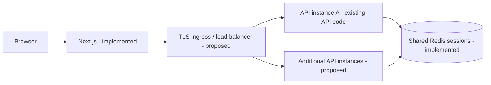
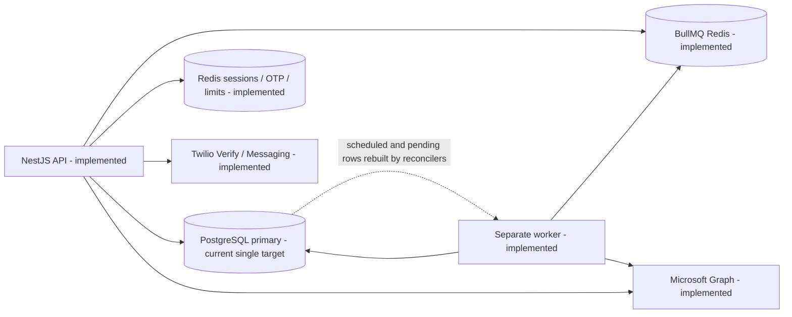
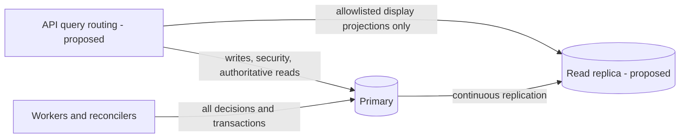
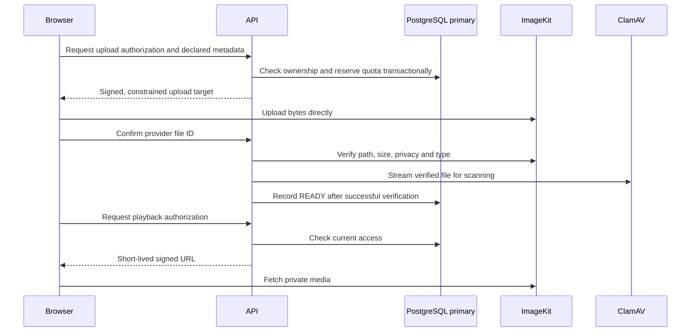

# Managing and scaling for after.

Repository review: **24 October 2026**. This guide describes the checked-out source, recorded evidence and future operating procedures. It does not implement or approve an architecture, select hosting, or certify production capacity.

## Table of contents

1. [Purpose, scope and current status](#1-purpose-scope-and-current-status)
2. [Current architecture and proposed production architecture](#2-current-architecture-and-proposed-production-architecture)
3. [Responsibilities and operational ownership](#3-responsibilities-and-operational-ownership)
4. [API and frontend scaling](#4-api-and-frontend-scaling)
5. [PostgreSQL storage and query performance](#5-postgresql-storage-and-query-performance)
6. [Connection pooling](#6-connection-pooling)
7. [Primary and read-replica architecture](#7-primary-and-read-replica-architecture)
8. [Explicit query-routing policy](#8-explicit-query-routing-policy)
9. [Read-after-write consistency](#9-read-after-write-consistency)
10. [Caching](#10-caching)
11. [Workers, queues and delivery correctness](#11-workers-queues-and-delivery-correctness)
12. [Media, quotas and cost control](#12-media-quotas-and-cost-control)
13. [Monitoring, alerts and service objectives](#13-monitoring-alerts-and-service-objectives)
14. [Backups, high availability and disaster recovery](#14-backups-high-availability-and-disaster-recovery)
15. [Staging and production deployment process](#15-staging-and-production-deployment-process)
16. [Capacity and failure testing](#16-capacity-and-failure-testing)
17. [Incident runbooks](#17-incident-runbooks)
18. [Daily, weekly and monthly operations](#18-daily-weekly-and-monthly-operations)
19. [Costs and growth roadmap](#19-costs-and-growth-roadmap)
20. [Configuration reference and implementation backlog](#20-configuration-reference-and-implementation-backlog)

## 1. Purpose, scope and current status

Use this guide to grow safely toward lakhs (hundreds of thousands) or millions of registered users. **There is no measured basis here for saying the application supports millions.** Design and purchasing decisions must follow measured traffic, data volume, privacy requirements and recovery objectives.

| Measure | Meaning and operating consequence |
| --- | --- |
| Registered users | Accounts retained in PostgreSQL; predicts some storage, not instantaneous load. |
| Monthly active users (MAU) | Distinct people active during a month; useful for product and cost trends. |
| Concurrent users | People active at the same time; their actions and think time determine traffic. Open browser tabs are not equivalent to active database work. |
| Requests per second (RPS) | HTTP arrival rate, measured by route and response size. A dashboard can generate several requests. |
| Queued deliveries | Work waiting for releases, recipient fan-out and provider calls. A scheduled burst can be large while HTTP traffic is quiet. |
| Stored and delivered media bytes | A separate capacity and cost dimension from database rows and API requests. |

The **reported 16 MB database size is a user-provided observation**, not a capacity benchmark or a measurement performed for this document. It does not establish remaining server disk, connection capacity, future row sizes, media usage or sustainable throughput. Local results do not establish production capacity.

The hosting provider, region and final production sizing remain **undecided**. Historical provider names below explain existing files; they are not recommendations or selections.

### Evidence labels

- **Source verified:** inspected implementation or configuration wiring. This does not prove runtime configuration or deployment.
- **Local recorded:** a repository report describes a test or manual development check. Tests were inspected, not executed during this review.
- **Deployed verified:** requires environment-specific release identity, configuration review and runtime checks. **No current deployment was independently verified for this guide.**
- **Proposed:** future configuration, implementation or operating procedure.
- **Unknown:** evidence is absent, stale, or must be confirmed with the eventual provider.

| Capability | Source verified | Local/documentary evidence | Deployment status and remaining work |
| --- | --- | --- | --- |
| API and separate worker | [API entrypoint](src/main.ts), [worker entrypoint](src/worker.ts), [composition](src/worker.module.ts) | [Worker process tests](test/worker-process.e2e-spec.ts), [Phase 24 report](docs/testing/phase-24-results.md) | Unknown deployed revision; worker deployment remains open in the project record. |
| PostgreSQL and Prisma | [Prisma service](src/prisma/prisma.service.ts), [schema](prisma/schema.prisma), [migrations](prisma/migrations/) | Phase 24 used local PostgreSQL 18.6 | Production server version, capacity, backups and HA unknown. |
| Shared sessions, OTP and rate limits | [HTTP setup](src/config/app.setup.ts), [Redis throttler](src/redis/redis-throttler.storage.ts), [OTP engine](src/otp-auth/otp-auth.service.ts) | [Security tests](test/security-critical.e2e-spec.ts) | Multiple-instance behavior under the actual proxy chain must be proven. |
| Release and notification recovery | [Release service](src/message-release/message-release.service.ts), [notification processor](src/release-notifications/release-notification.processor.ts) | Local fake-provider burst, retry, cancellation and crash profiles | No production throughput or exactly-once external-send guarantee. |
| Microsoft Graph email | [Provider](src/email/microsoft-email-provider.ts), [factory](src/email/email-provider.factory.ts) | [Task record](docs/task.md) reports user-confirmed real inbox delivery locally on 22 October; [Graph wiring tests](test/microsoft-email-wiring.e2e-spec.ts) use stubs | Preserve the working Graph integration. Production credentials, sender-domain setup and quotas remain to verify. |
| Twilio | [Verify](src/sms/sms-verification.ts) for portal SMS OTP; [Messaging](src/sms/sms-sender.ts) for trusted-contact invitations | Task record describes local real-SMS checks | Account limits, sender registration and production behavior unknown; general release SMS is not implemented. |
| ImageKit and upload quota | [Storage adapter](src/media/storage/imagekit-media-storage.service.ts), [quota](src/media/storage-quota.service.ts), [verification](src/media/media.service.ts) | [Quota tests](test/storage-quota.e2e-spec.ts); Phase 24 records a live synthetic signed-URL expiry check | Production account limits, backup/export options and capacity unknown. |
| Caching, replicas, autoscaling | Browser query cache exists; one database connection target in source | No production replica/caching capacity evidence | Server summary cache, replica routing and autoscaling are proposed. |
| Observability and recovery | Optional API Observe integration; health checks; durable dead letters | [Incident guide](docs/incident-response.md) describes intended operations | Alert delivery, worker heartbeat, PITR and restore drills not verified. |
| Billing and plan entitlements | No implemented billing module in [AppModule](src/app.module.ts) | [Task record](docs/task.md) lists billing as future work | Do not sell or enforce invented plan allowances through this guide. |

### Contradictions and stale information

Treat the source and dated evidence as authoritative for this review, not checked task boxes.

- [Architecture](docs/architecture.md) still describes Postmark, planned Stripe/Sentry/WordPress modules, absent admin UI and absent delivery. Current source includes admin UI and Graph delivery. Those old topology entries do not prove integrations exist.
- [Deployment](docs/deployment.md) says nothing is deployed, later mentions a Railway client demo, and mixes AWS and Google hosting proposals. [Task tracking](docs/task.md) records a Railway demo from 6 October with an API service but no separate worker deployment. These are historical claims, not current deployment verification or a hosting decision.
- [Database notes](docs/database.md) say PostgreSQL 16 and reproduce an older schema. The local test report says PostgreSQL 18.6; production version is unknown. Read [actual migrations](prisma/migrations/) for partial indexes and constraints; do not infer implemented row-level security from a planned RLS paragraph.
- [Architecture](docs/architecture.md) overstates duplicate-send protection. Database uniqueness protects logical records; Graph acceptance is a separate side effect.
- [Phase 24 results](docs/testing/phase-24-results.md) explicitly predate the Graph migration and used the now-removed Brevo adapter against a fake endpoint. The [current harness](scripts/load/delivery-load.mjs) targets fake Graph. Historical rates are not a fresh Graph benchmark. Brevo must not be restored.
- [Incident notes](docs/incident-response.md) describe per-recipient delivery status as future work and discuss sessions under an older prefix. Current release notifications exist; customer and admin sessions use separate prefixes in [main.ts](src/main.ts). Follow current source when investigating sessions.
- [Worker composition tests](src/worker.module.spec.ts) concern queue consumers/reconcilers. The API also imports [MediaModule](src/media/media.module.ts), whose cleanup timer runs there. “API has no background work” would be inaccurate.
- A test file named [production.spec.ts](../for-after-frontend/e2e/production.spec.ts) is not evidence that production was deployed or tested.

## 2. Current architecture and proposed production architecture

### Verified stack

Versions below are resolved in [backend lockfile](package-lock.json) and [frontend lockfile](../for-after-frontend/package-lock.json), not observations of running servers. Manifests specify some ranges.

| Component | Repository version | Role |
| --- | --- | --- |
| Next.js / React | 16.3.7 / 19.2.8 | Customer, recipient, trusted-contact and admin UI |
| TanStack Query | 5.104.0 | Browser request state, caching and invalidation |
| NestJS core | 12.0.4; manifest range ^12.0.1 | HTTP API and worker application context |
| Prisma client / adapter-pg | 7.10.0 / 7.10.0 | PostgreSQL access through the pg driver |
| pg | 8.23.0 | Driver and per-process connection pools |
| BullMQ / ioredis | 6.3.9 / 6.0.0 | Release, notification and safeguard queues |
| node-redis | 6.2.1 | Sessions, OTP state, rate counters and Redis health |
| ImageKit Node SDK | 7.12.1 | New private media uploads and delivery |
| MSAL Node | 7.1.0 | Microsoft Graph app-only token acquisition |
| Twilio | 6.2.0 | SMS verification and invitation sending |

PostgreSQL and Redis server versions are provider choices, not established by npm dependencies. The local report used PostgreSQL 18.6 and Redis 7.4.11. ImageKit is the active new-upload provider; a legacy B2 adapter serves/deletes old B2 rows if configured. Resend remains an optional source adapter; Microsoft Graph is the working selected integration described by the project.

### Request path

Current source has one API composition root and shared Redis state. Multiple replicas of that process and a load balancer are **proposed deployment topology**; no instance counts are selected.



Browser API calls may use a direct configured API origin or the existing optional Next.js rewrite. [next.config.ts](../for-after-frontend/next.config.ts) consumes `API_PROXY_TARGET` at build time; this adds a proxy hop and must be included in client-IP and cookie tests.

### API, worker and durable state



Queue Redis can be separated using existing `QUEUE_REDIS_URL`; it otherwise falls back to `REDIS_URL`. This wiring does not prove that separate Redis services are deployed. Both API and worker can send email: most authentication and invitation sends originate in the API.

### Proposed read replication



### Implemented direct media flow



The browser upload bypasses API buffering. Confirmation scanning still streams bytes through backend infrastructure, and content-copy operations have additional bandwidth/memory costs; see section 12.

## 3. Responsibilities and operational ownership

**Proposed responsibility matrix.** Managed service responsibilities must be confirmed in the selected provider's service agreement. A managed database does not manage application correctness.

| Area | Provider normally supplies, subject to contract | Application team must own |
| --- | --- | --- |
| Compute/network | Hardware, virtualization and contracted networking availability | Runtime sizing, instance bounds, release process, defects and dependency updates |
| Load balancing/TLS | Available ingress, certificates and health-routing facilities | Correct proxy trust, domains, cookies, Origin allowlist, timeouts and probes |
| Database | Managed engine operation/patch options, storage and failover features | Schema, migrations, indexes, query budgets, pooling, access roles and compatibility |
| Capacity | Quotas and upgrade facilities | Trend monitoring, headroom, overload protection and capacity tests |
| Backups | Backup/PITR mechanisms if purchased/configured | Enablement verification, retention, encryption, restore drills and recovery evidence |
| Redis | Managed Redis and persistence/HA options | BullMQ compatibility, noeviction, memory budgets, session isolation and reconstruction |
| Access control | IAM/secret-storage facilities | Least privilege, MFA, app authorization, credential rotation and access reviews |
| Media and messaging | API availability and purchased quotas | Private objects, signed URLs, quota enforcement, mailbox scope, delivery failures and egress costs |
| Monitoring | Metrics/log plumbing if contracted | Instrumentation, redaction, SLOs, dashboards, alert routing and tested escalation |
| Incidents | Infrastructure support within contract | Incident command, containment, correctness/privacy assessment and stakeholder coordination |
| Costs | Usage/billing reporting | Budget, forecasts, spending alerts, instance ceilings and regular review |

Incident commander: **TBD**. Primary and backup on-call contacts: **TBD**. Database, messaging/media, security/privacy and provider-support escalation contacts: **TBD**. Assign actual people and acknowledgement windows before launch. Until assigned, none of the runbooks constitutes an operational on-call service.

## 4. API and frontend scaling

**Source verified:** [main.ts](src/main.ts) uses shared Redis-backed customer/admin session stores, enables shutdown hooks and starts only the API. [OTP sessions](src/otp-auth/otp-auth.service.ts) also use Redis. [SessionAuthGuard](src/auth/guards/session-auth.guard.ts) reloads the user for account/security decisions.

API instances should keep request state in PostgreSQL/Redis, not local files or process memory. All instances of one environment must share compatible session secrets, OTP peppers, cookie settings, Redis namespaces and database schema. Development console SMS uses a process-local map and is not suitable for distributed production.

[Redis throttling](src/redis/redis-throttler.storage.ts) shares counters across instances on wired routes. A Redis error fails the request instead of silently allowing it. This is not evidence of blanket rate limiting on every route: [AuthModule](src/auth/auth.module.ts) wires route-level throttling; OTP has separate counters. Audit expensive list, media authorization and admin routes before increasing exposure.

[HTTP setup](src/config/app.setup.ts) trusts **one proxy hop in production**. That is a hard-coded assumption, not a provider-independent setting. Determine the real ingress/rewrite chain; ensure only trusted ingress can reach the API and overwrite forwarding headers. Test genuine IP attribution, forged forwarding headers and secure-cookie behavior. Do not blindly increase proxy trust.

Mutating browser requests with an Origin outside the configured allowlist are rejected. Requests without Origin are currently allowed by that middleware; authentication and authorization still apply. CORS and Origin checks do not replace session/permission checks.

### Proposed operating checklist

- [ ] Put TLS ingress in front of APIs and route only to ready instances; keep internal databases/Redis private.
- [ ] Implement distinct **liveness** (process functioning) and **readiness** (can serve requests) semantics with bounded checks. Existing [health endpoints](src/health/health.controller.ts) are `/health/database` and `/health/redis`; they check dependencies individually. There is no dedicated combined readiness/liveness pair or worker HTTP probe.
- [ ] Do not use dependency failure as a reason to restart every healthy process repeatedly. Remove unready traffic, investigate dependencies, and avoid probe-induced connection storms.
- [ ] Drain ingress before API shutdown; allow in-flight requests to finish, then close pools. Existing shutdown hooks are a foundation, not proof of provider drain timing.
- [ ] Set request/header/body limits and route-specific timeouts. Bound DB acquisition, queries, external calls and internal work, not just the load-balancer timeout.
- [ ] Give scan confirmation its own bounded concurrency/timeout budget; large numbers of simultaneous scans can saturate API/network capacity.
- [ ] Reject excess work with controlled errors and backpressure rather than unlimited wait queues. Do not automatically retry writes with ambiguous outcomes.
- [ ] Keep static assets cacheable; private authenticated responses must bypass shared frontend/CDN caching. Audit headers and framework caching under the selected hosting model.
- [ ] Set independently measured minimum and maximum API/frontend/worker instance counts and spending alerts. Counts are **TBD**; scaling to a purchased maximum must fit DB and provider budgets, including rollout overlap.
- [ ] Scale vertically for measured per-process memory/CPU pressure; scale horizontally for parallel throughput and availability. Neither fixes slow queries or provider quotas automatically.

Use `npm run start:prod` for the API and `npm run worker:prod` for workers, from the backend package. Do not import `QueueWorkersModule` into `AppModule` or launch workers once per web replica accidentally. Worker process multiplication also multiplies reconcilers and all three queue consumers.

Before multiple APIs are approved, exercise login on instance A and authenticated reads on B; logout/password change/suspension across both; OTP challenge creation and verification on different instances; admin MFA; independent customer/admin/recipient/trusted-contact cookies; rate-limit aggregation; deleted-content denial; Origin/proxy behavior; rolling restart. Check in-flight browser cache responses when switching principals as well as server authorization.

## 5. PostgreSQL storage and query performance

Local and hosted storage are finite. Track these separate limits:

| Resource | What consumes it | Why more disk alone is insufficient |
| --- | --- | --- |
| Disk capacity | Tables, indexes, TOAST values, WAL, temporary files, maintenance and provider backup placement | A full filesystem can stop writes even when the main database seems small. |
| RAM | Shared buffers, connections, per-query sorts/hashes and OS cache | Too many concurrent sorts or connections can exhaust memory. |
| CPU | Filtering, joins, sorting, encryption and transaction processing | Larger volumes do not repair CPU-heavy scans. |
| I/O and latency | Random reads, WAL flushes, checkpoints and vacuum | Storage size and IOPS/throughput may be priced or limited separately. |
| Connections | Pools in APIs, workers, reconcilers, tools and provider agents | Connection exhaustion can occur with plenty of disk free. |

Database rows store content and media metadata; ImageKit stores file objects. Media growth still creates database metadata, while media egress is accounted separately. Message versions, activity, audit records, grants, recurring occurrences and dead letters also grow; review retention before using archival or partitioning.

### Read-only diagnostics for a future authorized operator

**Not executed in this review.** Use a restricted monitoring role and an approved environment. These examples return operational aggregates, not user content. Limit execution time using the administration tool/provider; diagnostic access itself should not become a workload.

```sql
-- Current database size, not total server/filesystem consumption.
SELECT pg_size_pretty(pg_database_size(current_database())) AS database_size;

-- Largest user relations; total includes indexes and auxiliary storage.
SELECT schemaname, relname,
       pg_size_pretty(pg_table_size(relid)) AS table_size,
       pg_size_pretty(pg_indexes_size(relid)) AS index_size,
       pg_size_pretty(pg_total_relation_size(relid)) AS total_relation_size
FROM pg_stat_user_tables
ORDER BY pg_total_relation_size(relid) DESC
LIMIT 20;

-- Session counts without query text, addresses or user identifiers.
SELECT state, wait_event_type, count(*) AS connections
FROM pg_stat_activity
WHERE datname = current_database()
GROUP BY state, wait_event_type
ORDER BY connections DESC;

SHOW max_connections;

-- Maintenance pressure estimates; n_dead_tup is an estimate.
SELECT relname, n_live_tup, n_dead_tup, last_autovacuum, last_autoanalyze
FROM pg_stat_user_tables
ORDER BY n_dead_tup DESC
LIMIT 20;
```

Use provider/OS volume metrics for total disk and free space, WAL storage, temporary spill and backup footprint. `pg_database_size` is not total server disk usage. Monitor replication-slot WAL retention if replicas are later introduced.

Profile the slow routes first, with normalized query fingerprints and durations; do not collect SQL parameters, private content or full query text into public logs. Confirm whether `pg_stat_statements` is available; enabling it is future configuration work.

Review plans with `EXPLAIN` before proposing indexes. **EXPLAIN ANALYZE executes the query**; use it only for reviewed read-only SELECT statements in an appropriate isolated/staging environment, with a timeout and representative synthetic data. Do not wrap a mutation in it. Even SELECT statements can invoke side-effecting functions.

Illustrative plan-only example; the synthetic UUID is not a real owner:

```sql
EXPLAIN (COSTS, FORMAT TEXT)
SELECT id, "createdAt"
FROM "Recipient"
WHERE "ownerUserId" = '00000000-0000-0000-0000-000000000001'::uuid
  AND "deletedAt" IS NULL
ORDER BY "createdAt" DESC, id DESC
LIMIT 20;
```

### Project-specific query review

| Existing behavior | Evidence | Proposed improvement when measurements justify it |
| --- | --- | --- |
| Recipient and message lists use count + offset/limit and stable ordering | [Recipients](src/recipients/recipients.service.ts), [messages](src/messages/messages.service.ts) | Measure count cost and deep-page offsets; consider cursor pagination. Do not return an owner's entire collection for dashboard counts. |
| Message summaries exclude media/signed URLs, but select text then form a preview | [Messages service](src/messages/messages.service.ts) | Measure actual DB bytes and serialization; a short response is not proof of a narrow underlying query. |
| Readiness performs parallel counts/grouping and reads contact readiness | [Readiness](src/readiness/readiness.service.ts) | Avoid repeated recomputation across dashboard widgets; consider reviewed owner-scoped summary caching. |
| Attention includes storage totals and relationship queries | [Attention](src/attention/attention.module.ts) | Bound result sets and cost; its display summary must never authorize storage or release. |
| Activity pages then batch-resolves live targets | [Activity](src/activity/activity.module.ts) | Preserve batch access to avoid N+1 queries; keep current deletion checks authoritative. |
| Quota sums five media tables under an owner lock for reservations | [Storage quota](src/media/storage-quota.service.ts) | Profile per-owner media growth and lock wait; never replace reservation decisions with stale cache/replica totals. |
| Some release/death reconciler scans are unpaginated | [Release reconciler](src/message-release/message-release-reconciler.service.ts), [death queue](src/death-verification/death-verification-queue.service.ts) | Add bounded, fair pagination and evaluate query plans before worker multiplication. |

Existing [schema indexes](prisma/schema.prisma) include owner/status message indexes, activity ordering, pending occurrence due-time lookup and notification status/creation time. Recipient list ordering and release schedule scans merit measured review; do not add speculative indexes to every column. Each index costs storage, write I/O and maintenance. Preserve migration-only partial unique indexes and the append-only audit trigger; schema prose alone does not capture them.

## 6. Connection pooling

**Source verified:** [PrismaService](src/prisma/prisma.service.ts) constructs `new PrismaPg({ connectionString })` from `DATABASE_URL` and passes it to `super({ adapter })`. [PrismaModule](src/prisma/prisma.module.ts) is global and exports one Nest provider per application context. Reuse this client within each process; never construct a client/pool per request.

[prisma.config.ts](prisma.config.ts) supplies the CLI datasource from `DATABASE_URL`; [schema.prisma](prisma/schema.prisma) contains the PostgreSQL provider and generated ESM client settings. Preserve this convention. There is no implemented replica URL, independent pool-budget variable, or runtime migration URL in the inspected setup.

The pg driver owns pooling. Source currently sets **no explicit** `max`, `connectionTimeoutMillis` or `idleTimeoutMillis`. Inspect the installed driver defaults when implementing explicit budgets; do not copy Prisma 6 URL pool settings or an obsolete `datasourceUrl` constructor. See the [Prisma 7 pooling reference](https://docs.prisma.io/docs/orm/v7/prisma-client/setup-and-configuration/databases-connections/connection-pool).

Proposed adapter options should set a deliberate pool maximum, bounded acquisition/connect timeout and idle lifetime. Statement/transaction timeouts are separate controls; ending an HTTP request does not necessarily cancel database work. Validate error handling, transaction duration and cancellation behavior with pg/Prisma versions actually deployed.

### Illustrative budget only — not production sizing

Assume, purely for arithmetic, a primary connection ceiling of 100:

| Consumer | Illustrative calculation | Reserved connections |
| --- | --- | ---: |
| APIs | 4 processes × pool max 8 | 32 |
| Workers | 3 processes × pool max 6 | 18 |
| Future dedicated reconciler | 1 process × pool max 4 | 4 |
| Migrations/admin tools | Reserved separately | 6 |
| Provider/system/emergency headroom | Reserved, including provider-specific limits | 20 |
| Total planned reservation | 32 + 18 + 4 + 6 + 20 | 80 |
| Unassigned margin | 100 − 80 | 20 |

Current reconcilers share their worker's Prisma client, so **do not double-count them as independent pools**. The separate reconciler line illustrates a possible future process. Rolling deployment of two extra API processes would add 16, leaving only 4 of that illustrative margin; unrestricted autoscaling would break the budget.

A future replica needs its own independent calculation: for example, 4 API replica pools × 4 + 4 admin + 10 reserve = 30 against an illustrative replica ceiling of 60. Replication/provider connections and per-role limits must be included according to the selected provider. Do not assume primary spare capacity covers replica saturation.

External pooling, such as a compatible transaction pooler, is an option rather than a requirement. Confirm pg/Prisma compatibility, TLS, authentication, prepared-statement behavior, interactive transactions, session-dependent SQL, migration routing and failover. Count both client connections and backend database connections. An external pool can reduce backend connections but cannot create unlimited query throughput.

## 7. Primary and read-replica architecture

**Current:** every Prisma query uses the single `DATABASE_URL`. **Proposed:** introduce a replica only after measured read pressure persists after query/index and caching improvements.

A read replica continuously receives database changes from its primary. It is not an independent database manually synchronized with periodic application writes. Replication lag means it can return an older view after a successful write. A replica adds eligible read capacity; it does not increase the primary's write capacity.

A read replica, a high-availability standby and a backup serve different purposes. A standby may be reserved for failover and unavailable for application reads. A readable replica is not necessarily configured for automatic failover. Neither protects against replicated accidental deletion; **a replica is not a backup**.

### Provider-independent introduction checklist — proposed, not performed

1. Establish the primary bottleneck, expected eligible read fraction and latency benefit. Exclude security/worker traffic from the estimate.
2. Confirm supported PostgreSQL version, replication mode, readable endpoint, failover/promotion semantics, failure-domain placement, maximum connections and billing.
3. Provision through a separately approved change only after design review; do not build dual-write synchronization in application code.
4. Confirm private connectivity, TLS certificate validation and network restrictions. Use separate least-privilege read credentials and private secret injection.
5. Design an explicit read client and operation allowlist. Keep existing `DATABASE_URL` as the primary; replica variables are proposed in section 20.
6. Monitor replay/receive progress, lag, last successful replay and query errors. Define maximum permitted staleness per operation. An idle database's replay timestamp alone can be misleading; use provider lag/LSN metrics and heartbeat evidence.
7. Test update/delete/revoke visibility, replica restart, long-read conflicts, pool exhaustion and read-after-write behavior with synthetic records.
8. Add bounded fallback and a circuit breaker: stop sending to an unhealthy replica; admit only a measured portion of eligible reads to primary.
9. Roll out one reviewed projection at a time. Compare correctness, primary load, replica load, latency and cost.
10. Keep a routing rollback that disables replica use without changing write ownership. Drain its pools and restore primary reads within tested admission limits; retain the replica until investigation is complete.

Do not automatically promote a read replica from application code. Failover orchestration, split-brain prevention, replication recovery and endpoint changes require provider confirmation and an approved database runbook.

## 8. Explicit query-routing policy

**All current database operations use primary.** The following is a future routing policy, not existing router behavior. A GET can perform an authorization decision or expose private data; neither the HTTP verb nor an entire screen is a routing category.

A replica candidate means a narrowly reviewed **projection** (selected display fields), after primary authentication and current authorization. If stale deletion/revocation could disclose information, keep the data read on primary or apply an authoritative current-visibility filter before returning it. Do not serve an old private body merely because the session itself is current.

| Operation | Primary/replica policy | Consistency requirement and reason | Source |
| --- | --- | --- | --- |
| Login, session identity, suspension, permissions, MFA and revocation | **PRIMARY** | Immediate security state; Redis session presence alone is insufficient | [Session guard](src/auth/guards/session-auth.guard.ts), [users](src/users/users.service.ts), [admin MFA](src/admin-auth/admin-mfa.service.ts) |
| Recipient/trusted-contact eligibility and portal access | **PRIMARY** | Must see current grant/message/case eligibility before disclosure | [Recipient auth](src/recipient-auth/recipient-auth.service.ts), [recipient messages](src/recipient-portal/recipient-messages.service.ts), [trusted-contact auth](src/trusted-contact-auth/trusted-contact-auth.service.ts) |
| Password, email and security changes; verification/reset links | **PRIMARY** | Single-use tokens, immediate identity change and session invalidation | [Auth tokens](src/auth/auth-tokens.service.ts), [auth service](src/auth/auth.service.ts) |
| Every create/update/delete and its ownership/business validation | **PRIMARY** | Validation and mutation must agree; never validate a write against stale data | [Recipients](src/recipients/recipients.service.ts), [messages](src/messages/messages.service.ts) |
| Scheduling, rescheduling, cancellation and recipient selection for a schedule | **PRIMARY** | Locking and immediate release eligibility | [Schedules](src/message-schedules/message-schedules.service.ts) |
| Upload reservation, confirmation, deletion and signed playback authorization | **PRIMARY** | Concurrent quota enforcement, current object state and privacy | [Quota](src/media/storage-quota.service.ts), [media](src/media/media.service.ts) |
| Death reports, evidence, confirm-alive, admin verify/reject and confirmation counts | **PRIMARY** | Safeguards and human decisions cannot use stale case state | [Death service](src/death-verification/death-verification.service.ts), [workflow](src/death-verification/death-verification-workflow.service.ts), [evidence](src/death-verification/death-verification-evidence.service.ts) |
| Release decisions, access-grant creation, notification eligibility and reconciliation | **PRIMARY** | Workers must observe cancellation/deletion and serialize decisions | [Release service](src/message-release/message-release.service.ts), [notification processor](src/release-notifications/release-notification.processor.ts) |
| Billing/entitlements when implemented | **PRIMARY** | Authoritative paid access/limits; implementation currently absent | [Task backlog](docs/task.md) |
| Transactions and immediate authoritative confirmations | **PRIMARY** | One transactional connection/consistent target; no mixed primary/replica transaction | [Prisma service](src/prisma/prisma.service.ts) |
| Owner-scoped display-only list projections | Replica **candidate after review** | Staleness may be acceptable only after current auth and visibility checks; exclude private notes, bodies and access URLs from an unreviewed projection | [Recipients](src/recipients/recipients.service.ts), [messages](src/messages/messages.service.ts), [memory vault](src/memory-vault/memory-vault.service.ts) |
| Historical activity/report aggregates | Replica **candidate after review** | Delayed counts may be acceptable; target links still need current visibility checks | [Activity](src/activity/activity.module.ts), [admin service](src/admin/admin.service.ts) |
| Non-authoritative dashboard counts/setup summaries | Replica **candidate after review** | Label/display acceptable staleness; never grant access, reserve space or decide release from these summaries | [Readiness](src/readiness/readiness.service.ts), [attention](src/attention/attention.module.ts) |
| Message details, private notes, recipient content and sensitive admin records | **PRIMARY by default** | Stale content or decisions could violate deletion/privacy requirements | [Messages](src/messages/messages.service.ts), [recipient portal](src/recipient-portal/recipient-messages.service.ts), [admin](src/admin/admin.service.ts) |

Current list implementations wrap count/list in `$transaction`, so **they remain primary under this policy**. Replica candidates require explicit query design/review, not swapping their Prisma service globally. In particular, recipient list responses currently include private contact fields and notes; do not label the existing full response automatically replica-safe.

Released grants are intentionally snapshots: [schema comments](prisma/schema.prisma) and [grant creation](src/message-release/message-release.service.ts) preserve released access despite later recipient contact edits or soft deletion from People I Love. Do not promise that deleting a recipient revokes previously released access. Distinguish that product rule from stale reads bypassing actual message deletion or future explicit revocation.

## 9. Read-after-write consistency

A successful primary write may not yet be visible on a replica. Returning the saved resource helps the UI show the committed result immediately. [Resource hooks](../for-after-frontend/src/hooks/use-vault.ts) already seed the detail query cache and invalidate relevant list queries. That is useful today, but invalidation alone will not make a future replica current.

### Concrete example: create recipient, then refresh list

1. The API validates the customer on primary, creates the recipient and returns the selected saved resource.
2. The existing frontend seeds the recipient detail cache and invalidates recipient lists/pages.
3. **Without a consistency policy**, a refetch from a lagging replica could omit the recipient or overwrite fresh client data with older fields.
4. **Proposed:** use primary for the immediate list confirmation, or merge the saved item into the appropriate cached page with a mutation version/marker until an authoritative refetch completes. Cancel or ignore older in-flight responses; respect filtering, sorting and pagination.
5. Keep the freshly returned ID/detail available if refresh fails. Do not create a second recipient as a recovery mechanism.

Use primary for immediate confirmations where correctness matters, especially permissions, security, scheduling, quota and cancellation. Read-after-write affinity is an optimization: route a session/operation to primary for a bounded period after a mutation. **An arbitrary delay does not guarantee replication has caught up.**

A stronger replication-aware design can wait for a replica to replay an observed commit position or use a provider-supported consistency mechanism. That requires implementation and provider support; a client clock/timestamp alone is not proof of replay. Set bounded waits; avoid tying up API/database connections indefinitely.

On replica lag/outage, open a circuit breaker and cap primary fallback by concurrency and RPS. Prefer temporarily unavailable or explicitly stale non-sensitive summaries over flooding the primary. Reserve primary capacity for authentication, writes and workers. Primary fallback must not bypass authorization or silently make stale private content acceptable.

## 10. Caching

**Existing:** [TanStack Query configuration](../for-after-frontend/src/lib/query/query-client.ts) uses a 30-second browser `staleTime`, window-focus refetch, selective query retries and no automatic mutation retries. Principal-specific reset functions remove private cache entries during session changes/expiry. These browser query keys are not a suitable design for a shared server cache; many do not contain owner identity.

The inspected readiness/attention/list services query Prisma directly. No shared Redis dashboard summary cache or Nest cache interceptor was found in these paths. Redis sessions, OTP challenges, rate counters, BullMQ jobs and MSAL's in-process token cache are not a general dashboard cache.

### Proposed owner-scoped summary cache

- Authenticate and perform current permission/suspension checks **before** reading cache.
- Cache only reviewed display counts/summary fields, not private message bodies, notes, signed media URLs, evidence, permission decisions or release eligibility.
- Example logical key, **not an existing key**: `summary:v1:owner:<owner-id>:<summary-type>:<normalized-filter-hash>`. Include tenant/principal where applicable, relevant filters, schema version and any authorization-sensitive version.
- Initial TTL might be **15–30 seconds, provisional**, with small randomized expiry variation. Measure freshness needs and hit ratio before choosing a value.
- Invalidate after relevant successful mutations: recipients/contacts/invitations, messages/schedules, memories/story/wishes, upload reservation/confirmation/deletion, and security changes. Worker releases must also invalidate affected summaries or advance a version.
- Handle the race where an old computation repopulates cache after invalidation. Use versioned keys or compare-and-set publishing; deleting a key alone does not solve this.
- Use single-flight/stampede protection: only one bounded recomputation per key, with short lock expiry and safe owner-token release. A cache outage must not fan out unlimited database queries.
- Treat cached storage figures as display-only. [Quota.reserve](src/media/storage-quota.service.ts) must keep its locked primary check.
- On error, return a bounded, safe fallback or temporarily omit a widget. Do not reuse one owner's summary for another.
- Keep private authenticated responses out of shared CDN/page caches. Test account switching and late responses across all four principals.

Separate disposable caches from durable queue/session Redis where memory pressure or differing retention policies justify it. Existing `QUEUE_REDIS_URL` allows queue separation; a dedicated summary-cache endpoint would need new wiring.

BullMQ Redis requires **noeviction** so memory pressure cannot silently discard queue keys, plus configured persistence and tested recovery. Noeviction causes writes to fail when memory is exhausted; it is not a substitute for headroom. Choose persistence/HA settings against the required recovery objective, and test provider support for BullMQ operations and connections. See [BullMQ production guidance](https://docs.bullmq.io/guide/going-to-production). The local load-test Redis deliberately had persistence disabled; do not copy that fixture into production.

## 11. Workers, queues and delivery correctness

### Existing process commands and queues

All commands below belong to [backend package.json](package.json). They are references for future operations and were **not run** for this documentation task.

| Purpose | Existing script |
| --- | --- |
| Build generated Prisma client and backend | `npm run build` |
| API development / production | `npm run start:dev` / `npm run start:prod` |
| Worker development / production | `npm run worker:dev` / `npm run worker:prod` |
| Access-grant backfill tool | `npm run backfill:access-grants`; inspect dry-run/apply behavior before any authorized use |
| Explicit email diagnostic | `npm run email:send-test`; can send real mail, and refuses production mode |
| Legacy media migration tool | `npm run migrate:b2-to-imagekit`; not a routine scaling action |

[WorkerModule](src/worker.module.ts) starts all three consumers, reconcilers and dead-letter alert recovery in an application context without HTTP. It does not contain a production worker heartbeat endpoint.

| Queue default / override | Job and ID | Retry/recovery source |
| --- | --- | --- |
| `message-release` / `RELEASE_QUEUE_NAME` | `release`; `message-release-<messageId>` or `message-release-occurrence-<occurrenceId>` | [Queue](src/message-release/message-release-queue.service.ts), [processor](src/message-release/message-release.processor.ts), [reconciler](src/message-release/message-release-reconciler.service.ts) |
| `email-delivery` / `EMAIL_QUEUE_NAME` | `message-released`; `release-notification-<notificationId>` | [Queue](src/release-notifications/release-notification-queue.service.ts), [processor/reconciler](src/release-notifications/release-notification.processor.ts) |
| `death-verification` / `DEATH_VERIFICATION_QUEUE_NAME` | `safeguard`; `death-verification-safeguard-<caseId>` | [Queue/reconciler](src/death-verification/death-verification-queue.service.ts), [processor](src/death-verification/death-verification.processor.ts), [workflow settings](src/death-verification/death-verification-workflow.service.ts) |

Jobs hold identifiers, not content, addresses or signed media URLs. Defaults in source are five attempts, exponential backoff starting at 5 seconds for release/safeguard and 30 seconds for email. Queue history is bounded to 1,000 entries with age limits (completed one day, failed seven days). Durable dead letters live in PostgreSQL; BullMQ history alone is not the incident ledger.

Consumers supply no explicit concurrency option; local harness documentation records BullMQ's default of **one job per queue per worker process**. Scaling the current worker executable scales every consumer and reconciler together. Separate per-queue process roles or concurrency settings would be **new implementation**, not existing environment switches.

### Durable state and recovery

- Schedule mutations commit to PostgreSQL before best-effort queue synchronization. A queue insertion failure does not erase the schedule. The release reconciler runs at startup and normally every 60 seconds, with a one-day lookahead; overdue eligible work can run immediately.
- Fixed-date/custom/NOW and death-activation scans are currently unpaginated. Recurring pending occurrences are limited to 1,000 per pass. Add fair cursor/batch processing before large backlogs; a fixed oldest-first batch can delay later work if early rows remain blocked.
- Release decisions lock the message row and re-read its schedule/state inside a transaction. Release records, access grants and notification rows are created with the relevant state changes. Cancellation and release serialize on database state, not job order.
- [Migration constraints](prisma/migrations/20261009120000_recurring_and_per_recipient_schedules/migration.sql) protect one occurrence per message/recipient/year, unique occurrence notifications and one whole-release notification per grant through a partial unique index. “One notification per grant forever” is inaccurate for recurring releases.
- The notification reconciler selects up to 200 old PENDING rows per pass, after a two-minute grace period. It restores missed enqueue attempts; it does not automatically resend every FAILED row.
- Death reconciliation retries unsent safety notices, advances expired safeguards and repairs verified activations. A report or elapsed timer alone does **not** authorize death-trigger release; admin verification and safeguards remain authoritative.
- [DeadLetterService](src/dead-letters/dead-letter.service.ts) watches terminal queue failures, deduplicates by queue/job, and retries failed operator alerts directly. Defaults: check every 300 seconds, 15-minute cooldown, retry rows from the last 24 hours, batch 20. Older alerts remain visible and need review.
- A release job that exhausts retries can be reconstructed while its message remains SCHEDULED. Thus terminal queue failure does not necessarily stop future release attempts. Alert on repeated failure and control the underlying work; do not assume a dead letter freezes it.

### Multiple-worker races and external sends

Database uniqueness prevents duplicate **internal records**. Deterministic BullMQ IDs normally prevent two instances from processing the same logical queued job simultaneously. Neither creates exactly-once external delivery.

The [notification processor](src/release-notifications/release-notification.processor.ts) reads the row, skips SENT, calls the provider, then updates the row. There is **no atomic database send claim/lease** before that call. Concurrent foreign-ID jobs for the same PENDING notification, a lost BullMQ lock or recovery races require additional protection and tests. The existing completed-row duplicate tests do not prove concurrent PENDING sends safe.

Microsoft Graph can accept a message and then the process can crash, the response can be lost, or the database update can fail. The row may still appear PENDING; a retry can submit the message again. The caller passes an internal idempotency key, but [MicrosoftGraphEmailProvider](src/email/microsoft-email-provider.ts) does not use it as provider deduplication. Graph acceptance also does not prove inbox delivery: [sendMail documentation](https://learn.microsoft.com/en-us/graph/api/user-sendmail?view=graph-rest-1.0) describes 202 as acceptance for processing.

Proposed improvements: database send claims with bounded leases and fencing, revalidation close to submission, persisted attempt/outcome states including **ambiguous acceptance**, and a reviewed replay policy. Do not keep a database transaction open across a slow external send. Claims reduce concurrent submissions but cannot atomically commit PostgreSQL and Graph together; **do not promise exactly-once email**.

Safety notices already use a conditional timestamp claim before sending, with a claim window related to the reconcile interval. Operator-alert retries also use conditional updates. Test lease duration versus configured provider timeout, slow token acquisition and process pauses; these mechanisms still have accepted-but-unrecorded windows.

Reconcilers run in every worker. Per-process “running” flags prevent local overlap, not distributed overlap. Deterministic jobs, database locks and conditional updates each cover specific races, but duplicate scanning/Redis churn still grows with worker count. Consider bounded scans and dedicated coordination only after measurement.

### Which outbound flows are actually durable?

| Flow | Current path and recovery | Gap to account for |
| --- | --- | --- |
| Released-message email | Transactional `ReleaseNotification` row → BullMQ → retry/dead letter | External ambiguity and missing DB send claim remain. |
| Recipient/trusted-contact email OTP | Redis challenge; asynchronous direct send from [OTP engine](src/otp-auth/otp-auth.service.ts) | Fire-and-forget promise catches/logs failure; no durable delivery queue. API crash can lose the send; requester must retry within limits. |
| Portal SMS OTP | Direct Twilio Verify send/check through [SMS verification](src/sms/sms-verification.ts) | Twilio owns code validation; not a BullMQ delivery flow. Preserve anti-enumeration and rate limits. |
| Registration verification/password reset/email-change link/security notice | Token state in PostgreSQL; direct [AuthTokensService](src/auth/auth-tokens.service.ts) email | Token durability does not imply delivery durability. No generic outbox/reconciler for these emails; inspect expiry and resend semantics before queuing them. |
| Trusted-contact invitation by email or SMS | Invitation row committed, then direct [send](src/trusted-contacts/trusted-contact-invitations.service.ts); caught failure cancels invitation | Crash before send can leave an apparently pending invitation; accepted-but-response-lost can cancel an already-sent link. No automatic generic delivery recovery. |
| Account-holder death safety notice | Direct send plus case attempt state and worker reconciliation | Durable workflow retry, not an ordinary email-delivery queue job; review timeout/claim windows. |
| Operator dead-letter alert | Direct Graph send, persisted alert status and bounded reconciliation | Uses the same email provider as the failed service; a separate monitoring channel is needed for provider outages. |

Do not delay OTP/security links in an unlimited backlog. If adding a durable outbox, define expiry, cancellation, supersession, allowed attempts and privacy of stored payloads per flow.

### Operations and restarts

Measure oldest **due** job age, backlog, completion rate, provider latency/throttling, attempts and pending database rows. Delayed jobs scheduled for next month are not overdue backlog. A rough estimate is backlog divided by net spare processing rate; if arrival rate exceeds completion rate, there is no finite drain time.

Increase workers only within primary/Redis connection budgets and provider send limits. Graph currently logs Retry-After but uses the caller's fixed exponential schedule; coordinated provider-wide rate control and honoring Retry-After are backlog work. Do not create a retry storm by restarting all workers or retrying all dead letters.

Shutdown hooks stop timers and close BullMQ workers, waiting for active work before closing resources. Test the actual termination grace period against provider/DB timeouts and full reconciliation duration. API media cleanup has a separate timer and its destroy hook clears the timer without awaiting a running cleanup pass; graceful shutdown is not uniformly proven for every background task.

After a queue Redis outage, restore the configured persistence/HA path, confirm PostgreSQL correctness, and let reviewed bounded reconciliation rebuild work. Review FAILED/ambiguous sends separately; do not flush Redis or bulk requeue. If session Redis was lost, require new sessions/OTP challenges rather than reconstructing credentials. Validate all three queues and operator-alert recovery before declaring success.

## 12. Media, quotas and cost control

**Source verified:** new uploads use ImageKit V2 signed parameters with server-selected path, private-file flag, no overwrite and a declared size ceiling. Confirmation checks provider path/file ID, exact size, reported MIME compatibility, file signature and ClamAV verdict before READY. See [media verification](src/media/media.service.ts), [ImageKit adapter](src/media/storage/imagekit-media-storage.service.ts) and [media documentation](docs/media-storage.md).

The confirmation implementation rejects an explicitly public file; it accepts absent privacy metadata rather than requiring an explicit true value. The signed upload fixes privacy, but strengthening confirmation and provider-metadata regression tests should be reviewed. Do not equate a filename or browser MIME declaration with verified type.

[Quota](src/media/storage-quota.service.ts) sums READY and PENDING_UPLOAD bytes across message media, memory-vault media, recipient photos, My Story and My Wishes. Reservation locks the owner's User row inside the same transaction that inserts pending metadata. Concurrent reservations for the same customer therefore serialize. The implemented shared limit defaults to **5 GiB per customer**; this is a source default, not a paid-plan promise.

[Media settings](src/media/media.service.ts) currently default to 20 MiB photos, 25 MiB audio and 100 MiB video; [recipient photos](src/recipients/recipient-photo.service.ts) default to 5 MiB. Individual feature restrictions can be narrower. [Death evidence](src/death-verification/death-verification-evidence.service.ts) has separate limits (default 20 MiB/file and five files) and is outside those five owner-quota tables. Account for evidence storage separately; do not claim the customer quota covers every stored byte.

### Operational checks

- Keep authorization, reservations and confirmation on primary. Displayed remaining space can be stale; server reservation is decisive.
- Keep scanner definitions current and clamd private. Scan errors fail closed and leave uploads pending; monitor scanner/network failures and reservation accumulation.
- Bound simultaneous scans and content copies. Browser upload/playback is direct, but malware scanning streams the whole file through backend infrastructure. The ImageKit copy path uses SDK upload buffering; copying media can raise memory even without a browser upload proxy.
- [Cleanup](src/media/media-cleanup.service.ts) retires pending uploads after 24 hours, runs by default at startup/hourly, and handles up to 100 deletions per media table per pass. It waits for upload-token expiry before id-less object lookup, makes rows inaccessible first and records storage deletion after provider success.
- Cleanup is registered in the API's MediaModule. More APIs mean more cleanup scans; per-process guards do not coordinate instances. Verify concurrent idempotent deletion and API shutdown before scaling. Do not assume all cleanup is in the separate worker.
- Automatic reconciliation purges ImageKit objects; legacy B2 deletion has different rules and is not swept automatically. Retain legacy access configuration only while supported rows need it.
- Do not bulk-delete “orphaned” provider objects solely because they are absent from an old backup or a lagging replica. Reconcile current primary references, upload-token lifetime, pending operations and shared/copy references first.
- Signed playback URLs are short-lived capabilities (default 300 seconds), not instantly revocable sessions. Existing URLs may work until expiry even after access changes; prevent issuance of new URLs and include this residual window in privacy incidents.
- Monitor used/reserved bytes, stale pending/failed uploads, deletion failures, provider API quotas, transformation costs and delivered bytes. Local quota release does not prove the physical provider object was deleted.
- Define plans, entitlement enforcement, retention, deletion policy and billing **before** introducing differentiated allowances. Billing is not implemented; do not infer paid limits from the fixed quota.

## 13. Monitoring, alerts and service objectives

**Existing:** [health checks](src/health/health.service.ts), category-based logs, [optional Observe wiring](src/app.module.ts), [global exception filter](src/config/global-exception.filter.ts), [admin queue view](src/admin/admin-queues.service.ts), durable dead letters and operator emails. Observe loads only when both keys exist, and is wired in the API root; equivalent worker instrumentation is not established. Repository wiring does not prove a live collector, dashboards or on-call delivery.

**Proposed SLOs, all provisional:** start discussion with 99.9% monthly successful service availability, p95 below 500 ms for ordinary authenticated list/count requests, and p95 due-to-release below 30 seconds / due-to-provider-acceptance below 60 seconds at an agreed workload. These are review targets, not promises. Exclude neither provider errors nor overload silently; define route classes, expected 4xx, scan operations, maintenance and measurement windows. Inbox delivery needs separate provider evidence.

The following alert thresholds are **illustrative/provisional**. Tune against staging baseline and approved objectives; every owner role needs an actual contact.

| Metric | Purpose | Provisional alert condition | Response | Owner |
| --- | --- | --- | --- | --- |
| API p50/p95/p99 by route | Detect user-visible latency/tail stalls | p95 breaches route budget for 10 min; immediate review of severe p99 increase | Compare DB waits, provider time and recent release | App on-call, TBD |
| API 5xx / availability | Detect failed service | >1% for 5 min with minimum request volume, or synthetic outage | Triage dependencies; stop rollout if correlated | Incident lead, TBD |
| CPU and event-loop delay | Distinguish compute saturation from I/O waits | CPU >80% sustained or event-loop p99 >100 ms for 5 min | Identify blocking work; shed load within budget | App on-call, TBD |
| Process RSS/heap and restarts | Detect memory leaks/OOM | >80% memory limit or sustained growth; any repeated OOM | Reduce scan/copy concurrency; inspect allocation trend | App on-call, TBD |
| DB connections and pool wait | Prevent exhaustion | >70% warning, >85% critical of usable budget; rising acquisition timeouts | Cap scale/concurrency; find leaks/long transactions | DB owner, TBD |
| Slow queries/locks/temp spill | Find inefficient SQL and contention | Route query budget exceeded or new sustained lock wait | Review fingerprints/plans and blocking transaction metadata | DB + app owners, TBD |
| DB free disk/WAL growth | Avoid unavailable writes | <25% free warning, <15% critical, or forecast exhaustion before response window | Identify relation/WAL/temp growth; approved expansion | DB owner, TBD |
| Replica lag/errors, when added | Avoid unsafe/stale reads | Beyond operation staleness budget or stale heartbeat | Circuit-break replica and bound fallback | DB + app owners, TBD |
| Redis memory/evictions | Protect queue/session state | >70% warning, >85% critical; **any queue-key eviction** | Investigate policy/history/backlog; preserve queues | Platform owner, TBD |
| Redis connections/latency | Detect per-worker connection pressure | Near provider limit or sustained command latency growth | Review worker multiplication and connection lifecycle | Platform owner, TBD |
| Oldest due job / DB pending age | Detect missed work despite low HTTP traffic | Due age breaches release target; pending notification >grace + 2 reconcile intervals | Compare queues with durable state; inspect worker | Delivery owner, TBD |
| Worker heartbeat/throughput | Detect dead or stuck workers | No heartbeat for 2 expected intervals or zero progress with due backlog | Verify process readiness, DB and queue reachability | Delivery owner, TBD |
| Dead letters/repeated failures | Detect terminal or reconstructing failures | Any new terminal failure; repeated same cause grouped | Review cause/eligibility before targeted retry | Delivery owner, TBD |
| Graph/Twilio 429/5xx and Retry-After | Respect provider quotas | Sustained throttling or increasing retry rate | Reduce send admission; coordinate backoff | Messaging owner, TBD |
| Email failures/ambiguous acceptance | Distinguish submission from delivery | Permanent/auth failure; unexpected ambiguity spike | Check request IDs, credential expiry and mailbox trace | Messaging owner, TBD |
| Upload authorization/confirmation failure | Detect quota, provider or scanner problems | Unexpected 5xx/rejection increase or pending age growth | Split quota denials from provider/scanner errors | Media owner, TBD |
| Cleanup backlog/provider bytes | Detect storage leakage/cost | Retired objects not shrinking across several passes | Inspect bounded cleanup and provider delete errors | Media owner, TBD |
| Backup success/recoverability | Detect unusable protection | Missed backup/PITR gap or overdue drill | Escalate and verify usable recovery point | DB owner, TBD |
| Spend and growth forecast | Prevent uncontrolled bills | Budget forecast exceeded or unexplained unit-cost increase | Review component usage and scale ceilings | Cost owner, TBD |

Deduplicate alerts by service/environment/cause and suppress secondary symptoms during a known dependency outage, while retaining incident evidence. Use warning versus paging severity, acknowledgement deadlines and escalation to a backup owner; all contact details/windows are TBD. Test an independent alert channel because Graph cannot reliably report its own outage.

Correlate ingress request IDs, trace IDs, queue/job IDs and provider request IDs without logging bodies, OTPs, tokens, signed URLs, connection strings or recipient details. Validate forwarded request IDs before accepting them. The exception filter can expose a trace ID when Observe is available; consistent end-to-end worker tracing remains work. Keep high-cardinality owner/message IDs out of metric labels; restrict logs and audit access, retention and exports.

## 14. Backups, high availability and disaster recovery

**Proposed; configuration and restore evidence unknown.** Automated PostgreSQL backups and point-in-time recovery (PITR: restoring to a selected moment using archived changes) are before-launch requirements. A running replica is not a backup.

Define **RPO** (maximum acceptable data loss measured in time) and **RTO** (maximum acceptable time to restore service). Both targets are **TBD**, separately for database state, media, sessions and notification processing. Do not inherit numbers from an old deployment diagram.

- [ ] Confirm backup frequency, PITR window, retention, encryption, deletion protection, failure-domain separation and restore/export facilities with the provider.
- [ ] Restrict backup and restore access; audit use and protect encryption keys separately. Include the admin TOTP encryption key in a controlled recovery plan.
- [ ] Keep a recovery copy outside the primary failure domain and, where the approved threat model requires it, outside the primary account. Test permission and regional dependencies.
- [ ] Define application-data retention with product/privacy owners; do not turn a backup retention setting into an unreviewed data-deletion policy.
- [ ] Record backup success, newest recoverable time, restore duration and validation results. “Backup job succeeded” is not “restore verified.”
- [ ] Schedule isolated restore drills with synthetic checks for ownership, grants, schedules, notifications, audit constraints and media references.

### Restore without unexpected releases or emails

1. Declare an incident and record the chosen recovery point and expected data-loss window. Preserve the original system for investigation where feasible.
2. Restore into an isolated environment with outbound Graph/Twilio blocked, workers stopped, no production ingress and separate queue/session Redis. **Do not boot the worker just to check the database**: reconcilers run on startup.
3. The API can send direct mail and run media cleanup. Avoid starting it against real media/provider credentials during validation; use fakes/blocked egress and disable periodic cleanup through the existing cleanup setting where an approved drill requires it. Do not put production-mode email into a forbidden configuration just to bypass startup validation.
4. Compare the restored DB with external realities: messages may already have been accepted after the backup point, objects may have been deleted or uploaded, and user security changes may have occurred.
5. Review due schedules, cancellations, confirm-alive/admin decisions, pending/FAILED notifications and ambiguous sends before permitting work. A restored PENDING row is not proof that no email was sent.
6. Reconcile database references with an approved media backup/export inventory. Do not let a restored database's incomplete object list drive provider deletion. Confirm private playback and access controls for synthetic restored records.
7. Treat session/OTP restoration conservatively: fresh login/challenges are safer than resurrecting stale sessions. Apply any required credential/security changes through a reviewed recovery procedure.
8. Resume a controlled amount of processing only after reconciliation and notification review are approved. Verify no cancelled/unverified work is released, no unapproved sends occur, and backlog drains within safe budgets.

Database backups do not automatically back up ImageKit objects. Confirm media retention/export/version-recovery capabilities and how object IDs/paths survive restoration. HA reduces infrastructure downtime; it does not resolve logical corruption, incorrect release decisions or external-send ambiguity.

## 15. Staging and production deployment process

These are **future procedures**, not actions performed by this document.

### Environment separation

- [ ] Separate staging/production databases, session Redis, queue Redis or namespaces, secrets, media targets, mail settings and SMS settings.
- [ ] Use synthetic recipients and fake outbound providers for staging automated tests. Enforce an egress restriction so a misconfiguration cannot send real notifications. Keep authentication/security behavior representative.
- [ ] Do not copy production private data to staging without an approved, privacy-preserving process.
- [ ] Keep production secrets in the selected secret manager; never commit or display them. Frontend public variables must never contain private credentials.
- [ ] Record the final domain/proxy topology, TLS, Origin allowlist and cookie scopes. Existing rewrite/proxy settings are not a universal deployment recipe.
- [ ] Do not carry demo safeguard intervals or nonpersistent test Redis into production.

### Review and rollout checklist

1. Review the change, its schema impact, threat/privacy impact and rollback plan. Identify the target commit/build and obtain the team's deployment approval.
2. In a future CI workflow, run appropriate build/lint/type/unit/integration/UI checks on isolated targets. [Backend scripts](package.json) include `build`, `lint`, `test`, `test:e2e`; [frontend scripts](../for-after-frontend/package.json) include `build`, `lint`, `typecheck`, `test`, `test:e2e`. No checks that execute the application were run for this guide.
3. Build once and promote the reviewed artifact, including both API and worker entrypoints. Record runtime versions, dependency lockfiles and generated Prisma client compatibility. `npm run deploy` exists but does not establish a selected hosting workflow.
4. Plan backward-compatible migrations using expand/contract changes: add compatible structures first, deploy readers/writers that tolerate both versions, backfill separately with bounds, remove old structures only after old processes are gone.
5. Review actual SQL and preserve partial uniqueness/check constraints/audit triggers. Run migrations once through a controlled job, not on every autoscaled API start. Verify backup/recovery readiness before a risky schema/data change.
6. Deploy to isolated staging; perform cookie/Origin/authorization, readiness, queue producer/consumer and fake-provider smoke checks. Record results instead of relying on task checkboxes.
7. Approve production rollout with minimum/maximum capacity and rollout-surge connection budgets. Drain API traffic and close worker processes gracefully under the provider's actual termination behavior.
8. Monitor error/latency/queue/connection dashboards and validate a small synthetic operation set using approved non-delivery smoke checks.
9. Roll back the application artifact/routing when safe; retain evidence. Schema or data changes may make the old build incompatible. Database rollback can lose later writes and repeat external effects, so it is not a routine undo button.
10. End the rollout only when both API and worker behavior are verified. A green web page says nothing about release processing.

The [deployment document](docs/deployment.md) and [task record](docs/task.md) contain useful history but mixed hosting assumptions. Confirm the current deployed revision and worker presence separately if investigating the existing demo. Do not change that demo as part of this guide.

## 16. Capacity and failure testing

### Evidence already in the repository

No tests, migrations, benchmarks or load tests were run for this task.

| Evidence | What it establishes in the recorded environment | Limits |
| --- | --- | --- |
| [Phase 24 results](docs/testing/phase-24-results.md) and [security matrix](docs/testing/phase-24-security-matrix.md) | Reported 563 passing e2e tests and 1,280 unit tests, with two then-skipped tests; local test setup/version details | Counts are historical; skipped Brevo tests were subsequently removed. A pre-existing auth timing flake is disclosed. This is not a current full-suite result. |
| [Worker process tests](test/worker-process.e2e-spec.ts), [composition tests](src/worker.module.spec.ts) | Assertions for API-only no consumption, worker release/email and restart separation | Test source alone does not prove behavior in deployed process supervisors or multiple API/proxy configurations. |
| [Graph wiring tests](test/microsoft-email-wiring.e2e-spec.ts), [provider unit tests](src/email/microsoft-email-provider.spec.ts) | API/worker provider selection, fake send behavior, errors and throttling assertions | External calls are stubbed; not real Graph throughput or deliverability. |
| [Quota tests](test/storage-quota.e2e-spec.ts), [media tests](test/media.e2e-spec.ts), [death evidence](test/death-evidence.e2e-spec.ts) | Concurrent reservations, access/verification and feature-specific assertions | Fakes are used in suites; provider-side privacy/quotas still need approved verification. |
| [Frontend e2e files](../for-after-frontend/e2e/) and component tests | Authentication, portals, schedules, storage, evidence and UI coverage exists | Presence is not a fresh pass or production result. |
| [Load harness](scripts/load/delivery-load.mjs), [worker harness](scripts/load/worker-entry.mjs), [raw results](docs/testing/load-results/) | Repeatable isolated worker pipeline profiles with synthetic records | Recorded runs used fake Brevo before migration; current harness uses fake Graph. No real provider capacity result. |

Selected **historical local fake-provider** measurements, all with recipient fan-out one:

| Profile | Recorded workload | Recorded result | Correct interpretation |
| --- | --- | --- | --- |
| Burst | 1,000 messages, one worker | 114.5 s drain; 8.7 recorded SENT/s | Local fake latency and one worker configuration only |
| Burst with two workers | 1,000 messages | 61.6 s drain; 16.3 recorded SENT/s | Demonstrates local parallelism, not linear production scaling |
| Sustained | 3 messages/s for 15 min, two workers | 2,700 recorded SENT; p99 due-to-SENT 0.31 s | Did not search saturation point or use real mailbox quotas |
| Recovery | 300 messages with process interruption | 300 logical notification rows, 302 provider submissions | Two externally repeated submissions despite unique rows |
| Faults | 300 messages with injected failures | 288 SENT / 12 FAILED; nine keys accepted twice | Timeout/retry ambiguity is observable, not theoretical |
| Duplicate/cancel | 300 messages, 60 cancelled | 240 released/sent; cancelled work stayed unreleased | Does not cover every concurrent foreign-ID PENDING notification race |

The report used a Windows laptop with 8 GB RAM, local PostgreSQL/Redis and fake latency around 80 ms with jitter. Recorded worker RSS was roughly 159–193 MB, not a production memory limit. Do not extrapolate these rates to Graph, larger fan-out, a production network or millions of accounts.

### Proposed isolated test protocol

**All numbers below are illustrative starting points, not successful results or launch limits.** Obtain separate authorization and isolate services before executing any future test. The existing [isolation helper](scripts/phase24/isolated-env.mjs) rejects unsafe targets, but must still be reviewed for the chosen environment. Never disable its guards to reach production.

Use synthetic owners, contacts, content and media only. Fake Graph/Twilio with egress denied; use fake media for baseline API tests and a separately authorized synthetic provider sandbox for media-specific checks. A test fixture that starts real API/worker code can send direct OTPs, safety notices or operator alerts unless all outbound paths are controlled.

Common measurements: offered/achieved RPS, p50/p95/p99, status counts, query/pool/lock latency, CPU/RSS/event-loop delay, DB/Redis connections and memory, due-job age, provider attempts, notification state and spend. Capture version, machine, dataset shape, fan-out, queue names, durations and fault timestamps.

**Common stop conditions:** any cross-owner disclosure, unauthorized release, real notification, wrong target, resource ceiling, uncontrolled growth, or >5% unexpected errors for one minute. Stop increasing load first; preserve records for diagnosis. **Common acceptance:** no privacy/authorization violation, no lost committed operation, correct durable record counts, bounded resources, recovery and latency within pre-agreed provisional budgets. Every row below adds scenario-specific checks.

| Scenario / workload | Synthetic dataset | Arrival/concurrency and duration | Additional metrics | Correctness and stop condition | Acceptance criteria, provisional |
| --- | --- | --- | --- | --- | --- |
| Login and session reuse | 1,000 owners; separate principal identities | 5/10/20 login attempts/s, 5 min each; spread IPs/identities deliberately | Rate-limit decisions, hash CPU, session lookup time | Test expected 429s separately; stop on session crossover or unbounded auth work | Shared limits exact across instances; successful session reuse and bounded denial |
| Dashboard, lists, filters and pagination | 1,000 owners, 100,000 messages, 10,000 recipients; include one large owner | 10/25/50 RPS, 10 min each; 5 min warm-up | Query count, response bytes, deep-page cost | Owner/deleted filters and stable page semantics; stop on runaway all-pages fetching | Agreed p95/p99, bounded queries and no cross-owner/deleted content |
| Concurrent writes and read-after-write | 100 owners, 10 recipients/owner | 10/25 concurrent clients for 15 min | Lock waits, conflicts, refetch ordering | Create/update/delete recipients and immediate refresh; stop on stale authoritative confirmation | No lost committed resource; correct conflict behavior and fresh confirmation |
| Media authorization and reservation | 100 owners near quota; fake assets at below/at/over bounds | 5/10/20 concurrent authorizations/scans for 10 min each | Reservations, scanner throughput, RSS, provider calls | Concurrent final-space claims; size/type/privacy rejection; stop on oversubscription/exposure | Quota never exceeded by accepted reservations; scan failure stays inaccessible |
| Multiple APIs/workers | Two API and two worker processes; 100 owners, 1,000 schedules | Mixed 20 RPS plus 2 due releases/s for 20 min | Per-process pools, shared counters, cleanup duplication | Cross-instance login/logout/MFA/OTP; stop if API consumes jobs | Session/authorization consistency, no lost work, total connections inside budget |
| Scheduled burst/fan-out | 100 then 1,000 due messages; fan-out 1 then 5 | 1 then 2 workers, up to 15 min/profile | Oldest due age, throughput, pending-row census | One release/grant/notification per defined key; stop if backlog grows without progress | Drain within agreed deadline; cancellations honored; distinguish internal uniqueness from external sends |
| Duplicate jobs and reconciliation | 100 PENDING notifications plus SENT controls, multiple job IDs | 2 then 4 workers; inject duplicates for 5 min, observe 10 min | Concurrent attempts per notification, claims and DLQs | Include simultaneous foreign-ID PENDING jobs; any unexpected send repetition is a defect | Record expected crash ambiguity; ordinary concurrent duplicates suppressed before expanding deployment |
| Replica lag and read-after-write, after implementation | 100 owners; writes and deletes with display projections | 20 reads/s + 5 writes/s; inject 1/5/30 s lag, 5 min each | Replay lag, primary affinity, stale-response suppression | Revoke/delete while reading; stop on private stale disclosure | Protected reads always primary; display freshness policy and client merge hold |
| Replica outage/fallback, after implementation | Same dataset; enough read traffic to exercise fallback | 50 reads/s for 15 min; 5 min outage | Fallback RPS/concurrency and primary headroom | Stop if fallback crowds out auth/writes/workers | Bounded degraded response, no primary overload; routing restores without oscillation |
| PostgreSQL connection pressure | Representative list and schedule dataset | Raise clients 10/25/50 for 5 min each; hold some reviewed read transactions briefly | Pool wait, active/idle connections, query timeout | Stop at reserved headroom boundary; no unrestricted process growth | Acquisition fails predictably; critical work retains budget; no leak after recovery |
| Redis outage/memory pressure | 1,000 scheduled rows plus sessions and OTP challenges | Mixed 10 RPS/2 releases per second; 2 min outage, 15 min recovery | Due rows vs jobs, eviction count, reconnect rate | Never evict queue keys; stop on silent schedule loss | Committed schedules reconstructed; auth fails closed; no blanket replay or credential resurrection |
| Graph/Twilio faults | 300 eligible synthetic sends and expired OTP cases | 2 workers/direct auth clients; 20 min; fake 429/5xx/timeouts/auth rejection | Retry-After handling, retry cadence, expiry, DLQs | Include accepted-but-response-lost; stop on retry storm | Correct terminal/transient classification, bounded retries and documented ambiguity |
| Crash, restart and cancellation | 300 due messages; cancellation at before/during claim | 2 workers for 20 min; crash at pre/post-provider acceptance and post-DB commit | Recovery delay, locks, attempts, row uniqueness | Confirm-alive/death approval races; stop on unauthorized release | Committed work recovered; cancelled/unverified work blocked; ambiguous sends isolated |
| Restore rehearsal | Synthetic DB/media inventory, schedules and prior accepted sends | One isolated restored environment, 60 min initial exercise | Recoverable time, restore duration, missing media and send attempts | Workers off and outbound blocked; stop if any real side effect | RPO/RTO measured, state/media reconciled and no automatic sends before approval |

Before scaling the baseline, include larger per-owner collections, content versions, old activity, recurring years, time zones/daylight-saving edges and recipient fan-out. Registered-account count alone does not describe a realistic dataset. Repeat only when workload, code, provider, topology or an unresolved failure warrants it.

## 17. Incident runbooks

**Future operational procedures.** All incident owners/escalation contacts are TBD until assigned. Use the least-disruptive containment available under an approved incident process. Preserve redacted evidence and timestamps. No destructive SQL, Redis flush, unreviewed mass retry or infrastructure action is authorized by this document.

### API latency or 5xx spike

1. **Detect:** route latency/error alerts and synthetic failures; establish affected principals, routes, regions and start time.
2. **First checks:** recent release/config change, healthy instance count, DB/Redis checks, pool wait, event loop, scan/copy load and external latency. Correlate trace IDs without content.
3. **Contain:** stop rollout; reduce nonessential traffic and expensive work; cap retries. Scale only if DB/provider headroom exists.
4. **Recover:** correct the measured cause or return to a compatible prior artifact; drain instances safely.
5. **Verify:** compare route percentiles/error rates and authenticated synthetic reads; ensure queue backlog and connection usage recover.
6. **Escalate:** app/platform owners; DB or provider support if dependency symptoms persist. Privacy symptoms immediately involve security lead.

### Database connection exhaustion or disk pressure

1. **Detect:** acquisition timeouts, connection thresholds, low free disk or rapid WAL/temp growth.
2. **First checks:** aggregate sessions, pool totals including rollout surge, long transactions, lock waits, relation/index growth, replication-slot retention and backup/storage metrics.
3. **Contain:** stop increasing instances; bound queries/worker concurrency and pause nonessential batch activity through approved controls. Do not delete WAL or terminate arbitrary sessions.
4. **Recover:** resolve leaking/long-lived clients or a reviewed blocking transaction; expand resources only through approved capacity change. Query/index fixes need review.
5. **Verify:** restored free-space margin, usable connection headroom, no retry storm and normal commit/release rates.
6. **Escalate:** DB owner and provider support; incident lead if write availability or recovery objectives are threatened.

### Replica lag or outage

1. **Detect:** replay/heartbeat lag, errors or stale display reports after replicas are introduced.
2. **First checks:** primary write/WAL rate, replica CPU/I/O, long reads, replication connectivity and retained WAL.
3. **Contain:** disable affected replica routing, cap primary fallback and shed optional summaries. Keep all security decisions primary.
4. **Recover:** repair replication/provider service or rebuild under an approved database plan; do not manually dual-write or promote from the app.
5. **Verify:** catch-up evidence, delete/revoke tests and a gradual read canary within the staleness budget.
6. **Escalate:** DB/platform owners and provider; security lead for any stale disclosure.

### Redis outage or memory pressure

1. **Detect:** session/OTP failures, queue errors, command latency, memory/connection alarms or any eviction.
2. **First checks:** distinguish session Redis from queue Redis; examine persistence/HA state, memory policy, queue history and process connection counts.
3. **Contain:** preserve keys, stop uncontrolled producer/worker scale and retry loops; let security failures remain closed.
4. **Recover:** restore the approved Redis path, confirm noeviction and persistence, then allow bounded DB-driven queue reconstruction. Require fresh sessions/challenges after lost auth state.
5. **Verify:** all queues process, committed schedules remain represented, no unreviewed FAILED/ambiguous sends replay, session isolation works.
6. **Escalate:** platform/delivery owners; provider support for persistence/failover; incident lead for data loss.

### Worker outage and growing backlog

1. **Detect:** absent heartbeat/consumer count, oldest due age and growing PENDING rows.
2. **First checks:** worker command/build, startup DB query, queue readiness, crash/OOM logs, poison jobs and provider throttling.
3. **Contain:** stop repeated blind restarts; maintain DB/provider headroom. If privacy or duplicate delivery is suspected, stop affected processing before recovery.
4. **Recover:** restore a compatible worker, let reconcilers repair missed jobs and increase capacity gradually if justified. Review dead letters individually.
5. **Verify:** compare due DB rows, queue states and recorded outcomes; check cancelled cases and repeat-send attempts as backlog drains.
6. **Escalate:** delivery/app owner; DB or provider specialist for blocking dependency.

### Microsoft Graph or Twilio throttling

1. **Detect:** rising 429s, Retry-After diagnostics, provider latency and auth/notification failures.
2. **First checks:** distinguish rate limits from expired credentials, mailbox permissions or provider outage; inspect redacted request IDs and safe error codes.
3. **Contain:** reduce send admission/concurrency and respect provider retry guidance. Direct OTP flows need controlled user retry, not bulk queue replay. Do not switch providers silently.
4. **Recover:** correct the actual permission/credential/quota issue through the approved process; add coordinated throttling where the current fixed backoff is insufficient.
5. **Verify:** small synthetic/fake recovery checks first; real verification only under separate explicit authorization. Confirm backlog, expiries and terminal failures.
6. **Escalate:** messaging owner, tenant/SMS administrator and provider support. Use independent alerts if Graph is unavailable.

### Suspected duplicate delivery

1. **Detect:** recipient report or multiple provider submissions for one logical notification.
2. **First checks:** correlate grant/occurrence/notification/job IDs, attempts, provider request IDs, process deaths and timeout windows. Separate repeated internal records from external submissions.
3. **Contain:** stop retries for the affected work through a reviewed control; if no granular control exists, stop affected consumers. Do not mark all pending work SENT.
4. **Recover:** classify known accepted, known failed and ambiguous attempts; reconcile with restricted provider evidence. Fix concurrent claim/retry defects before replay.
5. **Verify:** exercise simultaneous PENDING duplicates and accepted-but-unrecorded failure with a fake provider; verify unique rows and approved ambiguity policy.
6. **Escalate:** delivery/incident owners; security/privacy lead if content or access was exposed beyond the intended recipient.

### Incorrect release state or privacy incident

1. **Detect:** unauthorized content access, unexpected release, incorrect death decision or failed confirm-alive behavior.
2. **First checks:** preserve append-only audit/case events, schedule/activation/grant states and relevant build identity. Restrict evidence access.
3. **Contain:** stop relevant release processing and block affected access through reviewed controls. Do not assume deleting a recipient revokes snapshot grants; prevent new signed URL issuance and account for existing URL lifetime.
4. **Recover:** use an audited corrective workflow with security/product review. Do not erase release or audit history, manually guess a death date, or reopen all schedules.
5. **Verify:** current and formerly eligible principals cannot access disallowed data; cancellation/safeguard tests pass; no backlog reactivates incorrect work.
6. **Escalate:** incident commander and security/privacy owner immediately; legal/stakeholder communications follow the organization's approved process.

### Failed deployment

1. **Detect:** new build fails readiness, increases errors or stops workers.
2. **First checks:** artifact and configuration identity, schema compatibility, migration completion, pool surge, cookie/proxy changes and worker entrypoint.
3. **Contain:** halt rollout and further migrations; preserve a known compatible serving set where safe.
4. **Recover:** route to or deploy a previously approved compatible artifact. If schema/data compatibility prevents rollback, plan a reviewed forward fix or isolated recovery; do not blindly reverse migrations.
5. **Verify:** all principal logins, safe reads, producer-only API, fake/no-send queue smoke checks and stable resource metrics.
6. **Escalate:** release lead/app/DB owners; incident lead for sustained availability or correctness impact.

### Database restoration

1. **Detect:** confirmed corruption/loss or unavailable primary beyond repair objectives.
2. **First checks:** newest recoverable point, actual data-loss interval, media recovery availability and effects already sent externally.
3. **Contain:** isolate recovery target; block outbound services and keep workers/cleanup off. Preserve originals and audit evidence.
4. **Recover:** follow section 14, restore to a new isolated target, reconcile state/media, and review schedules and notifications before switching service.
5. **Verify:** measured RPO/RTO, schema constraints, authorizations, media consistency and controlled backlog processing without unexpected sends.
6. **Escalate:** incident commander, DB/media owners and provider support; explicitly approve resuming workers only after notification review.

## 18. Daily, weekly and monthly operations

These are **proposed recurring checklists**. Assign owners and keep a short dated record of exceptions and actions.

### Daily

- [ ] Check frontend/API dependency health, worker progress and oldest due work.
- [ ] Review new dead letters, repeated failures, ambiguous sends, direct OTP/invitation failures and provider throttling.
- [ ] Check DB/Redis connections, memory, free disk and growth; replica health if present.
- [ ] Check backup completion/PITR continuity and independent alert delivery.
- [ ] Review upload/scanner failures, stale reservations, cleanup backlog and unusual provider storage/egress.
- [ ] Inspect daily spend and forecast anomalies; do not wait for the month-end bill.

### Weekly

- [ ] Review slow-query fingerprints, lock waits, dashboard fan-out, pool acquisition and large-owner pagination.
- [ ] Compare worker arrival/completion rates and reconciliation duration; sample correctness with synthetic cases.
- [ ] Review quota consumption, media deletion failures, provider limits and credential expiry warnings.
- [ ] Triage dependency/security updates and test reviewed changes in isolation.
- [ ] Verify backup inventory, alert deduplication and escalation contacts; review recent incident follow-ups.
- [ ] Confirm instance ceilings and deployment surge still fit connection and spending budgets.

### Monthly

- [ ] Reforecast component costs and growth using active traffic, stored bytes and deliveries, not registered-user bands.
- [ ] Review privileged access, secret rotation status, mailbox scope, external-service permissions and retention.
- [ ] Perform or review an isolated restore drill; increase frequency if the approved RPO/RTO or change risk requires it.
- [ ] Review SLO performance, on-call effectiveness, provider reliability and failure-domain assumptions.
- [ ] Run approved representative capacity/failure tests after material changes; otherwise review the latest evidence and trend drift.
- [ ] Revisit caching/replica/archival decisions using measured bottlenecks and close accepted backlog items with evidence.

## 19. Costs and growth roadmap

No hosting prices are quoted and no provider is selected. Obtain comparable quotes only after workload and reliability requirements are defined.

| Cost center | Main drivers | Control and review |
| --- | --- | --- |
| Frontend/API compute | Instance runtime, CPU/RAM, request rate, builds and proxy traffic | Independent capacity bounds, static asset delivery, bounded API work |
| Workers | Always-running capacity, queue lag, scans/reconcilers and provider latency | Independent worker scaling; per-queue separation only if implemented and useful |
| PostgreSQL | Compute/RAM, storage, IOPS, connections, backup/WAL retention | Query/index tuning, explicit pool budget, retention and growth forecast |
| Read replicas/HA | Additional compute/storage, replication traffic and failure domains | Add only for measured read/availability needs; include operational overhead |
| Redis | Memory, persistence, HA, connections and networking | Bound history, noeviction headroom, avoid duplicate timers/connections; isolate disposable cache if justified |
| Media | Stored objects, delivery/egress, transformations, verification downloads and copies | Enforce reservations, cleanup, file limits and per-owner usage; monitor provider bytes separately |
| Backups/recovery | Retained snapshots/WAL, off-domain copies, restore compute and media exports | Approved retention/RPO/RTO and repeated recoverability evidence |
| Monitoring | Log/trace volume, retention, high-cardinality data and alert services | Redaction, sampling, metric-label discipline and useful retention |
| Microsoft Graph/Twilio | Mailbox/service arrangements, provider quotas, SMS/verification/invitation volume | Confirm terms/limits; prevent retry storms and duplicate attempts; budget all outbound flows |
| Support/operations | On-call time, incidents, security maintenance and drills | Automate measured recurring work; assign operational ownership |

Useful trends: cost per active user, per successful API request, per accepted release notification, per stored GiB and per delivered GiB. Track failures/retries as additional cost, and compare forecasts with actual provider invoices. Do not multiply every registered user by the maximum media allowance and call it observed use.

### Metric-driven stages

| Stage | Entry signal | Work | Exit evidence |
| --- | --- | --- | --- |
| Establish baseline | No representative production workload/SLO yet | Instrument, profile queries, bound scans, decide recovery/traffic expectations | Repeatable isolated baseline and approved resource budgets |
| Prove multiple-instance correctness | Availability/throughput requires more than one process | Session/proxy tests, distributed limits, release/notification claim review and shutdown tests | Cross-instance privacy/correctness plus measured connection ceilings |
| Add targeted caching | Repeated non-authoritative summary queries materially load primary | Owner-scoped cache with invalidation, stampede and stale-response controls | Reduced query cost with safe mutation/deletion behavior |
| Increase API and worker capacity independently | Sustained saturation or due-job delay with dependency headroom | Adjust approved limits based on route/queue metrics | Better latency/drain, stable DB/Redis/provider use and acceptable cost |
| Add a read replica | Remaining eligible read pressure dominates after tuning | Explicit routing, lag monitoring, privacy/read-after-write tests and fallback limits | Measured benefit without stale disclosure or primary overload |
| Consider further replicas, archival or partitioning | Proven residual bottleneck or maintenance/retention problem | Model tradeoffs and migration/recovery complexity | Benchmark and recovery evidence justify added cost/complexity |

No stage is assigned a guaranteed user count. One million mostly inactive accounts and one lakh heavy media users can have very different costs and failure modes.

## 20. Configuration reference and implementation backlog

### Existing runtime configuration — names only

No secret values or connection strings are included. “Existing” means consumed by source, not present or correctly set in a deployed environment. API/worker roles below refer to current module composition. Required versus optional behavior depends on the selected feature/provider; use the linked constructor/validator as the source of truth.

Keep **`DATABASE_URL` as the current primary/runtime and Prisma CLI convention**. This guide does not rename it, replace it with a replica URL or introduce a new migration URL.

| Existing variable names | Purpose | Consuming services and evidence |
| --- | --- | --- |
| `DATABASE_URL` | Primary PostgreSQL target | API, worker, Prisma CLI: [Prisma service](src/prisma/prisma.service.ts), [CLI config](prisma.config.ts) |
| `NODE_ENV`, `PORT` | Runtime behavior and API listen port; worker does not listen on PORT | [API entrypoint](src/main.ts), [HTTP setup](src/config/app.setup.ts), provider validators; frontend also uses NODE_ENV |
| `REDIS_URL` | Shared sessions, OTP/rate counters; queue fallback target | API [Redis service](src/redis/redis.service.ts); API/worker queue settings |
| `QUEUE_REDIS_URL` | Optional separate queue endpoint | API producers and worker consumers/reconcilers: [release settings](src/message-release/message-release-queue.service.ts) |
| `SESSION_SECRET`, `SESSION_TTL_SECONDS`, `COOKIE_DOMAIN` | Customer/admin session signing, lifetime and cookie scope | API [HTTP setup](src/config/app.setup.ts) |
| `FRONTEND_URL`, `WORDPRESS_URL` | Allowed browser origins; names do not prove WordPress integration | API [HTTP setup](src/config/app.setup.ts) |
| `THROTTLE_KEY_PREFIX` | Shared route-rate-limit namespace | API [Redis throttler](src/redis/redis-throttler.storage.ts) |
| `SWAGGER_ENABLED` | Documentation endpoint exposure | API [Swagger setup](src/config/swagger.ts); review production access |
| `EMAIL_VERIFICATION_TOKEN_TTL_SECONDS`, `PASSWORD_RESET_TOKEN_TTL_SECONDS` | Account-token expiry | API [auth tokens](src/auth/auth-tokens.service.ts) |
| `ADMIN_SESSION_IDLE_TIMEOUT_SECONDS` | Admin session idle expiry | API [session guard](src/auth/guards/session-auth.guard.ts) |
| `ADMIN_TOTP_ENCRYPTION_KEY`, `ADMIN_TOTP_ISSUER`, `ADMIN_TOTP_CHALLENGE_TTL_SECONDS`, `ADMIN_TOTP_MAX_ATTEMPTS`, `ADMIN_TOTP_VERIFY_IP_LIMIT` | Admin MFA encryption, labels, challenges and limits | API [MFA service](src/admin-auth/admin-mfa.service.ts); key recovery is operationally critical |
| `RECIPIENT_OTP_PEPPER`, `RECIPIENT_OTP_TTL_SECONDS`, `RECIPIENT_OTP_MAX_ATTEMPTS`, `RECIPIENT_OTP_REQUEST_LIMIT`, `RECIPIENT_OTP_REQUEST_WINDOW_SECONDS`, `RECIPIENT_OTP_IP_REQUEST_LIMIT`, `RECIPIENT_OTP_VERIFY_IP_LIMIT`, `RECIPIENT_SESSION_TTL_SECONDS`, `RECIPIENT_COOKIE_DOMAIN` | Recipient OTP protection, rate limits and session/cookie settings | API [shared OTP engine](src/otp-auth/otp-auth.service.ts), dynamically expanded with RECIPIENT prefix |
| `TRUSTED_CONTACT_OTP_PEPPER`, `TRUSTED_CONTACT_OTP_TTL_SECONDS`, `TRUSTED_CONTACT_OTP_MAX_ATTEMPTS`, `TRUSTED_CONTACT_OTP_REQUEST_LIMIT`, `TRUSTED_CONTACT_OTP_REQUEST_WINDOW_SECONDS`, `TRUSTED_CONTACT_OTP_IP_REQUEST_LIMIT`, `TRUSTED_CONTACT_OTP_VERIFY_IP_LIMIT`, `TRUSTED_CONTACT_SESSION_TTL_SECONDS`, `TRUSTED_CONTACT_COOKIE_DOMAIN` | Trusted-contact OTP and separate sessions | API [shared OTP engine](src/otp-auth/otp-auth.service.ts), dynamically expanded with TRUSTED_CONTACT prefix |
| `TRUSTED_CONTACT_INVITATION_TTL_SECONDS` | Invitation lifetime | API [invitations](src/trusted-contacts/trusted-contact-invitations.service.ts) |
| `EMAIL_PROVIDER`, `APP_BASE_URL`, `EMAIL_FROM_NAME`, `EMAIL_SEND_TIMEOUT_MS` | Provider selection, app links, sender name and send deadline | API and worker [email settings](src/email/email-provider.ts), [factory](src/email/email-provider.factory.ts) |
| `MS_TENANT_ID`, `MS_CLIENT_ID`, `MS_CLIENT_SECRET`, `MS_SENDER_MAILBOX`, `EMAIL_FROM` | Current Microsoft Graph app-only authentication and sender configuration | API and worker [Microsoft provider](src/email/microsoft-email-provider.ts); certificate/federation support is not wired |
| `EMAIL_FROM_ADDRESS`, `RESEND_API_KEY` | Remaining optional Resend adapter settings | [Email provider](src/email/email-provider.ts); not the working Graph sender configuration and not a recommendation to switch |
| `SMS_VERIFY_PROVIDER`, `TWILIO_ACCOUNT_SID`, `TWILIO_AUTH_TOKEN`, `TWILIO_VERIFY_SERVICE_SID` | Portal SMS verification provider/auth | API [SMS verification](src/sms/sms-verification.ts) |
| `SMS_MESSAGING_PROVIDER`, `TWILIO_MESSAGING_SERVICE_SID` | Invitation SMS provider/service; shares Twilio account credentials | API [SMS sender](src/sms/sms-sender.ts) |
| `RELEASE_QUEUE_NAME`, `RELEASE_QUEUE_LOOKAHEAD_SECONDS`, `RELEASE_RECONCILE_INTERVAL_SECONDS`, `RELEASE_JOB_ATTEMPTS`, `RELEASE_JOB_BACKOFF_MS` | Release queue scheduling/retry settings | API producer and worker [release queue](src/message-release/message-release-queue.service.ts); reconcile timer runs in worker |
| `EMAIL_QUEUE_NAME`, `EMAIL_JOB_ATTEMPTS`, `EMAIL_JOB_BACKOFF_MS`, `EMAIL_RECONCILE_INTERVAL_SECONDS` | Released-message email queue settings | API/worker [notification queue](src/release-notifications/release-notification-queue.service.ts); consumer/reconcile timer in worker |
| `DEATH_VERIFICATION_QUEUE_NAME`, `DEATH_VERIFICATION_SAFEGUARD_SECONDS`, `DEATH_VERIFICATION_RECONCILE_INTERVAL_SECONDS`, `DEATH_VERIFICATION_JOB_ATTEMPTS`, `DEATH_VERIFICATION_JOB_BACKOFF_MS` | Safety/safeguard workflow and retry timing | API/worker [workflow settings](src/death-verification/death-verification-workflow.service.ts); consumer/reconciler in worker |
| `OPS_ALERT_EMAIL`, `OPS_ALERT_RECONCILE_INTERVAL_SECONDS` | Dead-letter alert destination and retry timer | Worker [dead-letter service](src/dead-letters/dead-letter.service.ts) |
| `IMAGEKIT_PUBLIC_KEY`, `IMAGEKIT_PRIVATE_KEY`, `IMAGEKIT_URL_ENDPOINT` | Direct upload signing/private media integration | API [ImageKit adapter](src/media/storage/imagekit-media-storage.service.ts); legacy migration tool also uses media integration |
| `STORAGE_LIMIT_BYTES` | Current shared customer quota, not plan pricing | API [storage quota](src/media/storage-quota.service.ts) |
| `MEDIA_UPLOAD_URL_TTL_SECONDS`, `MEDIA_ACCESS_URL_TTL_SECONDS`, `MEDIA_PHOTO_MAX_BYTES`, `MEDIA_AUDIO_MAX_BYTES`, `MEDIA_VIDEO_MAX_BYTES`, `MEDIA_MALWARE_SCAN_TIMEOUT_MS` | Upload/access lifetime, file-size and scan limits | API [media settings](src/media/media.service.ts) and feature media services |
| `RECIPIENT_PHOTO_MAX_BYTES`, `DEATH_EVIDENCE_MAX_BYTES`, `DEATH_EVIDENCE_MAX_FILES` | Feature-specific media limits | API [recipient photo](src/recipients/recipient-photo.service.ts), [death evidence](src/death-verification/death-verification-evidence.service.ts) |
| `MEDIA_CLEANUP_INTERVAL_SECONDS` | API media cleanup timer; zero can disable periodic cleanup | API [cleanup service](src/media/media-cleanup.service.ts), not WorkerModule |
| `CLAMAV_HOST`, `CLAMAV_PORT` | Private malware scanner connectivity | API [ClamAV adapter](src/media/scanner/clamav-malware-scanner.service.ts) |
| `OBJECT_STORAGE_REGION`, `OBJECT_STORAGE_BUCKET`, `OBJECT_STORAGE_ENDPOINT`, `OBJECT_STORAGE_ACCESS_KEY_ID`, `OBJECT_STORAGE_SECRET_ACCESS_KEY`, `OBJECT_STORAGE_FORCE_PATH_STYLE` | Optional legacy B2 storage access | API [legacy adapter](src/media/storage/legacy-b2-media-storage.service.ts); retain only while required by legacy rows/tools |
| `OBSERVE_APP_KEY`, `OBSERVE_APP_SECRET` | Optional API telemetry activation | [AppModule](src/app.module.ts); no equivalent worker root wiring established |
| `NEXT_PUBLIC_API_BASE_URL`, `NEXT_PUBLIC_APP_ENV` | Browser-visible API target and app environment | Frontend [env helper](../for-after-frontend/src/lib/env.ts); build/public settings, never secret containers |
| `API_PROXY_TARGET` | Optional frontend server rewrite target | Frontend [Next config](../for-after-frontend/next.config.ts); build-time topology input |

Test harness variables are **test-only**, not production service settings: `P24_DB_NAME`, `P24_REDIS_URL`, `P24_ISOLATED`, `P24_WORKER_ID`, `P24_FAKE_PROVIDER_URL`. Consumers: [isolation helper](scripts/phase24/isolated-env.mjs), [driver](scripts/load/delivery-load.mjs), [worker harness](scripts/load/worker-entry.mjs). This reference intentionally excludes arbitrary test fixture data and operating-system environment variables.

Current Microsoft configuration validates a client secret and warns in production; it does not implement certificate or workload-federated authentication. [Email production setup](docs/email-production-setup.md) calls for stronger production credentials, mailbox scoping, domain authentication and quota review. Preserve the working integration while closing those gaps through separate reviewed work.

### Proposed variable names — not implemented

These names are design suggestions only. Setting them now would **not** add the behavior.

| Proposed names | Intended purpose/consumer | Required implementation |
| --- | --- | --- |
| `PRIMARY_DB_POOL_MAX`, `PRIMARY_DB_CONNECTION_TIMEOUT_MS`, `PRIMARY_DB_IDLE_TIMEOUT_MS` | Explicit API/worker primary pool budgets | Validated adapter-pg options and deployment budget enforcement |
| `REPLICA_DATABASE_URL`, `REPLICA_DB_POOL_MAX`, `READ_REPLICA_ENABLED` | Optional API read client and explicit routing | Separate least-privilege client; primary remains DATABASE_URL |
| `READ_REPLICA_MAX_LAG_MS`, `REPLICA_FALLBACK_MAX_CONCURRENCY` | Staleness circuit breaker/fallback bounds | Real lag source, admission control and operation-specific routing |
| `CACHE_REDIS_URL`, `SUMMARY_CACHE_TTL_SECONDS` | Disposable owner-scoped summary cache | Auth-first access, invalidation/versioning and stampede controls |
| `EMAIL_WORKER_CONCURRENCY`, `EMAIL_PROVIDER_RATE_LIMIT` | Bounded worker/send capacity | Cross-worker provider coordination; define units and shared quota semantics before use |
| `WORKER_HEARTBEAT_INTERVAL_SECONDS` | Worker progress monitoring | Heartbeat storage/export and failure detection |
| `TRUST_PROXY` | Explicit deployment proxy trust configuration | Validated trust policy tested against real ingress topology; never blindly trust all senders |

Certificate/federation configuration, delivery-pause controls and per-queue worker roles need design; no existing switch is asserted for them.

### Prioritized implementation backlog

P0 = before launch or before the affected risky rollout. P1 = necessary to operate expected growth safely. P2 = conditional optimization. **All rows are open/proposed; none was implemented by this document.** Dependencies refer to decisions or backlog IDs, not permission to perform the work now.

| ID | Action | Current evidence | Priority | Dependency | Verification/acceptance criteria | Status |
| --- | --- | --- | --- | --- | --- | --- |
| OPS-01 | Select operating requirements and owners: hosting, region, budget, workload and SLO/RPO/RTO | Mixed proposals in [deployment](docs/deployment.md); unknown live capacity | P0 | Product/operations decisions | Named owners, signed-off targets, provider capability matrix and spend ceiling | Open decision |
| OPS-02 | Establish isolated staging and artifact/deployment evidence | [Task record](docs/task.md) describes a demo; worker deployment unverified | P0 | OPS-01 | Reproducible build identity, separate targets/secrets, no real automated sends; API and worker smoke evidence | Open |
| OPS-03 | Verify proxy trust, cookie/Origin boundaries and multiple-API sessions | [HTTP setup](src/config/app.setup.ts) hard-codes one hop | P0 before multiple instances | OPS-01/02 | Cross-instance security matrix and forged-header tests pass under chosen ingress | Open |
| OPS-04 | Make DB pool/timeouts and scaling budgets explicit | [Prisma service](src/prisma/prisma.service.ts) uses implicit driver settings | P0 before scale-out | Measured baseline/provider limits | Normal, surge and failover totals fit primary/replica budgets; bounded acquisition and no connection leak | Open |
| OPS-05 | Close notification concurrency and ambiguity policy gaps | [Processor](src/release-notifications/release-notification.processor.ts) reads/sends/updates without DB claim | P0 before increased delivery concurrency | Product delivery policy | Concurrent PENDING duplicates suppressed; crash/timeout tests record ambiguity; reviewed replay policy, no exactly-once claim | Open |
| OPS-06 | Preserve Graph; complete production credential and sender readiness | [Microsoft provider](src/email/microsoft-email-provider.ts), [email setup](docs/email-production-setup.md) | P0 | Tenant/provider access and OPS-02 | Scoped mailbox permissions, approved credential mechanism/rotation, domain-auth evidence and measured quota constraints | Open |
| OPS-07 | Review direct OTP/security/invitation durability per flow | [OTP](src/otp-auth/otp-auth.service.ts), [auth tokens](src/auth/auth-tokens.service.ts), [invitations](src/trusted-contacts/trusted-contact-invitations.service.ts) | P0 reliability decision; implementation as approved | Expiry/resend/privacy policy | Crash-before-send and accepted-timeout outcomes defined; expiry/supersession enforced; user recovery documented | Open |
| OPS-08 | Verify queue Redis durability and independent alert path | [Queue settings](src/message-release/message-release-queue.service.ts); local Redis persistence disabled in harness | P0 | OPS-01/02 | noeviction, persistence/HA verified; Redis-loss drill reconstructs schedules without unsafe resend; alerts survive Graph outage | Open |
| OPS-09 | Implement health/progress instrumentation and actionable alerts | [Health controller](src/health/health.controller.ts), optional API Observe, no worker heartbeat | P0 | Owners and SLOs | Distinct probes, worker heartbeat, queue age/pending-row dashboards and tested escalation | Open |
| OPS-10 | Configure/test backups, media recovery and safe resume | [Incident notes](docs/incident-response.md) have no verified restore evidence | P0 | OPS-01/02 and retention decisions | Isolated restore meets agreed RPO/RTO; no outbound/cleanup side effects before approval | Open |
| OPS-11 | Bound and fairly page reconciliation scans | [Release reconciler](src/message-release/message-release-reconciler.service.ts), [death queue](src/death-verification/death-verification-queue.service.ts), [notification queue](src/release-notifications/release-notification-queue.service.ts) | P1 before large bursts | OPS-04/baseline | Large/skewed backlog completes in bounded memory/time; blocked earliest rows do not starve later work | Open |
| OPS-12 | Coordinate provider throttling and Retry-After behavior | [Graph provider](src/email/microsoft-email-provider.ts) logs Retry-After; fixed exponential queue retry | P1; P0 if expected quota pressure | OPS-06/09 | Multi-worker fake-429 test respects shared limit, avoids storms and preserves delivery/OTP expiry | Open |
| OPS-13 | Review cleanup coordination, shutdown and scan/copy bounds | [Cleanup](src/media/media-cleanup.service.ts) runs per API; [ImageKit copy](src/media/storage/imagekit-media-storage.service.ts) can buffer | P1 before API scale-out | OPS-03/04 | Multiple cleanup instances safe; in-flight cleanup drains; bounded scan/copy RSS and provider calls | Open |
| OPS-14 | Verify privacy metadata and end-to-end private media behavior | [Upload match](src/media/media.service.ts) accepts absent privacy metadata; local signed-URL expiry test recorded | P0 privacy review | Provider metadata contract and OPS-02 | Review absent/malformed metadata, tampered file IDs, deleted access and expiry; no public private files | Open |
| OPS-15 | Profile dashboard/lists and large-owner fetching | [Readiness](src/readiness/readiness.service.ts), [attention](src/attention/attention.module.ts), [frontend people API](../for-after-frontend/src/lib/api/people.ts) fetches all recipient pages for picker | P1 | Representative dataset | Bounded UI requests/payloads; plans and index changes justified by measured reads/writes | Open |
| OPS-16 | Add owner-scoped summary cache only if useful | Browser cache exists; server summary cache absent | P2 | OPS-09/15 | Measured hit/query benefit; auth-first isolation, invalidation races and stampede tests pass | Proposed |
| OPS-17 | Add replica routing only if read pressure justifies it | Single target in [Prisma service](src/prisma/prisma.service.ts) | P2 | OPS-04/09/15/16; provider confirmation | Allowlisted projections, deletion/privacy/read-after-write tests, lag monitoring and bounded fallback | Proposed |
| OPS-18 | Run current Graph harness and representative capacity/failure tests | [Historical results](docs/testing/phase-24-results.md) predate migration | P0 baseline; repeat after material changes | Isolated targets, OPS-02 | New report distinguishes fake/live/local/staging; records correctness, stop conditions, resources and limits | Open |
| OPS-19 | Reconcile stale architecture/deployment/database/incident docs | Contradictions listed in section 1 | P1 | Accepted operating design | Documents distinguish present/planned/deployed; remove obsolete claims without restoring retired providers | Open; only this guide changed |
| OPS-20 | Define retention, archival and media/billing economics | Versions/activity/audit/grants grow; quota is fixed; billing absent | P1 policy; P2 optimization | Product/privacy/budget decisions | Approved retention and entitlement model; recovery/privacy tests precede archival/partitioning | Open |
| OPS-21 | Review shutdown and per-queue scaling design | [Worker root](src/worker.module.ts) runs all consumers together | P1 | OPS-05/09/11/12 | Tested termination grace; role separation only if measured; no accidental API consumers | Open |
| OPS-22 | Audit overload controls and frontend private-cache handling | [API setup](src/config/app.setup.ts), [query cache](../for-after-frontend/src/lib/query/query-client.ts) | P0 | OPS-02/03 | Route/body/time limits, bounded fallback, no stale in-flight cross-principal data, no shared private CDN caching | Open |

### Before-launch requirements

- [ ] Resolve OPS-01 and assign incident/escalation contacts.
- [ ] Identify and verify deployed API/frontend/worker revisions in isolated staging; complete the P0 security, delivery and recovery acceptance checks.
- [ ] Confirm database/Redis pool, persistence, backup and failover settings with evidence; test a no-send restore.
- [ ] Preserve Microsoft Graph and complete production authentication/sender/quotas review; define ambiguous-send handling and direct-flow recovery.
- [ ] Verify private media, quotas, scanner availability, safe deletion and signed-URL behavior.
- [ ] Establish independent monitoring/alerts, tested operational runbooks, spending bounds and approved rollout/rollback procedures.
- [ ] Record actual capacity/failure results for the intended workload; do not launch on the assumption that registered-user totals establish capacity.

### Later optimizations

Add targeted summary caching, independent per-queue worker roles, a reviewed read replica, deeper cursor pagination, archival or partitioning only when evidence shows the benefit. Reassess connection, privacy, failure and cost behavior after each change; do not implement the entire proposed topology at once.

### Open decisions

- Hosting provider and managed/self-managed responsibilities; region, data residency and failure domains.
- Monthly budget, emergency spending authority and component capacity ceilings.
- Expected registered/active/concurrent users, peak route mix/RPS, media distribution, scheduled bursts and recipient fan-out.
- Availability/latency/release objectives, acceptable display staleness, RPO/RTO and backup/media retention.
- Production Graph credential mechanism, mailbox/send quotas, SMS policies and independent alert service.
- Duplicate/ambiguous external-send policy, direct email/OTP durability expectations and operational pause/resume controls.
- Paid plan limits, entitlement/billing implementation, long-term preservation/deletion rules and archival needs.
- Incident commander, on-call rota, backup responders, provider support access and escalation deadlines.

This review inspected source, manifests/lockfiles, migrations, tests and recorded documentation without running the application, tests, migrations or real provider sends. It changes only this guide; it makes no infrastructure or deployment change.
